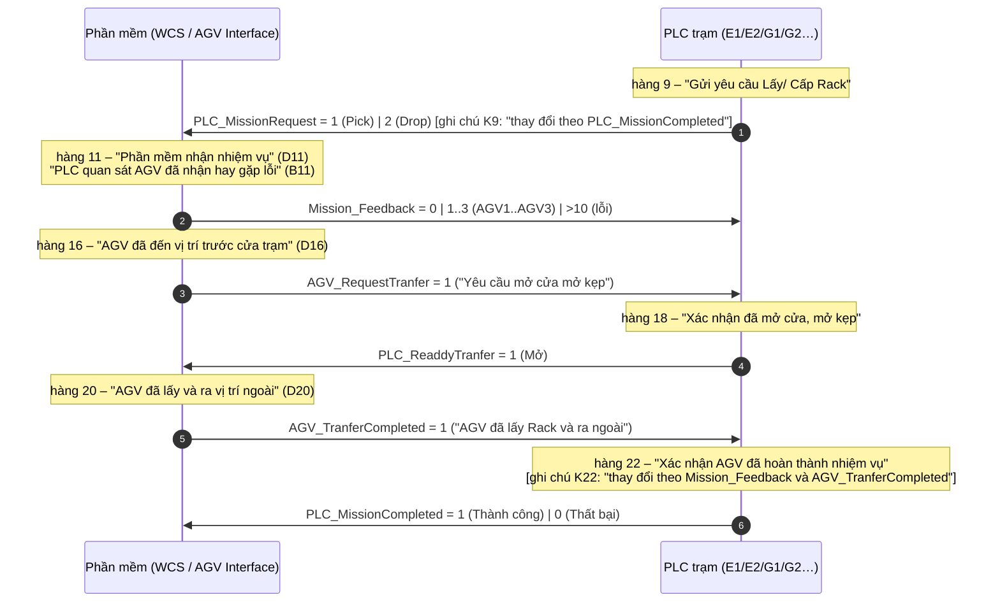

# PLC Handshake Specification – Phiên bản 2 (cơ sở: sơ đồ `Trang_tính1` ngày 20/11/2026)

> **ĐÍNH CHÍNH 2026-11-26 (OW-4).** Tài liệu này phân tích bản workbook cũ (`3c5da74b…`), trong đó `PLC_MissionCompleted` là BOOL `0` thất bại / `1` thành công. Bản đang dùng làm căn cứ (`a291d28f…`) là INT **`1` = Thất bại, `2` = Thành công**. Mọi câu dưới đây coi `1` là thành công **không còn đúng**. Một giá trị INT không đủ để kết luận hoàn thành khi chưa xác minh đúng giao dịch (ADR-0011 D-4). Hợp đồng IO vẫn chờ kỹ sư PLC xác nhận. Xem [báo cáo Phase 2](PLC_PHASE2_REVIEW_2026-11-26.md).

| | |
|---|---|
| **Trạng thái** | `SPECIFICATION – PENDING PLC CLARIFICATION` |
| **Thay thế** | Quy trình 9 bước của `PLC_COMMUNICATION_SPECIFICATION_DRAFT.md` §7 (giao diện 10/11) |
| **Nhãn** | [N] nguồn · [SL] suy luận · [CX] chưa xác định (PQ-nn) · [HT] hiện trạng · [KT] nguyên tắc đã thống nhất – xem [Interface Specification](PLC_INTERFACE_SPECIFICATION_V2_20_11_2026.md) |

> Sơ đồ dưới đây chỉ dựng lại **những gì sheet `Trang_tính1` thể hiện** (6 mũi tên theo thứ tự hàng). Mọi hành vi không nằm trong sơ đồ (reset, giữ mức/xung, timeout, lỗi) là **[CX]**, không được coi là yêu cầu.

## 1. Sơ đồ trình tự dựng lại từ `Trang_tính1`

Làn trái `AGV` (cột D) = phần mềm WCS/AGV Interface; làn phải `PLC` (cột G). Hướng mũi tên đọc từ drawing (cờ `flipH` = từ PLC sang phần mềm).

Song song, độc lập với 6 bước: `HeartBit` (SW → PLC) bật/tắt chu kỳ 1 s, timeout 10 s **[N]** (IO Matrix hàng 28).

### 1.1. Bảng bước (ngôn ngữ nguồn, đủ ô tham chiếu)

| Bước | Hàng | Hướng | Tín hiệu | Giá trị trong nguồn | Chú thích gốc |
|---|---|---|---|---|---|
| 1 | 9 | PLC → SW | `PLC_MissionRequest` (J9) | 1 Pick, 2 Drop | G9 "Gửi yêu cầu Lấy/ Cấp Rack"; K9 "thay đổi theo PLC_MissionCompleted" |
| 2 | 11 | SW → PLC | `Mission_Feedback` (C11) | 0 / 1–3 / >10 | D11 "Phần mềm nhận nhiệm vụ"; B11 "PLC quan sát AGV đã nhận hay gặp lỗi" |
| 3 | 16 | SW → PLC | `AGV_RequestTranfer` (C16) | 1 Đã đến | D16 "AGV đã đến vị trí trước cửa trạm" |
| 4 | 18 | PLC → SW | `PLC_ReaddyTranfer` (J18) | 1 Mở | G18 "Xác nhận đã mở cửa, mở kẹp" |
| 5 | 20 | SW → PLC | `AGV_TranferCompleted` (C20) | 1 | D20 "AGV đã lấy và ra vị trí ngoài" |
| 6 | 22 | PLC → SW | `PLC_MissionCompleted` (J22) | 1 Thành công, 0 Thất bại | G22 "Xác nhận AGV đã hoàn thành nhiệm vụ"; K22 "thay đổi theo Mission_Feedback và AGV_TranferCompleted" |

## 2. Phân tích theo yêu cầu rà soát

Mỗi nội dung được phân loại: **[N]** xác định rõ · **[SL]** suy luận từ trình tự · **[CX]** chưa quy định.

| Nội dung | [N] Xác định rõ | [SL] Suy luận (chưa chính thức) | [CX] Cần bên PLC xác nhận |
|---|---|---|---|
| **Điều kiện bắt đầu giao dịch** | Trạm bắt đầu bằng việc PLC gửi `PLC_MissionRequest` (1 Pick / 2 Drop); 0 = không nhiệm vụ | Giao dịch bắt đầu khi giá trị chuyển từ 0 sang 1 hoặc 2; "Lấy/Cấp Rack" ↔ Pick/Drop: **Lấy ≈ Pick (trạm có rack cần AGV lấy), Cấp ≈ Drop (trạm cần AGV cấp rack)** | Giữ mức hay xung (PQ-02); điều kiện tại trạm cho phép phát yêu cầu; có cần trạm "sẵn sàng/an toàn" trước (PQ-18); giá trị >10 của request (PQ-05) |
| **PLC gửi yêu cầu Pick/Drop** | `PLC_MissionRequest` INT: 1 Pick, 2 Drop, 0 không nhiệm vụ | Pick và Drop là hai chiều của một giao dịch, không đồng thời (một INT) | Dữ liệu đi kèm (vị trí/loại rack/ID) **không còn**: PQ-10, PQ-17; yêu cầu mới khi giao dịch cũ chưa reset (PQ-10) |
| **WCS tiếp nhận và phản hồi `Mission_Feedback`** | `Mission_Feedback`: 0 chưa có AGV nhận; 1/2/3 = AGV1/AGV2/AGV3; >10 lỗi; ý nghĩa "trạng thái nhiệm vụ của AGV"; PLC "quan sát AGV đã nhận hay gặp lỗi" | Phần mềm "nhận nhiệm vụ" ⇒ phản hồi; giá trị 1–3 xuất hiện khi AGV **đã nhận** (đã được gán) nên **không** ghi khi mới tiếp nhận yêu cầu | Có giá trị riêng cho "WCS đã tiếp nhận nhưng chưa có AGV" ngoài 0 (PQ-04, PQ-05); số thực ↔ AMR do RCS chọn (PQ-06); giữ đến khi nào/ai reset (PQ-04); các mã lỗi >10 (PQ-05, PQ-15) |
| **AGV đến vị trí trước cửa** | `AGV_RequestTranfer` 1 = "Đã đến", ý nghĩa "Yêu cầu mở cửa mở kẹp, AGV ở vị trí trước cửa"; sơ đồ: "AGV đã đến vị trí trước cửa trạm" | Đây là **cả** thông báo vị trí **và** yêu cầu mở cửa/kẹp trong một tín hiệu; nguồn thông tin "đã đến" nằm ngoài giao diện PLC (RCS/AGV) | Nguồn sự kiện "AGV đã đến" phía RCS (nội bộ: PQ-23); mức/xung (PQ-08); điều kiện an toàn của lệnh mở cửa (PQ-18); khoảng "trước cửa" (dung sai) |
| **PLC xác nhận cửa Rack và kẹp đã mở** | `PLC_ReaddyTranfer` BOOL 0 Đóng / 1 Mở; "Xác nhận đã mở cửa Rack, mở Kẹp" | Cửa **và** kẹp cùng báo bằng một bit (không có bit riêng "kẹp đã đóng") | Khi nào PLC tự "Đóng" (0) và ai reset (PQ-07); có trường hợp mở thất bại/timeout (PQ-11); với **Drop** cũng dùng bit này không (PQ-16) |
| **AGV xác nhận đã lấy Rack và ra ngoài** | `AGV_TranferCompleted` ý nghĩa "AGV đã lấy Rack và ra ngoài"; sơ đồ "AGV đã lấy và ra vị trí ngoài" | Đây là xác nhận **AGV rời trạm sau khi hoàn tất thao tác** (gộp "đã lấy xong" và "đã ra ngoài"); với Drop chưa có mô tả | Nhãn giá trị trùng `AGV_RequestTranfer` ("Rời đi/Đã đến") – giá trị 0/1 nghĩa gì (PQ-08); nguồn sự kiện; ý nghĩa cho **Drop** (PQ-16) |
| **PLC xác nhận giao dịch thành công/thất bại** | `PLC_MissionCompleted` 1 Thành công / 0 Thất bại; "Xác nhận Giao/Nhận thành công"; K22 phụ thuộc `Mission_Feedback` và `AGV_TranferCompleted` | Sau `AGV_TranferCompleted` = 1 PLC đánh giá và trả kết quả; thất bại là một khả năng hợp lệ của bước cuối | Cách phân biệt "chưa có kết quả" với "Thất bại" (cùng 0) (PQ-09); điều kiện PLC xác định thành công (PQ-09); hành vi WCS khi 0 (PQ-15) |
| **Điều kiện kết thúc và giải phóng giao dịch** | **Không có** trong nguồn. Chỉ có hai chú thích "thay đổi theo …" (K9, K22) | Giao dịch kết thúc khi `PLC_MissionCompleted` có kết quả; `PLC_MissionRequest` về 0 sau đó; trạm sẵn sàng cho yêu cầu kế (diễn giải của K9) | Toàn bộ: ai reset từng tín hiệu, thứ tự, thời điểm WCS được xem giao dịch là xong và nhận yêu cầu kế (PQ-03, PQ-04, PQ-07, PQ-10) |

### 2.1. Điều nguồn **không** nói (không được coi là có)

- Không có bước "đóng kẹp/nhả kẹp" và "cửa đóng lại" riêng (giao diện 10/11 có `Station_Ready` M9004).
- Không có tín hiệu xác nhận **WCS đã nhận yêu cầu** tách biệt (giao diện 10/11 có `Request_Ack` M9101); chỉ `Mission_Feedback` "PLC quan sát AGV đã nhận hay gặp lỗi".
- Không có `Request_ID`/số thứ tự giao dịch, không có dữ liệu vị trí/loại rack/đích, không có tín hiệu an toàn hay trạng thái trạm.
- Không có timeout nào cho các bước (chỉ `HeartBit`: 10 s).
- Không có đường lỗi tường minh giữa các bước (ngoài `>10` của `Mission_Feedback` và `0: Thất Bại` của `PLC_MissionCompleted`).

## 3. Biến thể Pick và Drop

| | Pick (`PLC_MissionRequest` = 1) | Drop (= 2) |
|---|---|---|
| 6 bước | Như sơ đồ; `AGV_TranferCompleted` = "AGV đã lấy Rack và ra ngoài" **[N]** | **Cùng 6 bước?** workbook không phân biệt **[CX]** (PQ-16) |
| Rack kind (đầy/rỗng) | Không có trong giao diện **[N]** | Không có trong giao diện **[N]** |
| Ánh xạ nghiệp vụ | BP-01 (A1/A2 rack đầy), BP-03 (B1/B2 rack rỗng), BP-06 (F5 trả rack rỗng) là các yêu cầu "lấy" của trạm **[SL]** | BP-02 (A1/A2 cần rack rỗng), BP-04 (REVIEW, **không triển khai**), BP-05 (F5 cần rack đầy) là các yêu cầu "cấp" **[SL]** |

Quan hệ trạm + hướng → BP **không** được nguồn xác nhận; phải do chủ dự án/PLC xác nhận (PQ-17) trước khi dùng. BP-04 vẫn `REVIEW` [KT].

## 4. Đối chiếu nhanh quy trình cũ (9 bước, 10/11) và mới (6 bước, 20/11)

| 9 bước cũ (10/11) | Tương đương gần nhất trong 6 bước mới | Ghi chú |
|---|---|---|
| 1 `Pickup_Request`/`Delivery_Request` + dữ liệu D1500/D1510/D1512/D1514/D1520 | 1 `PLC_MissionRequest` (1/2) | **Mất dữ liệu đi kèm** |
| 2 `Request_Ack` M9101 | 2 `Mission_Feedback` (một phần) | Ack tách "tiếp nhận" khỏi "gán AGV" **không còn** |
| (ngoài 9 bước) `AGV_Assigned`, `AGV_ID`, `AGV_Arrived` | 2 `Mission_Feedback` 1–3 | Gộp |
| 3 `AGV_Departure_Permit` M9120 (yêu cầu mở cửa) | 3 `AGV_RequestTranfer` | Gộp với "đã đến" |
| 4 `Station_Online` M9003 (cửa đã mở) | 4 `PLC_ReaddyTranfer` | Thêm "mở kẹp" |
| 5 `AGV_Busy` M9121 (AGV ở vị trí) | 3 `AGV_RequestTranfer` (một phần) | Gộp vào bước 3 |
| 6 `Station_Ready` M9004 (kẹp đã đóng/nhả) | (không có) | **Mất** |
| 7 `AGV_Fault` M9122 (hoàn tất lấy/trả) | 5 `AGV_TranferCompleted` (một phần) | Gộp |
| 8 M9123 (AGV rời trạm; PLC reset) | 5 `AGV_TranferCompleted` (một phần) | Gộp; quy tắc "PLC reset" **không còn được nêu** |
| 9 `Rack_Present` M9005 (giao nhận thành công) | 6 `PLC_MissionCompleted` | Thêm giá trị "Thất bại" |

Các tương đương trên là **suy luận [SL]** để rà soát ảnh hưởng, không phải mapping chính thức.

## 5. Trạng thái cần có trước khi triển khai mã

Không triển khai handshake cho đến khi: (1) PQ-01 (địa chỉ), PQ-02…PQ-10 (ngữ nghĩa tín hiệu, reset, chống trùng) có câu trả lời; (2) chủ dự án quyết định C-1 và C-2 ([Interface Specification](PLC_INTERFACE_SPECIFICATION_V2_20_11_2026.md) mục 7); (3) có kế hoạch chuyển đổi được duyệt (CR-029). Bắt đầu commissioning ở chế độ **chỉ đọc**; chỉ bật ghi sau khi kỹ sư PLC duyệt từng tín hiệu và quy trình thử an toàn; tuyệt đối không ghi `AGV_RequestTranfer` (lệnh mở cửa/kẹp) để thử kết nối **[KT]**.

## 6. Cập nhật theo quyết định D-1…D-4 (2026-11-21, [ADR-0011](../../decisions/ADR/ADR-0011-plc-interface-20-11-2026-architectural-decisions.md))

- **D-1:** 6 bước chỉ chạy cho **một** Station mỗi PLC tại một thời điểm; Station khác của cùng PLC chờ trong FIFO của PLC. Ranh giới "Handshake đang hoạt động" chưa xác định (PQ-26); chưa triển khai.
- **D-2:** bước 2 (`Mission_Feedback`) là **trạng thái tiếp nhận/xử lý**, không phải định danh AMR; không ghi 1–3 làm `RobotCode`.
- **D-4:** bước 6 (`PLC_MissionCompleted`=1) **không** đủ để coi rack đã được bàn giao đúng; cần thêm bằng chứng rack (có mặt, danh tính khi yêu cầu), định danh giao dịch, điều kiện an toàn – nguồn dữ liệu chưa xác định (PQ-10, PQ-18, PQ-27, PQ-28; IF-P1…IF-P5).
- Workbook nguồn **không đổi**; sơ đồ ở mục 1 vẫn là bản dựng lại nguyên trạng của nguồn.
