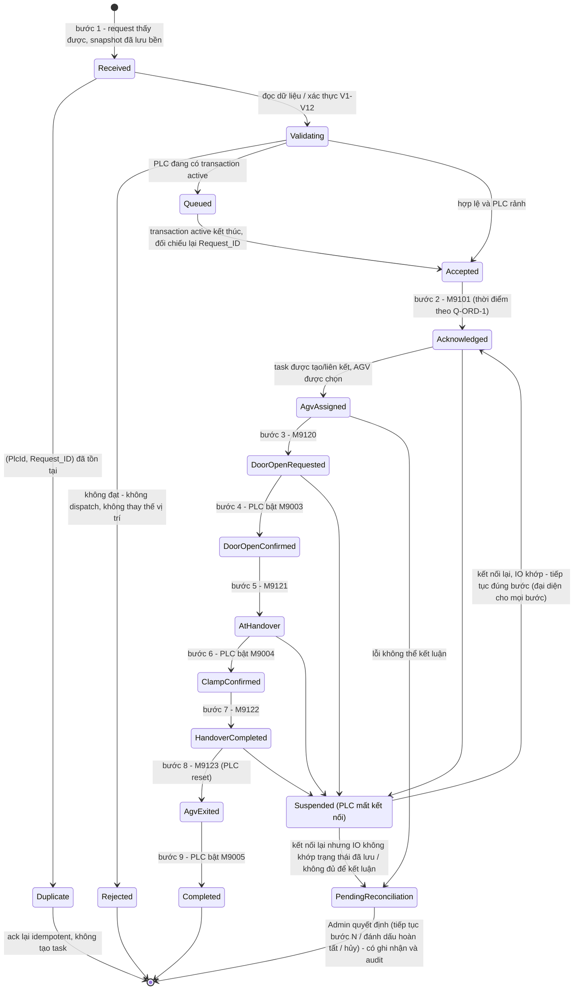
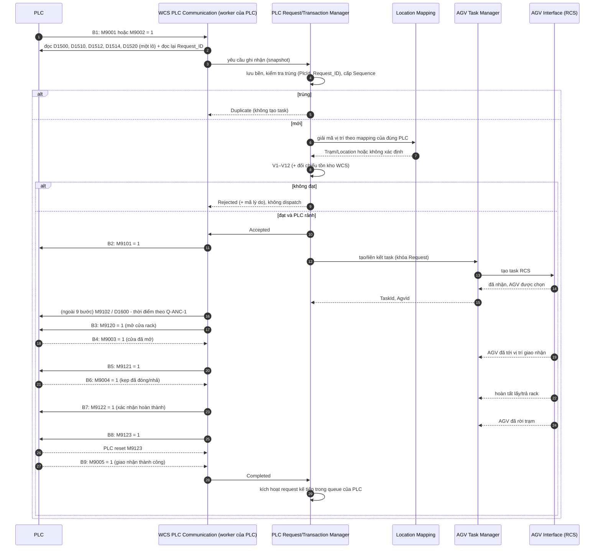
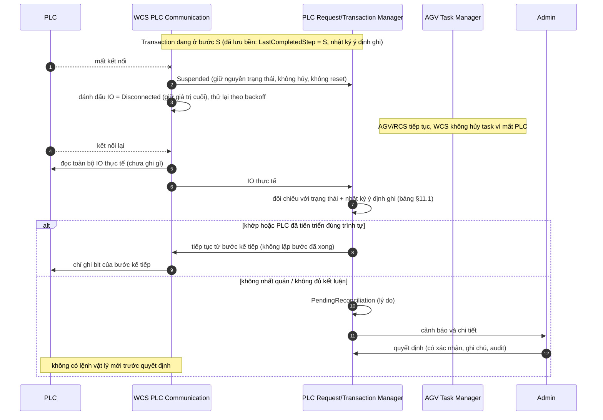
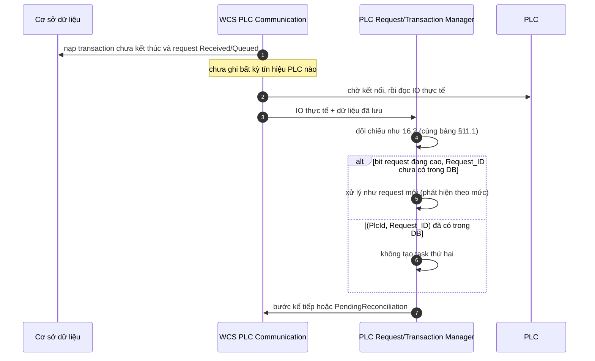

# PLC Communication Specification – Bản đề xuất (DRAFT)

**Trạng thái:** `DRAFT – chờ chủ dự án review/phê duyệt (CR-010)`. Tài liệu này **không** thay thế bất kỳ đặc tả đã duyệt nào cho đến khi CR-010 được phê duyệt. Không có mã nguồn, schema hay cấu hình nào bị thay đổi để viết tài liệu này.
**Phạm vi:** giao tiếp WCS ↔ PLC của hệ thống AGV (Phase 1): kết nối, IO mapping, quy trình trao đổi 9 bước, đọc dữ liệu xác định vị trí, queue/transaction, khôi phục.
**Đọc cùng:** [Khảo sát hiện trạng & bảng khoảng cách](PLC_REVIEW_CURRENT_STATE_AND_GAP_ANALYSIS.md) · [Danh sách cần xác nhận](PLC_SPEC_OPEN_QUESTIONS.md).

### Nhãn độ chắc chắn (áp dụng cho mọi mệnh đề)

| Nhãn | Nghĩa |
|---|---|
| **[XLS]** | Có trong `AGV_PLC_IO_Interface_List_10_11_2026.xlsx`. |
| **[YC]** | Chủ dự án xác nhận trong yêu cầu 2026-11-17. |
| **[HT]** | Hiện trạng đã có trong mã/tài liệu và được giữ nguyên. |
| **[ĐX]** | **Đề xuất** của người phân tích; chưa được duyệt. |
| **TBD** | Chưa có căn cứ; không được tự điền. Mỗi TBD có mã `Q-…` trong tài liệu "cần xác nhận". |

---

## 1. Tổng quan kiến trúc

### 1.1. Mô hình logic

```
                        ┌───────────────────────────────────────────────┐
                        │ Shared Communication Process (quy trình 9 bước) │  ← một định nghĩa dùng chung
                        └───────────────▲───────────────────────────────┘
                                        │ dùng bởi mọi PLC Instance
 Shared Signal Definition ──► Default IO Mapping Template ──(sao chép khi thêm PLC)──┐
                                                                                       ▼
 ┌──────────────── PLC Instance (1..N, động) ───────────────────────────────────────────────┐
 │ PLC Connection Settings   │ PLC IO Mapping Instance (độc lập) │ PLC Location Mapping       │
 │ PLC Request Queue (FIFO)  │ PLC Transaction State (≤ 1 active)│ AGV Task Link              │
 └──────────────────────────────────────────────────────────────────────────────────────────┘
```

Đây là mô hình **chức năng** để đánh giá, không phải yêu cầu tạo lớp/bảng cùng tên **[YC]**. Bảng dưới cho biết từng thành phần đã có hay chưa trong WCS hiện tại **[HT]** (chi tiết ở tài liệu khảo sát):

| Thành phần logic | Hiện có | Ghi chú đề xuất |
|---|---|---|
| Shared Communication Process | Chưa (handshake chỉ quan sát, không có luật) | Mới; một triển khai dùng chung cho mọi PLC **[ĐX]** |
| Shared Signal Definition | Một phần (catalog 23 tín hiệu v2) | Thay bằng định nghĩa mới theo §3 |
| Default IO Mapping Template | Catalog nhúng `plc-io-catalog.json` (chỉ tham chiếu địa chỉ) | Phiên bản template mới, có địa chỉ mặc định theo Excel |
| PLC Instance | `plc_connections` (4 dòng) | Giữ; thêm vòng đời tạo/vô hiệu hóa PLC |
| PLC Connection Settings | `plc_connections` | Giữ nguyên, bảo toàn thông số |
| PLC IO Mapping Instance | `station_io_points` (theo Trạm) | Đổi sang theo PLC |
| PLC Location Mapping | `plc_stations.LocationCode` (Trạm→Location) | Thêm mapping *giá trị thanh ghi → Trạm* |
| PLC Request Queue | Không (một bộ xử lý chung) | Mới, riêng cho mỗi PLC |
| PLC Transaction State | Không (`station_requests` chỉ giữ yêu cầu) | Mới, lưu bền |
| AGV Task Link | `station_requests.TaskId`, `TransportTask.RequestKey` | Mở rộng thêm PLC/transaction |

### 1.2. Nguyên tắc ràng buộc (giữ nguyên, không thương lượng)

1. Giữ **nguyên tên và địa chỉ** tín hiệu như §3 **[YC][XLS]**. Không tự đổi tên, không tự đặt tên M9123.
2. Không hardcode địa chỉ IO, IP, PORT, số lượng PLC tối đa **[YC]**.
3. Mỗi PLC một kết nối, một worker, không có khóa/queue toàn cục giữa các PLC **[HT][YC]**.
4. Không tạo giá trị mặc định/timeout/retry khi chưa được duyệt: ghi `TBD` **[YC]**.
5. Quy tắc được bảo vệ vẫn hiệu lực: PER_AGV; BP-04 `REVIEW`; WCS sở hữu tồn kho/trạng thái vị trí; A3/A4 và D1/D2 `UNCHANGED`; không bind rack tại điểm "Không bind rack" **[HT]**.
6. Chỉ thêm tài liệu; triển khai chỉ sau khi CR-010 được duyệt.

---

## 2. PLC Connection Configuration

### 2.1. Dữ liệu cấu hình mỗi PLC **[HT]**

IP, Port, Protocol/frame, Network Number, PC Number, Module I/O Number, PLC Station Number, Monitoring Timer, Timeout (chung và theo thao tác: connect/read/write), Polling Interval, cơ số địa chỉ X/Y và W, công tắc Enabled. **Tất cả tham số mạng cho phép `null` = `NEEDS_CONFIGURATION`**; hệ thống **không** tự điền giá trị.

### 2.2. Yêu cầu mới

- **Bảo toàn** mọi giá trị đã nhập; không đổi tự động **[YC]**. (Cơ sở dữ liệu phát triển hiện có PLC-01 với Port/Protocol/Network/PC/Module/Station đã nhập, PLC-02 đang tắt, PLC-03/04 chưa có tham số; phải giữ nguyên khi triển khai.)
- Admin có thể **thêm PLC**, sửa kết nối, **vô hiệu hóa/quản lý** PLC **[YC]**. PLC mới bắt đầu với tham số trống, `Enabled = false`, `Mode` theo cấu hình triển khai hiện có **[ĐX]**.
- **Không giới hạn 4 PLC.** Bốn PLC dưới đây là *cấu hình ban đầu/tham khảo* **[YC]**:

| PLC | IP | Vị trí tham khảo |
|---|---|---|
| PLC-01 (PLC1) | 192.168.10.101 | A1, A2, A3, A4 |
| PLC-02 (PLC2) | 192.168.10.111 | B1, B2, D1, D2 |
| PLC-03 (PLC3) | 192.168.10.121 | X1, X2, X3, X6 |
| PLC-04 (PLC4) | 192.168.10.131 | E1, E2, G3, G7 |

- Xóa vật lý một PLC có transaction/lịch sử: **không cho phép**; chỉ vô hiệu hóa (giữ truy vết) **[ĐX]** (Q-LIFE-1).
- Mọi thay đổi cấu hình qua Change Request/Audit hiện có; tham số kết nối mới (nếu có) là `NEEDS_CONFIGURATION` cho đến khi kỹ sư PLC xác nhận **[HT]**.
- Chế độ SIMULATOR / REAL_READ_ONLY / REAL_READ_WRITE và các khóa an toàn ghi (`AllowLiveConnection`, `Write.Enabled`, mã phê duyệt kỹ sư, `HandshakeApproved`) **giữ nguyên**; bắt đầu commissioning bằng chỉ đọc; không ghi tín hiệu an toàn chỉ để thử kết nối **[HT]**.

---

## 3. Signal Definition (danh mục tín hiệu chuẩn)

Chiều và tên giữ đúng [XLS]/[YC]. Cột "Bên ghi" suy ra từ chiều.

### 3.1. PLC → WCS (WCS chỉ đọc)

| # | Signal | Địa chỉ | Kiểu | Ý nghĩa (nguyên văn nguồn) | Ghi chú |
|---|---|---|---|---|---|
| 1 | `Safety_Ready` | M9000 | BOOL | Điều kiện an toàn cho phép AGV đến lấy rack | Vai trò trong 9 bước **không được nêu** (Q-SAFE-1) |
| 2 | `Pickup_Request` | M9001 | BOOL | Trạm yêu cầu AGV đến lấy rack | Bước 1 |
| 3 | `Delivery_Request` | M9002 | BOOL | Trạm yêu cầu AGV giao rack | Bước 1 |
| 4 | `Station_Online` | M9003 | BOOL | Xác nhận cửa rack đã mở | Bước 4 (tên không phản ánh nghĩa; **giữ tên**) |
| 5 | `Station_Ready` | M9004 | BOOL | Xác nhận cơ cấu kẹp đã đóng/nhả | Bước 6 |
| 6 | `Rack_Present` | M9005 | BOOL | Xác nhận giao nhận rack thành công | Bước 9 |
| 7 | `Request_ID` | D1500 | STRING | ID duy nhất của request: chống xử lý trùng, hỗ trợ đối soát | Độ dài **254** [YC]; đơn vị và chồng lấn: Q-STR-1; **không quy định format** [YC] |
| 8 | `Rack_Full` | D1510 | INT | Vị trí hiện đang chứa rack đầy | `1=A1, 2=A2, 3=A3, 4=A4` [XLS]; ngoài A1–A4: **TBD** |
| 9 | `Rack_Empty` | D1512 | INT | Vị trí hiện đang chứa rack rỗng | `1=A1 … 4=A4` [XLS]; ngoài A1–A4: **TBD** |
| 10 | `Destination_Available` | D1514 | INT | Vị trí đích có khả năng tiếp nhận rack | [XLS] ghi "làm rõ"; **không có bảng giá trị** (Q-DEST-1) |
| 11 | `Rack_Type` | D1520 | INT | Loại rack/sản phẩm cần vận chuyển | [XLS] ghi "làm rõ"; **không có bảng giá trị** (Q-TYPE-1) |

### 3.2. WCS → PLC (WCS ghi)

| # | Signal | Địa chỉ | Kiểu | Ý nghĩa | Ghi chú |
|---|---|---|---|---|---|
| 12 | `Heartbeat_SW` | M9100 | BOOL | Heartbeat của phần mềm, đổi trạng thái định kỳ | Chu kỳ: TBD (Q-HB-1) |
| 13 | `Request_Ack` | M9101 | BOOL | WCS đã nhận và ghi nhận request | Bước 2 |
| 14 | `AGV_Assigned` | M9102 | BOOL | Đã phân công AGV cho task | **Không thuộc 9 bước**; thời điểm: Q-ANC-1 |
| 15 | `AGV_Arrived` | M9103 | BOOL | AGV đang xử lý task liên quan đến trạm | **Không thuộc 9 bước**; thời điểm/reset: Q-ANC-1 |
| 16 | `Transfer_Permit` | M9104 | BOOL | **Chỉ báo lỗi** trong task AGV có ảnh hưởng đến hoạt động trạm [YC]. *Không* phải tín hiệu "cho phép chuyển rack" | Reset: WCS chủ động khi điều kiện lỗi hết trong lúc AMR đang làm task [YC]. Điều kiện lỗi: TBD (Q-ERR-1) |
| 17 | `AGV_ID` | D1600 | INT | ID AGV thực hiện task | Quy ước giá trị (AGV1/AGV2 → số) **TBD** (Q-ANC-2) |
| 18 | `Error_Code` | D1610 | INT | Mã lỗi giao tiếp hoặc vận chuyển | **Bảng mã chưa có** (Q-ERR-1) |
| 19 | `AGV_Departure_Permit` | M9120 | BOOL | Yêu cầu mở cửa rack | Bước 3 (tên không phản ánh nghĩa; **giữ tên**) |
| 20 | `AGV_Busy` | M9121 | BOOL | Xác nhận AGV đã đến vị trí giao nhận rack | Bước 5 |
| 21 | `AGV_Fault` | M9122 | BOOL | Xác nhận hoàn tất Pickup/Delivery thành công | Bước 7. **Không phải tín hiệu lỗi** [YC]; giữ tên; không đổi tên |
| 22 | *(chưa có tên)* | M9123 | BOOL | Xác nhận AGV đã rời khỏi trạm | Bước 8. WCS bật khi AGV vào trạm, hoàn thành lấy rack và rời trạm; **PLC reset** để xác nhận đã nhận [YC]. Không đặt tên |

### 3.3. Phạm vi tín hiệu: theo PLC hay theo Trạm

Excel không nêu. Yêu cầu mới [YC] quy định **mapping theo PLC** và xác định Trạm bằng giá trị thanh ghi (§6). Hệ quả **[ĐX]**: mọi tín hiệu ở trên là **PLC-scoped** (một bản cho mỗi PLC), kể cả `Heartbeat_SW`. Việc phân loại này phải được duyệt rõ ràng (CLAUDE.md §7.3: không âm thầm nhân bản hay gộp tín hiệu): **Q-SCOPE-1**.

### 3.4. Quyền ghi và chặn an toàn **[HT → cần rà soát]**

`WritePolicy` hiện chặn theo **tên**: `Safety_Ready`, `Transfer_Permit`, `AGV_Departure_Permit` và nhóm Safety/Interlock. Vì ngữ nghĩa của `Transfer_Permit` (đảo thành báo lỗi) và `AGV_Departure_Permit` (thành "mở cửa rack") đã đổi, danh sách chặn **phải được kỹ sư PLC phân loại lại** trước khi bật ghi thật (Q-SAFE-2). Mọi ghi bước handshake đi qua cùng chính sách: chế độ, allow-list từng điểm, phê duyệt kỹ sư.

---

## 4. Default IO Mapping Template

**[YC]** WCS có một **Default IO Mapping Template** chứa danh sách tín hiệu, địa chỉ và kiểu dữ liệu mặc định theo Excel.

### 4.1. Cấu trúc **[ĐX]**

Mỗi dòng template: `SignalName` · `Group` (nullable: M9123 không có nhóm) · `Direction` · `DataType` · `DefaultAddress` · `WordLength` (STRING) · `Encoding` (STRING) · `Description` · `Scope = PLC` · `TemplateVersion`.

- Giá trị mặc định = **đúng như bảng §3** (22 dòng có địa chỉ). `WordLength`/`Encoding` của `Request_ID` = **TBD** (Q-STR-1), không điền khi chưa xác nhận.
- Template có **phiên bản** và dấu vết nguồn (tên file, ngày, sha256 của workbook), tương tự cơ chế catalog hiện tại.
- Template gốc **không chỉnh trực tiếp bằng thao tác cấu hình PLC**; thay đổi template là thay đổi tài liệu được kiểm soát (qua CR) và tạo **phiên bản mới**; phiên bản cũ được giữ.
- Template **không chứa** Location Mapping giá trị→vị trí của từng PLC (xem §6): các giá trị `1..4 = A1..A4` thuộc PLC mà Trạm A1–A4 gắn vào, không áp cho PLC khác.

---

## 5. Independent IO Mapping per PLC

1. **Tạo:** khi Admin thêm PLC, WCS tạo một **bản sao đầy đủ, độc lập** (deep copy) của template hiện hành cho PLC đó, ghi nhận `TemplateVersion` nguồn **[YC]**. Không có tham chiếu chia sẻ có thể chỉnh sửa tới template.
2. **Sửa:** Admin sửa **địa chỉ bit/register** từng tín hiệu của PLC đó **[YC]**. Thay đổi **không** ảnh hưởng PLC khác hay template **[YC]**. Không được giả định mọi PLC dùng cùng địa chỉ sau khi cấu hình **[YC]**.
3. **Trạng thái địa chỉ [ĐX]:** giữ vòng đời hiện có (CR-002/004): `NeedsConfiguration → Configured (Admin nhập) → Approved (kỹ sư PLC duyệt)`. Bản sao từ template mang địa chỉ mặc định ở trạng thái **`Configured` (chưa `Approved`)**: chỉ điểm `Approved` mới được đọc/ghi trên PLC thật (`Pollable`). *Đây là điểm mâu thuẫn với nguyên tắc CR-002 "không tự gán địa chỉ" và cần quyết định* (Q-IO-2).
4. **Ràng buộc địa chỉ:** trong **một PLC** không được giao nhau vùng thiết bị (kể cả vùng STRING: `D1500` + độ dài so với `D1510…`); giữa các PLC khác nhau được phép trùng **[HT]**. Chỉ hỗ trợ thiết bị `D`, `W`, `M` cho IO mapping; `X/Y` ngoài phạm vi **[HT]**.
5. **Lưu/tải [ĐX]:** lưu bền trong cơ sở dữ liệu theo PLC; runtime nạp lại **chỉ PLC bị đổi** (cơ chế `ReloadPlcAsync` hiện có), PLC khác không bị gián đoạn **[HT]**. Hỗ trợ xem so sánh với template và thao tác "đặt lại theo template" có xác nhận và ghi audit; template cập nhật **không tự lan** sang bản sao đã tồn tại.
6. **Ghi:** cờ cho phép ghi từng điểm (`WriteAllowed`) mặc định tắt, chỉ bật cho điểm `Approved` hướng WCS→PLC và không thuộc danh sách chặn **[HT]**.
7. **Quyền:** chỉ Admin xem/sửa địa chỉ; Operator chỉ giám sát, không thấy IP/địa chỉ **[HT]**.

---

## 6. PLC Location Mapping

**Mục đích [YC]:** đối chiếu mã vị trí PLC (giá trị của `Rack_Full`, `Rack_Empty`, `Destination_Available`) với Location trong WCS **của đúng PLC đó**.

### 6.1. Cấu trúc **[ĐX]**

| Cột | Ý nghĩa |
|---|---|
| `PlcId` | PLC sở hữu bảng mapping |
| `Register` | `Rack_Full` / `Rack_Empty` / `Destination_Available` (mỗi thanh ghi có bảng riêng vì giá trị có thể khác nghĩa) |
| `Value` | Giá trị INT PLC trình bày |
| `StationCode` | Trạm của PLC (đã có `plc_stations`) |
| `LocationCode` | Location WCS (qua liên kết `plc_stations.LocationCode` hiện có; có thể rỗng nếu Trạm là monitor-only) |
| `Enabled` | Bật/tắt dòng |

- Hai tầng: `Value → Trạm (của PLC)` rồi `Trạm → Location (WCS)`. Tầng sau **đã có** và do Admin đặt tường minh **[HT]**.
- **Nội dung ban đầu:** chỉ những gì tài liệu có: PLC-01, `Rack_Full` và `Rack_Empty`: `1→A1, 2→A2, 3→A3, 4→A4` **[XLS]**. Không mở rộng quy tắc mã hóa này sang vị trí hoặc PLC khác nếu chưa có căn cứ **[YC]**. `Destination_Available`: chưa có dòng nào (**TBD**). Các PLC khác: mapping rỗng cho đến khi Admin khai báo theo tài liệu PLC tương ứng.
- Giá trị không có trong mapping (kể cả `0`, mà ý nghĩa chưa được nêu) ⇒ **không xác định được vị trí** ⇒ không dispatch (§8).
- Việc A3/A4 xuất hiện trong dải giá trị không làm A3/A4 trở thành Trạm có luồng BP: A3/A4 và D1/D2 `UNCHANGED`, chỉ monitor/legacy **[HT]**.

---

## 7. PLC–WCS Communication Process (9 bước)

Giữ nguyên thứ tự, tín hiệu và ý nghĩa của `Trang_tính1` **[XLS]**. Không thêm, bớt hay đảo bước **[YC]**.

### 7.1. Bảng chi tiết từng bước

Mọi `TMO-n` là **TBD** (chưa có giá trị được duyệt). "Đã ghi/Đọc" nghĩa là WCS ghi/đọc qua PLC worker của PLC đó.

| Bước | Trigger | Read/Write | Signal | WCS Action | PLC Response | Trạng thái transaction sau bước | Timeout / Lỗi | Khôi phục khi mất kết nối |
|---|---|---|---|---|---|---|---|---|
| **1** | PLC bật request | **Read** | `Pickup_Request` M9001 / `Delivery_Request` M9002; kèm đọc nhóm thanh ghi dữ liệu §8 (D1500, D1510, D1512, D1514, D1520) | Phát hiện theo *mức* (bit đang cao và `Request_ID` chưa có trong DB) thay vì chỉ theo cạnh [ĐX]; chụp thanh ghi; lưu bền yêu cầu; kiểm tra trùng | Giữ bit và dữ liệu ổn định cho tới khi nhận ack (giả định, Q-PLC-1) | `Received` | Cả hai bit cùng cao ⇒ `ConflictingRequests`, không xử lý (lỗi dữ liệu). `Request_ID` không đọc được ⇒ chưa ghi nhận, đọc lại chu kỳ sau (không mất request vì phát hiện theo mức) | Request đã lưu thì giữ nguyên; chưa lưu thì phát hiện lại khi kết nối lại |
| **2** | Request hợp lệ và đã được ghi nhận (Q-ORD-1) | **Write** | `Request_Ack` M9101 = 1 | Ghi M9101 *sau khi* request được lưu bền và (mặc định đề xuất) đã xác thực; chỉ khi transaction này đang là transaction active của PLC | Có thể hạ bit request / chuyển sang chờ bước 3 (TBD) | `Acknowledged` | TMO-1: PLC không phản ứng sau ack (TBD). Ghi mơ hồ ⇒ không gửi lại; đọc lại giá trị | Đọc lại M9101: đã =1 ⇒ coi bước đã xong, **không ghi lại**; =0 và chưa chắc đã ghi ⇒ xem §11 |
| **3** | AGV đã được phân công / điều kiện mở cửa (thời điểm: Q-ORD-2) | **Write** | `AGV_Departure_Permit` M9120 = 1 ("yêu cầu mở cửa rack") | Ghi sau khi task AGV đã được tạo/liên kết; tôn trọng `Safety_Ready` nếu được xác nhận là điều kiện (Q-SAFE-1) | Mở cửa rack | `DoorOpenRequested` | TMO-2: chờ M9003 (TBD). Ghi bị từ chối bởi chính sách ⇒ transaction dừng chờ, báo Admin | Không ghi lại nếu M9120 đã =1; nếu không chắc ⇒ reconciliation (lệnh có tác động vật lý) |
| **4** | PLC cửa đã mở | **Read** | `Station_Online` M9003 = 1 | Quan sát; ghi lại thời điểm | Bật M9003 | `DoorOpenConfirmed` | TMO-2 hết hạn ⇒ lỗi giao tiếp (không tự hủy); hành động TBD (Q-TMO-1) | Nếu thấy M9003=1 khi kết nối lại ⇒ coi bước 4 đã xảy ra (PLC là bên sở hữu bit) |
| **5** | AGV đã tới vị trí giao nhận (từ RCS/AGV Interface) | **Write** | `AGV_Busy` M9121 = 1 ("xác nhận ở vị trí lấy/trả rack") | Ghi khi AGV Interface báo AGV ở vị trí; chỉ sau bước 4 | Thực hiện đóng/nhả kẹp | `AtHandover` | TMO-3: chờ M9004 (TBD) | Không ghi lại nếu đã =1; AGV tiếp tục chờ ở RCS, không hủy |
| **6** | PLC kẹp đã đóng/nhả | **Read** | `Station_Ready` M9004 = 1 | Quan sát | Bật M9004 | `ClampConfirmed` | TMO-3 hết hạn ⇒ lỗi (không tự hủy) | Như bước 4 |
| **7** | Hoàn tất lấy/trả rack theo AGV Interface | **Write** | `AGV_Fault` M9122 = 1 (**xác nhận hoàn thành**, không phải lỗi) | Ghi sau bước 6 và khi AGV Interface xác nhận hoàn tất | Chờ AGV rời | `HandoverCompleted` | TMO-4 (TBD) | Không ghi lại nếu đã =1 |
| **8** | AGV đã rời khỏi trạm | **Write** | M9123 = 1 (chưa có tên) | Ghi khi AGV vào trạm, hoàn thành thao tác lấy rack và rời trạm [YC] | **PLC reset M9123** để xác nhận đã nhận [YC] | `AgvExited` | TMO-5: chờ PLC reset M9123 (TBD) | Nếu M9123=0 sau khi đã ghi ⇒ có thể PLC đã reset (hợp lệ) hoặc chưa từng ghi: cần nhật ký ý định ghi (§10.3) để phân biệt |
| **9** | PLC xác nhận giao nhận thành công | **Read** | `Rack_Present` M9005 = 1 | Quan sát ⇒ hoàn tất transaction; thực hiện reset theo chính sách đã duyệt (Q-RST-1); kích hoạt request kế tiếp trong queue của PLC | Bật M9005 | `Completed` | TMO-6: chờ M9005 (TBD) | Đọc M9005 khi kết nối lại; M9005 xung hay mức: Q-LVL-1 |

> **Bước 1 và Bước 2 – thời điểm đọc dữ liệu.** Xem §8.4: việc **đọc** các thanh ghi dữ liệu luôn xảy ra **trước** khi ghi M9101 (ít nhất `Request_ID` phải đọc được để ghi nhận request). Điều chưa xác định là liệu **xác thực** dữ liệu vị trí/loại rack xảy ra trước hay sau khi ghi M9101 (Q-ORD-1). Vì vậy tài liệu tách hai mốc nội bộ khác nhau: **`Recorded`** (đã lưu bền) và **`Accepted`** (đủ điều kiện tạo AGV task).

### 7.2. Reset ownership

| Bit/Thanh ghi | Bên reset | Căn cứ |
|---|---|---|
| M9123 | **PLC** (xác nhận đã nhận) | [YC] |
| M9104 `Transfer_Permit` | **WCS** (khi điều kiện lỗi hết trong lúc AMR còn đang làm task) | [YC] |
| M9101, M9102, M9103, M9120, M9121, M9122, D1600, D1610 | **TBD** | Không được nêu (Q-RST-1) |
| M9001, M9002, M9003, M9004, M9005 (PLC→WCS) | PLC (đề xuất, mặc định hiển nhiên vì WCS chỉ đọc) | [ĐX] |
| Bit là *mức* hay *xung* | **TBD** | Q-LVL-1 |

### 7.3. Tín hiệu ngoài 9 bước (không được tự gán vào bước)

| Signal | Hành vi đã có căn cứ | Chưa có căn cứ |
|---|---|---|
| `Heartbeat_SW` M9100 | Đổi trạng thái định kỳ [XLS] | Chu kỳ, thời gian PLC chờ, hành vi PLC khi mất heartbeat, có phát khi WCS đang khôi phục (Q-HB-1) |
| `AGV_Assigned` M9102 / `AGV_ID` D1600 | "Đã phân công AGV" / "ID AGV" [XLS] | Thời điểm ghi và reset; mã số của AGV1/AGV2 (Q-ANC-1/2). **Đề xuất ĐX:** ghi sau khi task được tạo và AGV được chọn (ghi nhận ở Transaction) |
| `AGV_Arrived` M9103 | "AGV đang xử lý task liên quan đến trạm" [XLS] | Khi nào bật/tắt (Q-ANC-1). Lưu ý: *tên* gợi "đã đến" nhưng *nghĩa* là "đang xử lý": giữ nghĩa [XLS] |
| `Transfer_Permit` M9104 | Báo lỗi task AGV ảnh hưởng trạm; WCS tự reset khi hết lỗi [YC] | Điều kiện lỗi cụ thể, ánh xạ với `Error_Code` (Q-ERR-1) |
| `Error_Code` D1610 | Mã lỗi giao tiếp/vận chuyển [XLS] | Toàn bộ bảng mã và thời điểm xóa |
| `Safety_Ready` M9000 | Điều kiện an toàn cho phép AGV đến lấy rack [XLS] | Có là điều kiện bắt buộc trước bước 3/5 không (Q-SAFE-1) |

---

## 8. Data Acquisition và Location Resolution

**[YC] Bắt buộc:** trước khi điều phối AGV, WCS phải đọc dữ liệu PLC để xác định chính xác vị trí cần lấy/giao. Không được dispatch khi chưa xác định được vị trí; không tự chọn vị trí thay thế.

### 8.1. Dữ liệu đọc khi PLC phát request

| Thanh ghi | Dùng để |
|---|---|
| D1500 `Request_ID` | Nhận diện và chống xử lý trùng |
| D1510 `Rack_Full` | Xác định ô đang chứa **rack đầy** cần lấy |
| D1512 `Rack_Empty` | Xác định ô đang chứa **rack rỗng** (trường hợp lấy rack rỗng) |
| D1514 `Destination_Available` | Xác định vị trí đích có thể tiếp nhận rack theo dữ liệu PLC |
| D1520 `Rack_Type` | Bảo đảm task đúng loại rack |
| M9001/M9002 | Phân loại **Pickup** hay **Delivery** |

### 8.2. Cách đọc **[ĐX]**

- Đọc **một lô nhất quán** (một yêu cầu MC cho nhóm word D1500…D1520 và một cho nhóm bit) ngay khi phát hiện request, rồi **đọc xác nhận lần hai** `Request_ID`; nếu khác nhau ⇒ dữ liệu không ổn định, bỏ lô và đọc lại. (PLC có đảm bảo giữ ổn định thanh ghi khi bit request còn cao không: Q-PLC-1.)
- Lô đọc được **lưu bền cùng request** (snapshot). Request vào queue **không** bị đọc lại thanh ghi sau này để lấy dữ liệu (thanh ghi chung của PLC sẽ thuộc về request khác): dữ liệu của request là snapshot.
- Dữ liệu chỉ được dùng khi chất lượng điểm là `Good` (không dùng giá trị `Disconnected`/`Bad`/giả lập ở chế độ thật).

### 8.3. Quy tắc xác thực **[ĐX]** (tất cả phải đạt trước khi tạo/dispatch AGV task)

| Mã | Quy tắc | Khi không đạt |
|---|---|---|
| V1 | Đúng một trong `Pickup_Request`/`Delivery_Request` đang cao | `ConflictingRequests`/không có request: không xử lý |
| V2 | `Request_ID` đọc được, khác rỗng, không vượt độ dài đã cấu hình, đúng encoding đã cấu hình (TBD) | Không ghi nhận, đọc lại |
| V3 | `(PlcId, Request_ID)` chưa được xử lý | Trùng ⇒ **không tạo task thứ hai**; xử lý như §9.3 |
| V4 | Kết nối PLC đang sống; các điểm IO cần dùng đã `Approved` (pollable) | Giữ ở trạng thái chờ, không dispatch |
| V5 | Pickup: thanh ghi vị trí tương ứng (`Rack_Full` hoặc `Rack_Empty`) có giá trị xác định; không đồng thời mơ hồ giữa hai thanh ghi; ý nghĩa giá trị `0` chưa được nêu (Q-POS-1) | Không xác định ⇒ từ chối, không dispatch |
| V6 | Giá trị nằm trong **Location Mapping của chính PLC** đó | Thiếu mapping ⇒ từ chối `LOCATION_MAPPING_MISSING` |
| V7 | Trạm/Location tương ứng đang bật và có **luồng đã duyệt** (`StationFlows`). A3/A4, D1/D2, các Trạm monitor-only: **không** tạo task. Delivery tại B1/B2 tương ứng **BP-04 = REVIEW**: không triển khai | Từ chối/giữ, ghi lý do |
| V8 | `Rack_Type` hợp lệ và nhất quán với loại rack của luồng (bảng ánh xạ: Q-TYPE-1) | Không rõ ⇒ từ chối |
| V9 | Delivery: `Destination_Available` hợp lệ theo ngữ nghĩa đã duyệt (Q-DEST-1) | Không rõ ⇒ từ chối |
| V10 | Đối chiếu **tồn kho WCS** (WCS là nguồn sự thật): vị trí PLC báo có rack nhưng WCS không có (hoặc ngược lại) | **Không tự ghi đè/chọn thay**; chuyển chờ reconciliation (Q-INV-1) |
| V11 | `Safety_Ready` nếu được xác nhận là điều kiện (Q-SAFE-1) | Giữ ở trạng thái chờ |
| V12 | Dữ liệu ổn định giữa hai lần đọc | Đọc lại |

Khi một quy tắc không đạt: **không tạo AGV task**, **không dispatch**, ghi lại mã lý do vào transaction/nhật ký, và (nếu được duyệt) báo PLC qua `Error_Code` (Q-ERR-1). Không bao giờ chọn vị trí thay thế.

### 8.4. Thứ tự đọc dữ liệu so với M9101 – phân tích

Sheet quy định M9101 là bước 2 ngay sau yêu cầu. Tài liệu chưa nói xác thực dữ liệu xảy ra trước hay sau M9101. Tách hai thời điểm:

| Mốc | Ý nghĩa | Điều kiện |
|---|---|---|
| **`Recorded`** | WCS *đã nhận và ghi nhận* request (đúng định nghĩa M9101 trong IO Matrix) | Snapshot đọc được và đã lưu bền; `Request_ID` có mặt |
| **`Accepted`** | Dữ liệu *đủ điều kiện tạo AGV task* | V1–V12 đạt |

| Phương án | Cách làm | Ưu điểm | Rủi ro |
|---|---|---|---|
| **A** – ack theo `Recorded` | Ghi M9101 ngay khi lưu bền; xác thực sau | PLC biết sớm WCS đã nhận; request không bị "mất" nếu xác thực chậm | Request không hợp lệ đã được ack ⇒ cần cơ chế báo lỗi và **reset M9101** (chủ reset chưa được nêu) |
| **B** – ack theo `Accepted` *(mặc định đề xuất cho bản nháp)* | Đọc → lưu → xác thực → ghi M9101 chỉ khi hợp lệ | Không bao giờ phải thu hồi ack; M9101 luôn có nghĩa "request hợp lệ đã được nhận" | PLC không thấy ack khi request không hợp lệ ⇒ phải dựa `Error_Code`/timeout (TBD) để biết bị từ chối |

Trong **cả hai** phương án: (1) việc **đọc** thanh ghi diễn ra trước M9101; (2) **không có** M9120 (mở cửa) và **không có** AGV task trước khi `Accepted`; (3) bước 2 vẫn đứng ngay sau bước 1 trong chuỗi tín hiệu. **Không tự chọn** phương án trong đặc tả cuối: đây là mục **Q-ORD-1** cần kỹ sư PLC/chủ dự án xác nhận.

---

## 9. Request Queue và Transaction Management

### 9.1. Transaction độc lập theo PLC **[YC]**

- Mỗi PLC xử lý **tối đa một transaction tại một thời điểm**; các PLC khác nhau xử lý **đồng thời**.
- **Không** có khóa PLC toàn cục hay queue toàn cục. Mỗi PLC có trạng thái transaction riêng.
- Transaction PLC kết thúc khi bước 9 (M9005) hoàn tất ở Trạm đó. **Không đồng nhất với toàn bộ vòng đời AGV task**: task có thể còn tiếp tục (ví dụ BP-01: sau khi lấy rack tại A1/A2, AGV còn chuyển tới B1/B2/F…) **[ĐX]**. Task và transaction là hai thực thể có liên kết.
- PER_AGV vẫn áp dụng cho task (tối đa một task hoạt động trên một AGV); không thay đổi **[HT]**.

### 9.2. Queue **[YC]**

- Mỗi PLC một queue **FIFO**, theo thời điểm WCS **tiếp nhận** request. **Không ưu tiên** Pickup hay Delivery.
- **Thứ tự xác định khi trùng thời điểm [ĐX]:** mỗi request nhận một **số thứ tự đơn điệu tăng theo PLC** khi được ghi bền (từ một bộ phát số duy nhất; worker của PLC là người ghi duy nhất nên không có đua). FIFO = `(ReceivedAt, Sequence)`.
- Request xếp hàng **không được ack** cho tới khi trở thành transaction active (vì M9101 là một bit duy nhất của PLC) và khi kích hoạt WCS **đối chiếu lại** `Request_ID` hiện tại của PLC với snapshot đã lưu; khác nhau ⇒ reconciliation, không dispatch (Q-PLC-1).
- Khi transaction active kết thúc (Completed/Rejected/Cancelled/đã đối soát), request kế tiếp của **cùng PLC** được kích hoạt.

### 9.3. Request_ID và chống trùng **[YC]**

- Khóa chống trùng **[ĐX]**: `(PlcId, Request_ID)` (hiện tại khóa là `PlcId:Station:RequestID`; Trạm không còn là một phần định danh vì Trạm được suy ra từ dữ liệu). *Request_ID có duy nhất toàn hệ thống hay chỉ trong PLC*: chưa nêu (Q-ID-1); dùng khóa theo PLC là cách bảo thủ.
- WCS lưu nhận diện request và trạng thái xử lý (bền). Không tạo AGV task thứ hai cho Request_ID đã được xử lý hoặc đang xử lý.
- **Không quy định format sinh Request_ID** **[YC]**. Nếu PLC **tái sử dụng** một ID cũ: coi là trùng (không tạo task); điều này cần PLC bảo đảm ID duy nhất theo thời gian (Q-ID-1).
- Request trùng của một request đã `Accepted` ⇒ xác nhận lại idempotent (không tạo gì mới); trùng của `Rejected` ⇒ hành vi TBD.

### 9.4. Liên kết với AGV Task **[YC]**

Khi request đã được tiếp nhận và dữ liệu hợp lệ, WCS tạo hoặc liên kết request với AGV task qua cơ chế tạo task hiện có (idempotent bằng khóa request) **[HT]**, và lưu quan hệ **PLC – request – transaction – AGV task**, AGV được phân công; cập nhật các tín hiệu phản hồi theo đúng quy trình; bảo đảm một request không sinh nhiều task ngoài ý muốn.

### 9.5. Mô hình dữ liệu logic **[ĐX]** (không bắt buộc tên)

| Thực thể | Trường chính |
|---|---|
| PLC request | `PlcId`, `RequestId`, `Sequence` (đơn điệu theo PLC), `ReceivedAt`, loại (Pickup/Delivery), **snapshot** D1500/D1510/D1512/D1514/D1520, kết quả xác thực + mã lý do, trạng thái |
| PLC transaction | `PlcId`, `RequestId`, `State`, **`LastCompletedStep` (0–9)**, `Phase`, `TaskId`, `AgvId`, thời điểm từng bước, `PendingReconciliation` + lý do |
| Nhật ký ý định ghi | Từng lần *định ghi* một bit: `Signal`, giá trị, thời điểm, kết quả (đã ghi/mơ hồ/bị chặn), để phân biệt "đã ghi rồi PLC reset" với "chưa từng ghi" (§10.3, §11) |
| Sự kiện transaction | Nhật ký chuyển trạng thái (truy vết/đối soát) |

Có thể mở rộng `station_requests` hiện có thay vì tạo bảng song song; quyết định ở giai đoạn thiết kế triển khai (không thuộc đợt này).

---

## 10. State Machine

### 10.1. Sơ đồ



### 10.2. Đối chiếu trạng thái gợi ý của yêu cầu với 9 bước

| Trạng thái gợi ý [YC] | Trạng thái/bước tương ứng |
|---|---|
| Request Received | `Received` (bước 1) |
| Request Data Reading | một phần của `Received` → `Validating` (§8.2) |
| Request Validation | `Validating` |
| Request Accepted | `Accepted` |
| Queued | `Queued` |
| AGV Task Created/Assigned | `AgvAssigned` |
| AGV Processing | khoảng `AgvAssigned` … `AgvExited` |
| Rack Door Open Request | `DoorOpenRequested` (bước 3) |
| Rack Door Open Confirmed | `DoorOpenConfirmed` (bước 4) |
| AGV At Handover Position | `AtHandover` (bước 5) |
| Rack Clamp/Transfer Confirmed | `ClampConfirmed` (bước 6) |
| Pickup/Delivery Completed | `HandoverCompleted` (bước 7) |
| AGV Exited Station | `AgvExited` (bước 8) |
| PLC Handover Acknowledged | `Completed` (bước 9) |
| Error/Recovery/Pending Reconciliation | `Suspended`, `PendingReconciliation`, `Rejected` |

Các trạng thái `Duplicate`, `Rejected`, `Suspended` là trạng thái **quản trị**, **không** thay đổi thứ tự hay nghĩa của 9 tín hiệu.

### 10.3. Điều kiện chuyển trạng thái

- Bước do **WCS ghi** (2, 3, 5, 7, 8) chỉ xảy ra khi: transaction đang ở trạng thái liền trước; chính sách ghi cho phép (chế độ, allow-list, khóa an toàn); PLC đang `Connected`; và `Nhật ký ý định ghi` được ghi **trước** khi ghi và cập nhật kết quả **sau** khi ghi.
- Bước do **PLC bật** (1, 4, 6, 9) chỉ được ghi nhận khi đọc được giá trị với chất lượng `Good`.
- `LastCompletedStep` chỉ **tăng**, không bao giờ giảm tự động.

---

## 11. PLC Disconnect / Reconnect Recovery (WCS vẫn chạy)

**[YC] Bắt buộc.** Khi PLC mất kết nối giữa transaction:

1. **Giữ nguyên** trạng thái transaction; chuyển cờ `Suspended` (ghi nhận lý do và thời điểm).
2. **Không hủy** transaction. **Không reset** bất kỳ tín hiệu PLC nào để đưa transaction về trạng thái đầu. Không ghi bất cứ gì khi chưa `Connected` (hành vi hiện có: ghi bị từ chối `NOT_CONNECTED`; ghi mơ hồ không gửi lại).
3. Giá trị cuối cùng vẫn hiển thị nhưng đánh dấu `Disconnected` (hành vi hiện có); AGV/RCS **không** bị tác động bởi sự kiện này (không hủy task do mất PLC; tương tác với các timeout trạng thái của task: cần đánh giá riêng, Q-TSK-1).
4. Chờ PLC kết nối lại theo backoff hiện có (không ảnh hưởng PLC khác).

**Khi kết nối lại:**

5. **Đọc IO thực tế hiện tại** của PLC (toàn bộ bit bước 1–9 và các thanh ghi: M9001–M9005, M9101–M9104, M9120–M9123, D1500, D1510–D1520, D1600, D1610), *trước khi ghi bất cứ gì*.
6. **Đối chiếu** với transaction đã lưu theo bảng dưới.
7. Xác định bước kế tiếp; **tiếp tục từ đúng bước chưa hoàn thành**.
8. Không lặp lại bước đã hoàn thành; không tạo AGV task trùng; không lặp lại thao tác vật lý Pickup/Delivery.

### 11.1. Bảng đối chiếu **[ĐX]**

Ký hiệu: *E(S)* = tập giá trị bit dự kiến khi transaction ở bước hoàn thành S; *Req* = `Request_ID` đã lưu.

| Quan sát khi kết nối lại | Kết luận | Hành động |
|---|---|---|
| `Request_ID` hiện tại ≠ `Req` | PLC đã chuyển sang request khác | `PendingReconciliation` (`RECON_REQUEST_ID_CHANGED`); không phát lệnh mới |
| Bit PLC khớp *E(S)* hoặc **tiến xa hơn** *E(S+k)* (PLC đã bật M9003/M9004/M9005 trong lúc mất kết nối) và bit WCS khớp những gì đã ghi | PLC tiến triển đúng trình tự | Ghi nhận các bước PLC đã làm (chỉ các bit PLC sở hữu); tiếp tục từ bước kế tiếp; không ghi lại bit WCS đã đúng |
| Bit WCS đọc về **đúng** giá trị đã ghi (M9101/M9120/M9121/M9122 = 1) | Bước đã hoàn thành | **Không ghi lại** |
| Bit WCS đã ghi nhưng đọc về **0** và PLC **không** tiến triển | PLC có thể đã tự reset, hoặc ghi không đến nơi (mơ hồ) | **Không tự ghi lại** bit có tác động vật lý (M9120, M9121, M9122). Tra nhật ký ý định ghi: nếu kết quả "mơ hồ"/không rõ ⇒ `PendingReconciliation`. Bit chỉ báo hạ tầng (vd. Heartbeat) có thể phục hồi |
| Bit PLC **lùi** (đã thấy M9003=1 nay =0 mà quy trình chưa tới bước kế) | Trạng thái PLC không nhất quán | `PendingReconciliation` (`RECON_BIT_REGRESSED`) |
| Toàn bộ bit về trạng thái rỗng khi transaction đang giữa chừng | PLC đã reset/khởi động lại; không biết giao nhận vật lý đã xảy ra chưa | `PendingReconciliation`; **không suy đoán** đã hoàn tất hay chưa |
| Dữ liệu không đủ để kết luận chắc chắn | – | `PendingReconciliation` (`RECON_DATA_INSUFFICIENT`) |

**Nguyên tắc:** khi không chắc chắn: giữ transaction ở `PendingReconciliation`, **không phát lệnh vật lý mới**, **không suy đoán** transaction đã hoàn tất hay chưa, ghi lý do để Admin/Operator kiểm tra **[YC]**.

---

## 12. WCS Restart Recovery

**[YC]** Transaction state phải lưu vào cơ sở dữ liệu để khôi phục kể cả khi WCS khởi động lại.

1. Khi khởi động, trước khi ghi bất cứ tín hiệu nào: nạp mọi transaction **không ở trạng thái kết thúc** từ DB (chưa `Completed`/`Rejected`/đã đối soát) và các request ở `Received/Queued`.
2. Với mỗi PLC có transaction dở dang: chờ PLC `Connected`, rồi thực hiện **đúng quy trình §11** (bước 5–8). Hạ tầng mất heartbeat khi WCS tắt: việc có phát lại `Heartbeat_SW` trước khi đối chiếu hay không: Q-HB-1.
3. Request đang hiển thị trên PLC (bit request đang cao) nhưng **chưa có trong DB** ⇒ được phát hiện theo **mức** (không phụ thuộc cạnh lên) và xử lý như request mới; **trùng** `(PlcId, Request_ID)` với bản ghi trong DB ⇒ không tạo task thứ hai.
4. Task AGV đã tồn tại (liên kết bền) **không** tạo lại. `TaskStateMachine` và PER_AGV không đổi.
5. Chưa quyết định: cách xử lý khi sau restart PLC và DB lệch nhau ngoài các trường hợp ở §11.1 ⇒ luôn `PendingReconciliation`.

Mức độ bảo đảm: `LastCompletedStep` và nhật ký ý định ghi được ghi **trước** khi thực hiện ghi PLC để một lần tắt đột ngột giữa chừng vẫn cho thấy "có thể đã ghi" thay vì "chưa ghi".

---

## 13. Error Handling và Reconciliation

| Tình huống | Xử lý |
|---|---|
| Request không hợp lệ (V1–V12) | `Rejected` + mã lý do; không task; (nếu được duyệt) báo `Error_Code` |
| Timeout một bước | **TBD** (Q-TMO-1): ghi cảnh báo `HANDSHAKE_TIMEOUT`, **không tự hủy**, không tự lùi bit; giữ tình trạng cho Admin |
| Lỗi task AGV làm ảnh hưởng trạm | `Transfer_Permit` M9104 = 1 + `Error_Code`; **WCS tự reset M9104** khi điều kiện lỗi hết trong lúc AMR còn làm task [YC]; điều kiện/ánh xạ mã = TBD (Q-ERR-1) |
| Ghi mơ hồ (`WRITE_AMBIGUOUS`) | **Không gửi lại**; đọc lại giá trị; nếu vẫn không chắc ⇒ `PendingReconciliation` [HT] |
| Dữ liệu PLC không khớp tồn kho WCS | Không ghi đè tồn kho; `PendingReconciliation` (Q-INV-1) |
| Mất kết nối / khởi động lại | §11, §12 |
| `PendingReconciliation` | Chỉ **Admin** xử lý: xem snapshot, IO thực, nhật ký; chọn *tiếp tục từ bước N*, *đánh dấu hoàn tất*, hoặc *hủy*; có xác nhận, ghi chú bắt buộc và audit (cùng tinh thần màn đối soát CR-008B-3) **[ĐX]** |

Không có thao tác "ép hoàn tất/ép hủy" tự động.

---

## 14. AGV Task Integration

- Điểm vào: request ở `Accepted` ⇒ tạo/liên kết task qua cơ chế tạo task hiện có (khóa idempotent) **[HT]**. Production không dispatch tới RCS giả lập **[HT]**; khi RCS chưa kết nối request **chờ**, không mất.
- Nguồn/đích: do WCS chọn theo `FlowOptions` và tồn kho như hiện nay **[HT]**; dữ liệu PLC xác định **Trạm/ô của PLC** (nơi lấy hoặc nơi nhận ở phía Trạm), và là bằng chứng để đối chiếu (V10), **không** thay thế quyền sở hữu tồn kho của WCS (Q-INV-1).
- Ánh xạ tín hiệu của quy trình 9 bước với các tín hiệu nghiệp vụ hiện có của task **[ĐX – cần duyệt, Q-MAP-1]**:

| Tín hiệu task hiện có [HT] | Gợi ý bước 9 bước tương ứng [ĐX] |
|---|---|
| `PlcPermissionRequested` → `WaitingForPlc` | Chuỗi bước 3→5 (mở cửa, AGV tại vị trí) |
| `PlcPermissionGranted` | Bước 4 (M9003) và/hoặc bước 6 (M9004) |
| `PickConfirmed` / `DropConfirmed` | Bước 9 (M9005) sau bước 7 |

  Đây chỉ là gợi ý; việc chọn là quyết định nghiệp vụ. **Không** sửa `TaskStateMachine` trong đặc tả này.
- Chặng do **WCS khởi tạo ở Trạm khác** (không phải Trạm phát request; vd. lấy rack trống tại B1/B2 cho yêu cầu của A1/A2) **không có trình tự trong sheet** (Q-LEG-1).
- M9102/D1600 (AGV được phân công) và M9103: xem §7.3.

---

## 15. Security và phân quyền cấu hình

- Thêm PLC, sửa kết nối, sửa IO mapping và Location Mapping, duyệt địa chỉ, quyết định đối soát: **chỉ Admin** (API cấu hình trả 403 cho Operator) **[HT]**; Operator chỉ giám sát, không thấy IP/địa chỉ.
- Mọi thay đổi cấu hình, duyệt địa chỉ, đặt lại theo template và xử lý đối soát **được ghi audit** (tên tác nhân, trước/sau, không chứa bí mật) **[HT → mở rộng]**.
- Dữ liệu nhạy cảm (địa chỉ, lỗi, log) chỉ phát tới nhóm Admin qua SignalR **[HT]**.
- Không ghi tín hiệu an toàn/liên động hay cho phép chuyển để thử kết nối; commissioning bắt đầu bằng chỉ đọc; chỉ bật ghi sau khi kỹ sư PLC duyệt danh sách tín hiệu và quy trình thử an toàn **[HT]**.

---

## 16. Sequence Diagram

### 16.1. Luồng chính (phương án ack theo `Accepted`, mặc định đề xuất cho bản nháp)



### 16.2. Mất kết nối PLC và khôi phục (WCS vẫn chạy)



### 16.3. WCS khởi động lại khi transaction chưa hoàn thành



---

## 17. Đề xuất thay đổi IO Mapping (tổng hợp) và tương thích

| Nội dung | Đề xuất |
|---|---|
| Default Template | Phiên bản mới theo §3/§4, có nguồn và sha256; v2 giữ để truy vết |
| Tạo mapping khi thêm PLC | Sao chép sâu từ template hiện hành, ghi `TemplateVersion` |
| Chỉnh sửa | Theo PLC, Admin, vòng đời `Configured → Approved`, kiểm tra giao nhau trong PLC |
| Lưu/tải | DB theo PLC; nạp lại chỉ PLC bị đổi |
| Độc lập | Không chia sẻ dữ liệu chỉnh sửa giữa PLC hay với template; template mới không tự lan |
| Số lượng PLC động | Thêm/vô hiệu PLC; catalog 4 PLC/16 Trạm chỉ còn là **dữ liệu khởi tạo tham khảo** |
| Tương thích cấu hình hiện có | Giữ nguyên bảng kết nối; giữ cấu hình Trạm (`plc_stations`); dữ liệu IO theo Trạm hiện có (cơ sở dữ liệu phát triển có 368 điểm, trong đó 2 điểm kiểm thử `A1/Safety_Ready=M1000`, `A1/Pickup_Request=M2000` ở trạng thái `Configured`) cần quyết định chuyển đổi hoặc loại bỏ (Q-MIG-1) |

---

## 18. Tài liệu baseline cần cập nhật **sau khi** CR-010 được duyệt (không sửa trong đợt này)

| Tệp | Nội dung dự kiến |
|---|---|
| `docs/specification/integration-requirements.md` | §5.2 *Signal mapping* (theo PLC thay vì theo station/transfer point); §5.3 *Handshake* (thay bằng 9 bước + quy tắc đọc dữ liệu); §5.9 danh sách xác nhận; §5.10 thay "16 bộ IO độc lập theo Trạm" bằng "mapping theo PLC" |
| `docs/specification/business-rules.md` §1.8 | Cập nhật phụ lục topology/IO |
| `docs/README.md` | Tham chiếu workbook phiên bản mới |
| `docs/decisions/ADR/ADR-0004` | Bổ sung (supersede) quyết định 3, 4, 7, 8, 10 và các ghi chú về `WritePolicy` |
| Workbook | Đăng ký phiên bản mới (giữ v2); cập nhật `Read Me`, `Handshake Definition` |
| `change-management/{CHANGELOG, IMPACT_MATRIX, REQUIREMENT_TRACEABILITY}.md` | Theo quy trình CR |
| `docs/specification/task-state-machine.md` | Chỉ nếu quyết định Q-MAP-1/Q-TSK-1 yêu cầu (hiện **không** đề xuất sửa) |
