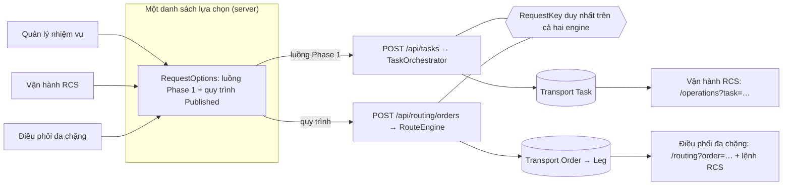
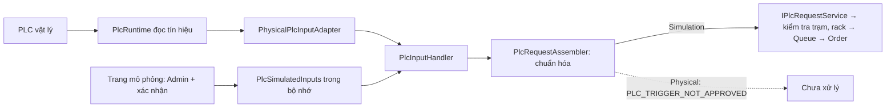

# CR-041 – Liên kết các phân hệ vận hành, danh mục quy trình, PLC Simulation theo từng IO, bản ghi Rack

| | |
|---|---|
| **Trạng thái** | `IMPLEMENTED – TESTED (Simulator / mock) – NOT DEPLOYED – NOT READY FOR REAL OPERATION` |
| **Nguồn phê duyệt** | Chỉ thị của chủ dự án ngày 2026-11-26 |
| **Migration** | `AddSimulatedStationTransaction` (thêm `station_transactions.Simulated`, mặc định `false`). SQL: [`CR-041_migration_up.sql`](CR-041_migration_up.sql), [`CR-041_migration_down.sql`](CR-041_migration_down.sql). **Chỉ mới chạy trên database test** |

## 1. Nguyên nhân gốc của danh sách quy trình thiếu

Trên môi trường đã import danh mục từ trước (CR-039 mục "database đã import PH2-01…06"), seeder không sửa mã đã tồn tại. Các quy trình đó nằm ở Draft nên không vào dropdown; `PH2-04` còn cờ REVIEW dù D-09 đã chấp thuận. Hai form vận hành đã đọc quy trình Published từ database (CR-039); trang Điều phối đa chặng có form riêng chỉ liệt kê lệnh theo quy trình.

## 2. Danh sách quy trình

| Quy trình | Trạng thái theo tài liệu | Ghi chú |
|---|---|---|
| BP-01, 02, 03, 05, 06 | Giữ (Phase 1) | Chạy engine task từ cấu hình máy chủ; có thể đồng thời tồn tại bản Published trong database (chạy engine lệnh) – OQ-40-01 |
| BP-04 | Giữ ở REVIEW | Không công bố, không chạy |
| PH2-01…04, 06…12 | Giữ (đã chốt) | Published + NotReady theo danh mục chuẩn |
| PH2-05 | Giữ ở Draft | Chưa duyệt đưa rack rời QC thủ công |
| A3/A4 ↔ D1/D2 | Không có quy trình | `UNCHANGED`: giữ quy trình cũ, không tự tạo |
| Mã do người dùng tạo, không thuộc danh mục | Không tự xóa | Admin tắt (**Ngừng sử dụng**) nếu không dùng; lịch sử giữ nguyên |

**Không quy trình nào bị CR này xóa hoặc tắt tự động.**

- **Đồng bộ danh mục:** trang Quy trình đánh dấu quy trình mặc định **khác danh mục chuẩn**. Admin nhập lý do → `POST /api/processes/{id}/apply-catalog` tạo **version Draft mới** theo danh mục và đặt cờ REVIEW theo danh mục. Không validate, không publish, không đặt Ready, không xóa version.
- **Ngừng sử dụng / kích hoạt lại:** dùng cờ `Enabled` sẵn có; quy trình tắt rời dropdown và từ chối yêu cầu, lệnh lịch sử giữ nguyên.
- **Tạo quy trình mới:** không thay đổi; quy trình mới tự xuất hiện ở cả ba form.

## 3. Ba trang vận hành

| Trang | Đối tượng | Vai trò |
|---|---|---|
| Quản lý nhiệm vụ | Yêu cầu vận chuyển (task và lệnh) | Tạo, theo dõi |
| Vận hành RCS | Thực thi task | Bản tin RCS gửi/nhận, trạng thái điều khiển |
| Điều phối đa chặng | Transport Order và chặng | Theo dõi từng chặng, giao dịch trạm |

Task Phase 1 và Transport Order là **hai loại đối tượng**; không có quan hệ cha–con giữa chúng, nên không có liên kết "từ Task sang Transport Order" của cùng một yêu cầu. Điều hướng đi từ danh sách yêu cầu chung tới trang chi tiết của từng loại.

## 4. PLC thật và PLC Simulation

- `PhysicalPlcInputAdapter` **chưa được lịch nào gọi**; đường PLC thật dừng ở bộ xử lý chung cho tới khi quy tắc kích hoạt được duyệt (OQ-41-02).
- **Chế độ AGV thật:** đặt/xem/reset tín hiệu được; yêu cầu mô phỏng bị từ chối `SIMULATION_REAL_MODE` **trước khi ghi bất kỳ dữ liệu nào**, kiểm tra lại trong transaction tạo lệnh, và dấu `Simulated` được lưu để lần khởi động lại không biến nó thành yêu cầu thật. Áp dụng cho cả `POST /api/routing/plc-requests`. Trang mô phỏng không xác nhận Pick/Drop cho lệnh Real.
- **Thay đổi so với CR-035/CR-040:** mô phỏng không còn dùng được để điều AMR thật.
- Thêm: địa chỉ và mô tả IO, reset trạm, lịch sử (audit người, thời gian, IO, giá trị).

### Tín hiệu mô phỏng được (mọi tín hiệu PLC → WCS của port, IO Map v2)

| Tín hiệu | Kiểu | Bộ tiếp nhận đọc |
|---|---|---|
| Pickup_Request, Delivery_Request | Bool | Có |
| Request_ID | String | Có |
| Rack_Full, Rack_Empty, Destination_Available, Rack_Type | Int | Có |
| Safety_Ready, Station_Online, Station_Ready, Rack_Present, Station_Fault, Transfer_Complete | Bool | Không – chỉ đặt/hiển thị, chưa có xử lý được duyệt |

## 5. Vị trí và tồn kho

Backend và giao diện cho phép Admin thêm / sửa / chuyển / xóa từ CR-040; môi trường chạy bản cũ thì chưa có. Bổ sung: loại rack khi thêm và sửa; gán product model qua API khi rack chưa có; hộp thoại báo **lý do bị khóa** (`GET /api/inventory/racks/{id}/editability`) trước khi bấm. Rack đang giữ chỗ, đang vận chuyển, thuộc lệnh chưa xong, xử lý thủ công hoặc chưa đối soát vẫn bị từ chối.

## 6. API và hành vi mới

| API | Quyền |
|---|---|
| `POST /api/processes/{id}/apply-catalog` | Admin |
| `GET /api/inventory/racks/{id}/editability` | Admin |
| `POST /api/plc-simulation/stations/{id}/reset`, `GET /api/plc-simulation/history` | Admin |
| `POST/PUT /api/inventory/racks` nhận thêm `rackType` (PUT nhận `productModelId`) | Admin |
| `POST /api/tasks`, `POST /api/routing/orders`: lỗi mới `REQUEST_KEY_IN_USE` khi mã đã thuộc engine kia | như cũ |

## 7. `DEFERRED - PENDING USER APPROVAL`

| ID | Nội dung và đề xuất | Cách làm hiện tại |
|---|---|---|
| OQ-40-01 | Chuyển BP-01…06 sang quy trình database và bỏ nhóm cấu hình. Đề xuất: duyệt định nghĩa BP trong DB, thêm vào danh mục mặc định, rồi tắt engine cũ theo từng luồng | Hai nhóm trong cùng dropdown, ghi rõ loại |
| OQ-39-08 | BP và PH2 cùng trigger tại A1/A2, B1/B2: yêu cầu PLC không kèm mã quy trình bị `PROCESS_AMBIGUOUS`. Đề xuất: tắt BP trùng trên môi trường dùng PH2 | Không tự tắt |
| OQ-41-01 | Mô phỏng tạo công việc khi hệ thống ở Real (cần tách tồn kho/AGV giả khỏi thật). Đề xuất: giữ chặn | Chặn |
| OQ-41-02 | Quy tắc cạnh/mức/reset/handshake để tín hiệu PLC thật tạo yêu cầu (CR-029) | PLC thật không tạo yêu cầu |
| OQ-54, 58, 45, 49, 55 | Như CR-040 | Không đổi |
| OQ-39-01…07, 09, 10 | Như CR-039 | Không đổi |

## 8. Triển khai và rollback

Sao lưu → chạy migration → khởi động backend mới. Rollback bị từ chối khi còn yêu cầu mô phỏng đã ghi nhưng chưa bắt đầu (`ROLLBACK_REFUSED`).

## 9. Chưa kiểm chứng

Giao diện trên trình duyệt; PLC, RCS, AMR thật.
