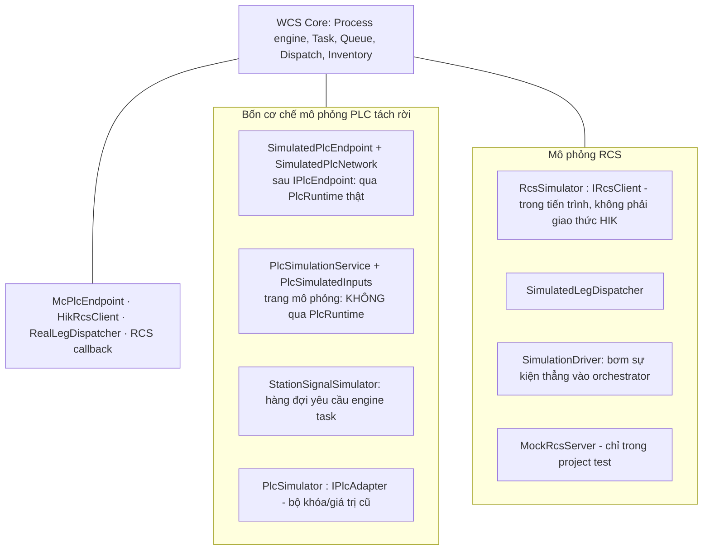
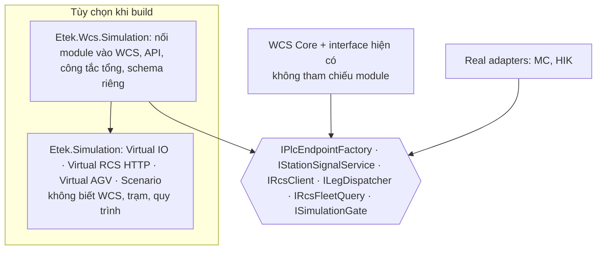

# CR-043 – Module mô phỏng PLC & RCS dùng lại được: INITIAL REVIEW

| | |
|---|---|
| **Ngày** | 2026-11-26 |
| **Đánh số** | Yêu cầu ghi CR-042, nhưng CR-042 đã dùng cho đợt "quyết định sau initial review". Tài liệu này dùng **CR-043** |
| **Source** | `main` `844c415` + thay đổi CR-042 chưa commit |
| **Phạm vi lượt này** | Chỉ đọc source. Không sửa code, schema, cấu hình cho CR-043 |
| **Giới hạn** | Chưa đọc hết mọi file (đặc biệt driver MC, nội dung chi tiết của `MockRcsServer`, giao diện mô phỏng PLC cũ). Không kiểm chứng với thiết bị thật |

## 1. Kiến trúc hiện tại

**Phụ thuộc cứng làm cho hiện nay không gỡ được mô phỏng:**

- `RoutedRcsClient` và `RoutedLegDispatcher` (bộ chọn adapter) nhận thẳng lớp `RcsSimulator`, `SimulatedLegDispatcher`.
- `RcsDispatchGuard` nằm trong thư mục Simulation và kiểm tra kiểu `RcsSimulator`.
- `PlcEndpointFactory` nhận `SimulatedPlcNetwork`; `StationSignalSimulator` là `IStationSignalService` mặc định.
- `Integration:Mode` chỉ chấp nhận `Simulator`; `Plc:Mode` và Execution Mode mặc định là Simulator.
- Mã mô phỏng nằm trong `WCS.Application` (`PlcSimulationService`, `PlcSignalSimulation`), `WCS.Infrastructure/Simulation`, `WCS.Api` (ba nhóm API), và frontend.
- Không có công tắc tổng. Công tắc hiện rải rác: trạng thái trang mô phỏng (trong bộ nhớ), `Integration:Mode`, `Plc:Mode`, Execution Mode, `Simulator:ExposeApi`, `Rcs:AllowSimulatorInProduction`.

## 2. Đánh giá hiện trạng

Phân loại: **ĐÁP ỨNG** · **MỘT PHẦN** · **CHƯA CÓ** · **CHƯA PHÙ HỢP** (có nhưng không tái sử dụng được).

| Hạng mục | Hiện trạng | Tái sử dụng được | Cần bổ sung | Rủi ro | Loại |
|---|---|---|---|---|---|
| Khai báo IO | Catalog và bảng `station_io_points`: tên, chiều, kiểu, mô tả, địa chỉ, độ dài, mã hóa, cho phép ghi | Toàn bộ | Active level, trigger, handshake, reset, timeout, ánh xạ nghiệp vụ: **không có trường nào** | Tự đặt = bịa giao thức | MỘT PHẦN |
| PLC → WCS | Đường runtime (polling) và đường trang mô phỏng khác nhau | `IPlcEndpoint`, `PlcWorker`, `StationIoHandler`, `PlcInputHandler` | Một nguồn tín hiệu duy nhất đi qua runtime | Mô phỏng đạt nhưng đường thật hỏng | CHƯA PHÙ HỢP |
| WCS → PLC | `PlcRuntime.WriteAsync` + chính sách ghi; endpoint mô phỏng nhận ghi | Có | Không có quy tắc handshake nào được cấu hình, nên WCS không ghi gì | Không mô phỏng được hai chiều nếu chưa duyệt | MỘT PHẦN |
| Edge / level / reset / timeout | Engine task: cạnh lên. `HandshakeCoordinator`: set/reset theo mức, cảnh báo timeout | Khung quy tắc | Định nghĩa theo từng tín hiệu | OQ-41-02 | MỘT PHẦN |
| Bộ IO chuẩn | Hệ thống dùng IO Map v2 (baseline cũ). Bản 20/11/2026 chưa duyệt, cột địa chỉ trống | – | Quyết định | Xây trên bộ sẽ bỏ | CHƯA KẾT LUẬN |
| Hợp đồng RCS trong Core | `IRcsClient`, `ILegDispatcher`, `IRcsFleetQuery` | Có | Đăng ký adapter theo mode, không theo lớp cụ thể | Đụng CR-038 | MỘT PHẦN |
| RCS Simulator | Đối tượng trong tiến trình; có tiêm lỗi: từ chối, timeout, mất kết nối, đội AMR tĩnh | Kịch bản lỗi, tính idempotent | Request/response đúng giao thức, mã phản hồi, phản hồi trễ/trùng | Không phát hiện lỗi định dạng | CHƯA PHÙ HỢP |
| RCS thật | `genAgvSchedulingTask`, `continueTask`, `cancelTask`, `queryTaskStatus`, truy vấn đội AMR; callback `start/outbin/end/cancel/ctu`. Mới kiểm bằng mock | Làm chuẩn cho Virtual RCS | Callback cho chặng Transport Order | OQ-42-06 | MỘT PHẦN |
| Virtual AGV | Danh sách AMR tĩnh | Cấu trúc đội AMR | Vị trí, trạng thái, lỗi, chuyển động | – | CHƯA CÓ |
| Hoàn tất nhiệm vụ | `SimulationDriver` sinh Pick/Drop trực tiếp; chặng do Admin xác nhận | – | RCS ảo tự quyết định phản hồi | `end` của RCS không đủ để hoàn tất; bằng chứng bàn giao chưa chốt (OQ-42-05) | CHƯA PHÙ HỢP |
| Process, Task, Queue, Dispatch | Dùng chung cho cả hai mode; mode ghim theo task/order | Giữ nguyên | – | Hai engine task/order | ĐÁP ỨNG |
| Chặn lẫn Simulator/Real | Ghim mode, kiểm tra trước khi đổi mode, yêu cầu mô phỏng không tạo việc ở Real | Có | Nguồn gốc dữ liệu trên Task/Order, tồn kho | Mô phỏng cập nhật **cùng bảng tồn kho** | MỘT PHẦN |
| Lịch sử bản tin | `rcs_messages` (đánh dấu mode), log PLC, audit | Có | Lịch sử tín hiệu mô phỏng bền vững | – | MỘT PHẦN |
| Scenario Engine | Không | `Harness`, `RoutingKit` trong test làm mẫu | Toàn bộ | – | CHƯA CÓ |
| Giao diện quản trị | Trang mô phỏng PLC, điều khiển simulator, mô phỏng task rải rác | Một phần | Một khu vực duy nhất | – | CHƯA PHÙ HỢP |
| Khả năng gỡ / tái sử dụng | Không | – | Ranh giới module | Refactor lớn | CHƯA CÓ |

## 3. Kiến trúc đề xuất

| Thành phần | Quy tắc |
|---|---|
| `Etek.Simulation` | Không tham chiếu project WCS. Tín hiệu, API, đội xe nạp từ file định nghĩa |
| `Etek.Wcs.Simulation` | Lớp nối duy nhất. `WCS.Api` đăng ký bằng một lời gọi, bật/tắt bằng thuộc tính build |
| Core | Thêm đăng ký adapter theo mode và `ISimulationGate` (mặc định: luôn tắt). Không đổi nghiệp vụ |
| Dữ liệu | Bảng của module ở schema riêng, lịch sử migration riêng. Dấu nguồn gốc trên dữ liệu nghiệp vụ ở lại Core |
| Frontend | Một thư mục riêng, nạp theo cờ build |

**Công tắc tổng:** bảng một dòng, mặc định OFF; Admin kiểm tra ở backend, có lý do và audit; mọi điểm vào của module hỏi công tắc **trong cùng transaction** tạo dữ liệu.

### Trình tự và phạm vi thay đổi

| Bước | Nội dung | File chính | Migration |
|---|---|---|---|
| S1 | Tách ranh giới, **không đổi hành vi**; kiểm tra build không có module | `RoutedDispatchers.cs`, `RcsDispatchGuard.cs`, `DependencyInjection.cs`, `PlcRuntimeInfrastructure.cs`, project mới | Không |
| S2 | Công tắc tổng | module, API, trang quản trị | Schema module |
| S3 | Virtual IO sau `IPlcEndpoint`; thay P2–P4 | `Plc/*`, `Routing/PlcSim*` | Có thể |
| S4 | Virtual RCS theo giao thức + Virtual AGV | module | Schema module |
| S5 | Scenario Engine | module | Schema module |
| S6 | Giao diện hợp nhất | frontend | Không |
| S7 | Kiểm tra gỡ module, `SIMULATION_MODULE_INTEGRATION.md` | CI/script, tài liệu | Không |

### Danh sách cần gỡ (dự kiến sau khi xong)
Hai project module, thư mục frontend mô phỏng và menu, các API `/api/plc-simulation`, `/api/simulator`, `/api/plc/simulator` (sau khi hợp nhất), schema mô phỏng, mục cấu hình mô phỏng, project test của module. Danh sách chính xác lập ở S7.

## 4. Rủi ro

| Rủi ro | Mức | Giảm thiểu |
|---|---|---|
| Refactor bộ chọn adapter làm đổi hành vi Dual Mode | Cao | S1 riêng, không đổi hành vi, full regression |
| Hơn một nghìn test dựa vào `RcsSimulator` hiện tại | Cao | Chuyển dần; giữ simulator cũ trong module tới khi đạt tương đương |
| Mô phỏng sửa tồn kho thật | Cao | OQ-43-05 |
| Virtual RCS/PLC phản ánh giả định chưa xác nhận | Cao | Gắn nhãn `ASSUMED`, không tuyên bố tương đương thiết bị |
| Client thật bị trỏ nhầm | Cao | Instance riêng, chỉ nhận địa chỉ do module cấp, không đọc cấu hình RCS thật |
| CR-042 chưa commit, chồng thay đổi | Trung bình | Review và commit CR-042 trước |

## 5. Câu hỏi cần quyết định (một đợt)

Đã chốt, không hỏi lại: Admin + xác nhận là đủ để mô phỏng; yêu cầu mô phỏng không tạo việc ở Real; công tắc mặc định OFF khi cài mới **hoặc chưa cấu hình**; không gửi tới thiết bị thật. Hệ quả cần biết: bản đang cài chưa có cấu hình công tắc, nên sau khi nâng cấp, mode Simulator **ngừng điều phối** cho tới khi Admin bật (số OQ-43-06 để trống vì lý do này).

| OQ | Vấn đề và bằng chứng | Phương án và ảnh hưởng | Đề xuất |
|---|---|---|---|
| **43-01** Bộ IO chuẩn | Code dùng IO Map v2; CLAUDE.md §7.8 coi là baseline cũ; bản 20/11 chưa duyệt | (a) v2: chạy ngay, có thể phải làm lại. (b) 20/11: trái cổng CR-029, thiếu địa chỉ. (c) Định nghĩa nạp từ file; giao v2 trước, thêm 20/11 khi duyệt | **c** |
| **43-02** Thuộc tính tín hiệu thiếu | Không có trigger, reset, timeout, handshake; không có quy tắc ghi được duyệt | (a) Chờ kỹ sư: không có hai chiều. (b) "Hồ sơ giả định" chỉ cho endpoint ảo, gắn nhãn, không bao giờ áp cho PLC thật: chạy thử được nhưng chưa chứng minh đúng giao thức. (c) Chỉ ON/OFF tay | **b**, bạn duyệt từng hồ sơ |
| **43-03** Mức mô phỏng RCS | `RcsSimulator` không đi qua giao thức | (a) Virtual RCS HTTP, WCS dùng `HikRcsClient` (instance riêng) cả khi mô phỏng: đúng giao thức, phải bảo vệ địa chỉ. (b) Giữ trong tiến trình: không đạt mục 5. (c) a cho tích hợp, giữ bản trong tiến trình cho test nghiệp vụ | **c** |
| **43-04** Hoàn tất chặng | Chặng không có callback; `end` không đủ; bằng chứng Pick/Drop chưa chốt | (a) RCS ảo chỉ dùng phương thức có trong tài liệu; Pick/Drop là bằng chứng ảo gắn nhãn SIMULATED gọi qua điểm xác nhận sẵn có. (b) Đặt callback giả định cho chặng. (c) Chờ vendor: tiêu chí 1 không đạt cho Transport Order | **a** |
| **43-05** Tách dữ liệu | Mô phỏng và thật dùng chung bảng rack, vị trí, task | (a) Cùng DB, có dấu nguồn: đơn giản, tồn kho bị trộn. (b) Instance/DB riêng cho mô phỏng; DB vận hành từ chối bật công tắc: tách tuyệt đối, tốn thêm môi trường. (c) Schema nghiệp vụ nhân đôi: phức tạp, dễ lệch | **b** (cùng DB chỉ cho dev/test) |
| **43-07** OFF khi còn việc mô phỏng | – | (a) Đóng băng, tiếp tục khi ON; OFF luôn được phép. (b) Hủy an toàn: mất trạng thái thử. (c) Không cho OFF: trái yêu cầu ưu tiên của OFF | **a**; đổi sang Real vẫn đòi hoàn tất hoặc hủy |
| **43-08** Đồng thời với Real | – | (a) Loại trừ: công tắc ON chỉ khi mode Simulator; sang Real phải OFF. (b) Song song theo port: phức tạp, rủi ro trộn | **a** |
| **43-09** Ý nghĩa "gỡ hoàn toàn" | – | (a) Loại khỏi build/deploy bằng cờ, mã còn trong repo; dấu nguồn gốc ở lại Core. (b) Xóa cả mã và cột dữ liệu: cần migration phá dữ liệu lịch sử | **a** |
| **43-10** Mô phỏng cũ | Bốn cơ chế PLC, ba nhóm API | (a) Hợp nhất vào module, bỏ cái cũ sau khi có test tương đương. (b) Giữ song song: không gỡ gọn được | **a** |
| **43-11** CR-042 đang dở | Chưa commit | (a) Review, commit, merge trước khi bắt đầu CR-043. (b) Chồng lên | **a** |

**Cần kỹ sư PLC / vendor** (đã có trong [danh sách câu hỏi](ENGINEER_QUESTIONS_PLC_RCS_2026-11-26.md)): OQ-41-02, OQ-55, OQ-42-05, OQ-42-06. Các phần phụ thuộc giữ BLOCKED hoặc chỉ chạy bằng hồ sơ giả định.

Công cụ không tự hết hạn sau 60 giây: câu chưa trả lời khi bạn yêu cầu triển khai sẽ ghi **DEFERRED**.

## 6. Làm được không phụ thuộc quyết định

Khi bạn cho phép bắt đầu: S1 (tách ranh giới, không đổi hành vi) ở mức không phụ thuộc OQ-43-03/09; khung test "build không có module"; bản nháp tài liệu contract. Các bước S2–S7 chờ quyết định tương ứng.

## 7. Kiểm thử dự kiến

PLC, RCS, tích hợp, bảo mật/cô lập theo mục 9 của yêu cầu; thêm: test kiến trúc cấm Core tham chiếu module, job build solution không có module, test chứng minh instance RCS của module không mở kết nối ra ngoài địa chỉ do module cấp. Mọi kết quả chỉ chứng minh trên mô phỏng; **không khẳng định tương đương thiết bị thật**.

## 8. Đối chiếu OQ-43 với kiến trúc PLC Simulator + RCS Simulator (2026-11-26)

"Đã thống nhất" ở đây là **yêu cầu**: hai bộ mô phỏng PLC và RCS, công tắc tổng cho Admin, tách Simulator/Real, gỡ được, dùng lại được. Các **phương án OQ-43 chưa được trả lời**; bảng dưới cho biết phương án nào đáp ứng yêu cầu. Chưa sửa source cho CR-043.

| Yêu cầu | Bắt buộc về thiết kế | OQ quyết định | Phương án đáp ứng | Phương án không đáp ứng | Cách kiểm chứng |
|---|---|---|---|---|---|
| Công tắc tổng ADMIN, mặc định OFF | Một nguồn trạng thái trong database; backend kiểm tra quyền, lý do, audit; **mọi** điểm vào hỏi công tắc trong transaction tạo dữ liệu; chưa cấu hình = OFF | 43-07, 43-08 | a, a | 43-07 c | Test từng điểm vào khi OFF; test phân quyền; test đổi OFF song song với tạo yêu cầu |
| Tách Simulator / Real | Ghim mode (đã có); module không đọc cấu hình thiết bị thật; Virtual RCS chỉ nhận địa chỉ do module cấp; dữ liệu mô phỏng không đổi trạng thái vận hành | 43-05, 43-08, 43-03 | **b** (database riêng), a, c | 43-05 a: tồn kho và trạng thái vị trí bị dữ liệu mô phỏng sửa trong cùng bảng | Test database vận hành từ chối bật; test không có kết nối ra ngoài địa chỉ cấp |
| Gỡ bỏ được | Core không tham chiếu module; một lời gọi đăng ký; cờ build; schema riêng; thư mục frontend riêng | 43-09, 43-10 | a, a | 43-10 b | Build và test khi loại module; test kiến trúc cấm tham chiếu ngược |
| Dùng lại độc lập | Phần lõi không biết WCS, trạm, quy trình; tín hiệu, API, đội xe nạp từ file | 43-01, 43-03 | c, c | 43-01 a, b (gắn cứng một bản IO) | Project lõi không tham chiếu project WCS; một host mẫu tối thiểu chạy được lõi |
| PLC Simulator đúng hành vi | Đi qua `IPlcEndpoint` và runtime thật; hành vi chưa xác nhận gắn nhãn `ASSUMED` | 43-02, 43-10 | b, a | 43-02 c: không có hai chiều | Test cạnh, reset, timeout theo từng hồ sơ được duyệt |
| RCS Simulator đúng giao thức | HTTP theo tài liệu RCS; đi qua client thật | 43-03, 43-04 | c, a | 43-03 b | Test hợp đồng request/response; không tuyên bố tương đương thiết bị |

**Điểm cần chỉnh so với bản đầu:**

1. Phương án 43-03 c giữ simulator trong tiến trình cho test nghiệp vụ: simulator này **cũng phải nằm trong module**, nếu không Core vẫn phụ thuộc và không gỡ được.
2. Phương án 43-05 b chỉ cho phép dùng chung database ở môi trường phát triển và kiểm thử. Máy vận hành phải từ chối bật công tắc.
3. Cần tách lõi thành hai phần dùng được riêng. Câu hỏi bổ sung:

| OQ | Vấn đề | Phương án | Đề xuất |
|---|---|---|---|
| **43-12** | Đóng gói hai bộ mô phỏng | (a) Một project lõi, hai namespace: đơn giản, dùng lại thì kéo cả hai. (b) Ba project: hợp đồng chung, PLC, RCS: dùng riêng từng bộ, nhiều project hơn. Cả hai kèm project nối WCS | **b** |

Công tắc tổng không phụ thuộc phương án nào trừ vị trí lưu, nên là phần làm trước sau S1. Thay đổi CR-042 mới nhất (quyền sở hữu rack) nằm trong Core, mô phỏng và thật dùng chung, không cần sửa ở module.
