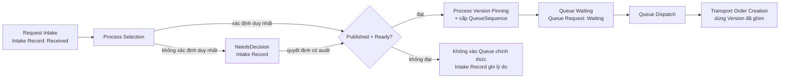

# AGV Phase 2 – Đặc tả vận hành tổng thể (P0)

> **IO MAP HIỆN HÀNH (2026-11-26, CR-045).** Dự án chỉ dùng một IO Map: [AGV_PLC Interface_List_22_11_2026.xlsx](../../02_Interface_Specification/PLC_IO_Map/AGV_PLC%20Interface_List_22_11_2026.xlsx) (SHA-256 `405586c9…34da3`). Các workbook cũ (IO Map v2, 10/11, 20/11) **đã ngừng sử dụng và đã gỡ khỏi repository**; nội dung dựa trên chúng trong tài liệu này chỉ còn giá trị lịch sử. IO Map 22/11 **chưa** được kỹ sư PLC xác nhận là hợp đồng IO. [Trạng thái từng tín hiệu](../../02_Interface_Specification/PLC_IO_Map/README.md).

| | |
|---|---|
| **Trạng thái** | **DRAFT – CHỜ CHỦ DỰ ÁN DUYỆT (Revision 1.2).** Đây là tài liệu P0 (phân tích/đặc tả); **không** phải CR được duyệt, **không** cho phép sửa code. Không mục nào ở đây được coi là *Approved / Published / Passed* nếu chưa có xác nhận ghi rõ. |
| **Ngày / nhánh / HEAD** | 2026-11-24 · `main` · `34c45b2` (working tree có thay đổi chưa commit của người dùng – xem §14) |
| **Revision** | **Revision 1 (2026-11-24)** – bổ sung 5 yêu cầu đã được chủ dự án duyệt (**R1-A…R1-E**): (A) quản lý quy trình vận chuyển động; (B) Execution Step của Order; (C) truy vết giao tiếp mức Step; (D) observability đầu–cuối; (E) gói chẩn đoán. Tài liệu vẫn là baseline P0, cập nhật tại chỗ; **không** bắt đầu P1, **không** code. Đề bài R1 bị cắt ở phần cuối (sau "communication transactions and…"): các yêu cầu A–E đã đủ được áp dụng; phần cập nhật cho tài liệu 5 (Rack/Queue) và 6 (Acceptance Tests) suy từ yêu cầu §2 và được ghi chú rõ. |
| **Revision 1.1** | **2026-11-24 – Correction, Approval & Consistency.** Áp dụng hai quyết định mới: **D-09** (PH2-04 gỡ REVIEW, chấp thuận toàn bộ làm baseline triển khai Phase 2, thuộc gói mặc định) và **D-10** (ghim Process Version tại thời điểm tiếp nhận vào Queue). Sửa 6 vấn đề: (1) PH2-04 publication & Operational Readiness; (2) diễn giải `PLC_ReaddyTranfer`; (3) append-only & retention; (4) bằng chứng bền vững & đường điều khiển không chặn; (5) chuẩn hóa E0–E6; (6) ghim Version tại Queue intake. Báo cáo: `docs/archive/agv-phase2/revisions/P0_REVISION_1_1_CORRECTION_REPORT.md`. |
| **Revision 1.2** | **2026-11-24 – Two-Gate Lifecycle & Queue Ordering.** Áp dụng quyết định: **D-11** (OQ-44: mô hình **hai Gate** – Publication Gate và Operational Readiness Gate, hai trục độc lập); **D-12** (Queue Intake chỉ tiếp nhận Request vào Queue chính thức khi Process Version = **Published + Ready**; Readiness **Suspended ⇒ Waiting → Held**, không hủy, giữ Version/QueueSequence, không tự Dispatch khi hồi phục); **D-13** (**Strict FIFO theo Queue Ordering Scope**, các Scope độc lập chạy song song). Giữ nguyên D-01…D-10 (PH2-04 vẫn baseline đã chấp thuận; D-09 không mở khóa BP-04 Phase 1). OQ-44 và OQ-01 đóng; OQ-49…58 mới. Báo cáo: `docs/archive/agv-phase2/revisions/P0_REVISION_1_2_CHANGE_REPORT.md`. |
| **Bộ tài liệu** | `PHASE2_OPERATIONAL_SPEC.md` (file này) · `PHASE2_PROCESS_FLOWS.md` · `PHASE2_STATION_IO_MAPPING.md` · `PHASE2_TRANSPORT_JOB_LIFECYCLE.md` · `PHASE2_RACK_BUFFER_QUEUE_RULES.md` · `PHASE2_ACCEPTANCE_TESTS.md` |
| **Ngôn ngữ** | Tiếng Việt (tên tín hiệu, tên code giữ nguyên) |

## 0. Nhãn dùng trong bộ tài liệu

| Nhãn | Ý nghĩa |
|---|---|
| **[QĐ]** | Quyết định đã được chủ dự án phê duyệt (D-01…D-08 trong yêu cầu P0). *Không đổi.* |
| **[QĐ R1-A…E]** | Yêu cầu bổ sung đã duyệt ở Revision 1: A quy trình động · B Execution Step · C truy vết giao tiếp mức Step · D observability · E gói chẩn đoán (xem §15–§19) |
| **[QĐ D-09]**, **[QĐ D-10]** | Quyết định của chủ dự án ở Revision 1.1: D-09 = PH2-04 baseline đã chấp thuận (gỡ REVIEW); D-10 = ghim Process Version tại Queue intake (xem §2, §15) |
| **[QĐ D-11]**, **[QĐ D-12]**, **[QĐ D-13]** | Quyết định chủ dự án ở Revision 1.2: D-11 = Two-Gate (OQ-44); D-12 = Intake = Published + Ready, Suspended → Held; D-13 = Strict FIFO theo Queue Ordering Scope (xem §2, §15.2b, §22) |
| **[HOẠT ĐỘNG]** | Nguyên tắc nghiệp vụ đã duyệt trước đó (CLAUDE.md §2, `docs/specification/*`, ADR đã chấp nhận) |
| **[NGUỒN]** | Nội dung tài liệu nguồn (PPTX, workbook, handoff, matrix) – chưa phải quyết định |
| **[CODE]** | Hành vi code hiện tại (đã đọc trực tiếp) |
| **[ĐX]** | Đề xuất kỹ thuật – *PROPOSAL – NEED USER CONFIRMATION* |
| **[OPEN OQ-xx]** | Chưa đủ căn cứ; xem bảng Open Questions §12 |
| KEEP / MODIFY / REPLACE / RETIRE / PROTECTED / OPEN | Phân loại kết luận (xem §10) |

> Lưu ý đánh số: **D-01…D-08** là quyết định P0 của chủ dự án; **ADR-0011 D-1…D-4** là các quyết định PLC đã có (D-1 FIFO/PLC, D-2 `Mission_Feedback`, D-3 CLAUDE.md, D-4 đối soát vật lý). Khi cần phân biệt, bộ tài liệu viết "ADR-0011 D-n".

## 1. Nguồn đã sử dụng (đường dẫn thực tế)

| Nguồn | Đường dẫn trong repo | Ghi chú |
|---|---|---|
| Handoff Phase 2 | `docs/01_Transport_Process_description/AGV_Phase2_Complete_Handoff.md` | **Untracked** (chưa commit). Gộp 6 phần (00–05). Handoff nhắc thư mục `sources/` – không có trong repo; hai file nguồn nằm ở vị trí dưới đây |
| PPTX | `docs/01_Transport_Process_description/ETEK Process AGV Phase 2 12.08.26.pptx` | **Untracked**. Tên file ghi `12.08.26`, **slide 1 ghi "Date: 20/1/2026"** (khác nhau – xem OQ-23). 10 slide; slide 10 không có text; đã đọc trực tiếp XML slide 1–10 và hình layout của slide 3 |
| Workbook PLC 20/11 (bản **HEAD**) | `docs/02_Interface_Specification/PLC_IO_Map/AGV_PLC Interface_List_20_11_2026.xlsx` @ `34c45b2` | sha256 `3c5da74b…` |
| Workbook PLC 20/11 (bản **working tree**) | cùng đường dẫn, trạng thái `M` | sha256 `a291d28f…`. Handoff mô tả **khớp bản working tree** (địa chỉ D1500…, `PLC_MissionCompleted` 1/2, X1–X4, E/G1–G2) |
| Workbook PLC 10/11 | `docs/02_Interface_Specification/PLC_IO_Map/AGV_PLC_IO_Interface_List_10_11_2026.xlsx` | Nền của CR-010 (9 bước) |
| Matrix quy trình | `docs/01_Transport_Process_description/WCS_BP_Port_PLC_Transaction_Matrix.xlsx` | Sheet BP_Port_Matrix (R2–R13), Port_PLC_Mapping, Transaction_Model, Open_Points |
| Báo cáo Phase 0 | `docs/reports/agv-phase2-assessment/*.md` (9 file) | Đã đọc; số liệu quan trọng được kiểm lại trực tiếp trên code |
| Đặc tả/ADR/CR | `CLAUDE.md`; `docs/specification/{business-rules,process-flows,inventory-management,task-state-machine,integration-requirements,access-control}.md`; ADR-0008, ADR-0010, ADR-0011; CR-029; `docs/02_Interface_Specification/PLC_20_11_2026/*` | Đã đọc nội dung liên quan |
| Code | `src/backend/WCS.{Domain,Application,Infrastructure,Runtime,Api}` | Dẫn `file:dòng` trong từng tài liệu |

IO Map v2 (`ETEK_WCS_IO_Map_4PLC_16Stations_v2_Separate_IO_Sets.xlsx`) hiện là `D` (đã xóa) ở working tree; **không** được dùng làm nguồn trong P0 (xem CLAUDE.md §7.1/7.8: baseline cũ, chỉ để tham chiếu lịch sử) và **không** được khôi phục.

## 2. Nguyên tắc và thứ bậc căn cứ

1. **[QĐ] D-01…D-13** là baseline nghiệp vụ Phase 2. Code, process configuration, PLC IO Map và thiết kế hiện tại **phải được điều chỉnh** nếu không phù hợp – *không* giữ nguyên chỉ vì đã triển khai.
2. Mọi thay đổi trong tương lai **có kiểm soát** (CLAUDE.md §3–§5): CR riêng, xác định phần thay thế/giữ nguyên, migration, ảnh hưởng API/DB/frontend/PLC/RCS/legacy, test hồi quy, rollback. P0 chỉ tạo tài liệu.
3. Thứ bậc khi mâu thuẫn: **[QĐ]/[HOẠT ĐỘNG] đã duyệt** > đặc tả đã duyệt hiện hành > tài liệu nguồn (PPTX/workbook/handoff/matrix, trong đúng phạm vi) > code hiện tại > suy luận kỹ thuật (luôn gắn nhãn [ĐX]). Mâu thuẫn **không** được chọn lặng lẽ: ghi vào bảng đối chiếu (§10) và Open Questions (§12).
4. **Điểm cần lưu ý về D-01 so với handoff:** handoff §00-3 mô tả "Mission/Transport Job ... có thể gồm một hoặc nhiều thao tác Pick/Drop". D-01 giới hạn: *một RCS Mission không cần nhiều Pick/Drop; một AMR không cần mang nhiều Rack*. Bộ tài liệu theo D-01 (chuỗi **Leg** tuần tự, mỗi Leg 1 Rack/1 Pick/1 Drop).
5. **D-09 (Revision 1.1) – PH2-04:** chủ dự án **gỡ REVIEW và chấp thuận toàn bộ quy trình PH2-04 (B1/B2 cần Full Rack) làm baseline triển khai Phase 2**; PH2-04 thuộc gói mặc định PH2-01…06 và tham gia vòng đời process thông thường. Quyết định này **thay thế hạn chế REVIEW cũ chỉ đối với PH2-04** trong D-08/BR-02; **mọi phần bảo vệ khác của D-08 giữ nguyên** (A3/A4, D1/D2, PER_AGV, không xóa/phá dữ liệu, giữ khả năng đối soát, không đánh dấu Rack đã đến đích khi mới dispatch/nhận RCS Completed). Không đặt lại câu hỏi PH2-04 có được triển khai hay không; không dùng BP-04 (Phase 1) làm căn cứ chặn. Tài liệu nguồn còn nói REVIEW (BR-02, CLAUDE.md §2, ADR-0008, `reference-processes.json`, `Cr010ProcessConfigTests.cs:183-184`) cần **CR cập nhật** (CR P1-G) – P0 không sửa các file đó. **BP-04 Phase 1** nằm ngoài D-09 (OQ-46). **Làm rõ (Revision 1.2):** PH2-04 được phép **Published khi vượt Publication Gate** dù **chưa đạt Operational Readiness**; Readiness chỉ quyết định việc tiếp nhận Request (D-12). D-09 **không** tự động mở khóa BP-04 Phase 1.
6. **D-10 (Revision 1.1) – Ghim Process Version tại Queue intake:** xem §15.4b. Thay thế quy tắc "ghim lúc tạo Transport Order" của Revision 1.
7. **Hai trục không được gộp (Revision 1.2, thay "bốn mức" của Revision 1.1):** *Publication Status* và *Operational Readiness* (§15.2b); không dùng một trục đại diện cho trục còn lại; không ghi trạng thái nào là đạt khi chưa có bằng chứng.
8. **D-11 (Revision 1.2) – Two-Gate Model (đóng OQ-44):** **Publication Gate** và **Operational Readiness Gate** độc lập về ý nghĩa và kết quả; **Publication Status** (Draft, Pending Approval, Approved, Published, Disabled) và **Operational Readiness** (NotReady, Ready, Suspended) là **hai trục riêng**, không trộn thành một trạng thái Process duy nhất; thay đổi Readiness **không** tự đổi Publication Status (§15.2b).
9. **D-12 (Revision 1.2) – Queue Intake và Suspension:** Request chỉ được tiếp nhận vào **Queue chính thức** khi Process Version = **Published + Ready**; không tự chọn Version khác; không bỏ qua Readiness. Khi Readiness chuyển **Suspended** và ảnh hưởng khả năng vận hành Request: **Waiting → Held** (không hủy; giữ `ProcessVersionId` và `QueueSequence`; không đổi vị trí Rack/tồn kho; **không tự Dispatch** khi hồi phục; revalidate rồi trả về **vị trí FIFO ban đầu**) – xem §22. Request đã Dispatched/InProgress **không** tự động bị hủy hay giả định AMR dừng an toàn.
10. **D-13 (Revision 1.2) – Strict FIFO theo Queue Ordering Scope (phương án B):** không bypass Request đứng trước trong cùng Scope; nếu Request đầu Scope Blocked thì các Request sau trong Scope chờ; các Scope độc lập có thể Dispatch song song; một PLC tối đa một giao dịch hoạt động; **không** mặc định mỗi PLC là một Scope, **không** mặc định cả hệ thống là một Scope, **không** suy đoán Request độc lập khi chưa có cấu hình được phê duyệt (§22). Cách xác định Scope: **OPEN OQ-54**.

## 3. Thuật ngữ và quan hệ giữa các thực thể [QĐ D-01]

| Khái niệm | Định nghĩa | Tên trong code hiện tại | Không được đồng nhất với |
|---|---|---|---|
| **Transport Job** | Yêu cầu vận chuyển nghiệp vụ; có thể gồm nhiều Leg **tuần tự** theo một quy trình | `TransportOrder` (`WCS.Domain/Routing/TransportOrder.cs:10`; trong tài liệu cũ gọi là "Transport Task") | `TransportTask` legacy (task thực thi AGV, state machine được bảo vệ) |
| **Leg** | Một chặng: **một Rack**, một điểm Pick, một điểm Drop | `TransportLeg` (`TransportOrder.cs:85`) | Station Transaction; RCS Mission |
| **Station Transaction** | Một lần AMR làm việc tại **một trạm** (lấy hoặc đặt); ở trạm PLC-managed có handshake | `StationTransaction` (`Routing/StationTransaction.cs`) | Leg (một Leg có thể mở 2 giao dịch: nguồn + đích) |
| **RCS Mission** | Nhiệm vụ điều khiển AMR gửi đến RCS cho **một Leg** | `ILegDispatcher` → `AgvRequestCode`/`AgvTaskCode` của Leg (`TransportOrder.cs:123-124`) | Transport Job; handshake |
| **PLC-managed Station** | Trạm có IO handshake với PLC | `PlcStation` + `Location` liên kết (`PlcEntities.cs:97`) | WCS-managed Station |
| **WCS-managed Station** | Điểm không có PLC IO; WCS tự quản lý tồn kho/occupancy và xác nhận | `Location` **không có** `PlcStation` liên kết (không có trường phân loại tường minh) | PLC-managed |
| **Buffer** | Vị trí đệm lưu Rack (P1–P4) do WCS quản lý | `LocationType.Buffer` | Vị trí chờ trung gian |
| **Manual QC** | Điểm QC thủ công (M5, M6) | `LocationType.ManualBuffer` (gần nhất) | F5 (OQ-10) |
| **Vị trí chờ trung gian** | Nơi AMR đứng chờ khi còn giữ Rack; không lưu Rack | `LocationType.WaitingPosition` / `RouteStep.WaitingPositionCode` | Buffer |
| **Origin Station** | Trạm/luồng nguồn gốc của Rack | **Chưa có** trong domain (xem §9/RACK doc) | Current Location |
| **Current Location** | Vị trí hiện tại của Rack trong tồn kho WCS | `Rack.CurrentLocationId` | Origin |
| **Process Version** | Phiên bản bất biến của một Process (dữ liệu cấu hình); Order ghim đúng một Process Version | `BusinessProcessVersion` (`BusinessProcess.cs:74`), snapshot trong Order (`ProcessSnapshot`) | Process (định danh); Order |
| **Route Step** | Bước *định nghĩa tuyến* trong Process Version (Pickup/Delivery/BufferStorage/BufferRetrieval/Waiting/Condition/ProcessCompletion) | `RouteStep` (`BusinessProcess.cs:141`) | **Execution Step** (bước thực thi lúc chạy) |
| **Execution Step** | Đơn vị **điều phối của WCS** trong một Order đang chạy, có định danh/trạng thái/thời gian/lịch sử riêng; *không* nhất thiết tương ứng 1–1 với một API call hay một lệnh RCS | **Chưa có** (mới – R1-B) | Route Step; API call; RCS command; Station Transaction |
| **Communication Transaction / Message** | Một lần trao đổi WCS ↔ PLC/RCS (transaction) gồm một hay nhiều message (gửi/nhận) có định danh riêng, lưu bằng chứng thô | **Chưa có** ở mức Step; có `plc_exchange_log` (hex, không gắn Order/Step) và log RCS chỉ định danh/kết quả | Log hệ thống thông thường |
| **Correlation ID** | Định danh WCS sinh ra để nối mọi sự kiện của một Order (và các ID con) | `TransportOrder.CorrelationId` + `DiagnosticContext` (AsyncLocal) | ID do hệ thống ngoài cấp |
| **Diagnostic Package** | Gói bằng chứng xuất theo Order/Leg/Step/khoảng thời gian để điều tra sự cố | CR-021: `SystemDiagnosticExporter` (theo khoảng thời gian/phạm vi), `DiagnosticExportService` (PLC) | — |
| **Publication Status** | Trạng thái xuất bản của một Process Version: Draft, Pending Approval, Approved, Published, Disabled | `ProcessConfigState` (`Draft/Validated/Published/Disabled`) – **MODIFY** | Operational Readiness |
| **Operational Readiness** | Trục độc lập với Publication: NotReady, Ready, Suspended – mức sẵn sàng kỹ thuật/vận hành của Process Version | **Chưa có** (mới – D-11) | Publication Status |
| **Intake Record** | Bản ghi tiếp nhận ban đầu của một yêu cầu (Received/NeedsDecision/không được tiếp nhận kèm lý do); **chưa** phải Queue Request đủ điều kiện Dispatch | **Chưa có** | Queue Request |
| **Queue Ordering Scope** | Tập Request có thứ tự tương đối phải bảo toàn (strict FIFO) vì ràng buộc qua tài nguyên chung | **Chưa có** (mới – D-13) | PLC; toàn hệ thống |
| **QueueSequence** | Số thứ tự FIFO gán khi Request được nhận vào Queue chính thức; **giữ nguyên** qua Waiting ⇄ Held | **Chưa có** | `CreatedAt` |
| **Held** | Trạng thái của Queue Request bị tạm giữ do Readiness Suspended; khác Order `Waiting` và Step `Blocked` | **Chưa có** | Waiting; Blocked |
| **Queue Request** | Yêu cầu đã được tiếp nhận và ghi **bền** vào hàng đợi (từ PLC hoặc PDA/Operator); mang Process ID + Process Version đã **ghim** tại intake và khóa FIFO | **Chưa có** (mới – D-03/D-10); gần nhất `StationRequestRecord` (legacy) | Transport Order (chỉ được tạo khi dispatch) |
| **Process Version Pin** | Bản ghi Process ID + Version (+ content hash, thời điểm, cách chọn) gắn vào Queue Request tại **intake** và giữ qua Order → Leg | **Chưa có** (hiện ghim khi tạo Order) | "Latest Published" |
| **Evidence level E0–E6** | Thang bằng chứng của một giao tiếp (§17): E0 chuẩn bị … E6 hoàn tất vật lý do WCS xác nhận | Chưa có | Mã lỗi giao thức |

Quan hệ: `Transport Job 1—n Leg`; `Leg 1—(0..2) Station Transaction` (nguồn, đích; điểm không có PLC không có giao dịch); `Leg 1—1 RCS Mission` (mỗi Leg là một RCS Mission độc lập, không có Mission nhiều điểm dừng – [CODE] `RouteEngine.cs:475`).

## 4. Vai trò

| Bên | Vai trò Phase 2 | Căn cứ |
|---|---|---|
| **WCS** | Sở hữu Transport Job, Leg, Queue, tồn kho Rack/Location/Reservation; chọn nguồn/đích theo quy tắc; xác nhận bàn giao; đối soát; điều phối handshake PLC (một giao dịch/PLC) | [QĐ] D-03, D-05, D-06; CLAUDE §2 |
| **PLC** | Phát yêu cầu Pick/Drop tại trạm PLC-managed; thực hiện cửa/kẹp; xác nhận chu trình thiết bị tại trạm | [NGUỒN] workbook 20/11; [QĐ] D-05 mục 2 |
| **RCS** | Chọn và điều AMR (đội động), báo trạng thái nhiệm vụ AMR | ADR-0010; [QĐ] D-05 mục 1 |
| **AMR** | Vận chuyển Rack; `RobotCode` thật do RCS cung cấp | ADR-0010/0011 D-2 |
| **Operator/PDA** | Gọi AMR tại M5/M6 (và Buffer thủ công); xác nhận thủ công có kiểm soát khi chưa có bằng chứng tự động | [NGUỒN] slide 8–9; [QĐ] D-05 |

## 5. Kiến trúc vận hành (mô hình đề xuất cho Phase 2) [ĐX – xem §11]

```
PLC station ──(handshake 6 tín hiệu, qua Driver PLC)──► WCS Request Intake ──► Durable Queue (per PLC / per resource)
Operator/PDA ──(request thủ công)────────────────────► WCS Request Intake ──►        │
                                                                                    ▼
                                                         Transport Job (Order) ─► Leg ─► chọn nguồn (Origin+FIFO) / đích (thứ tự ưu tiên)
                                                                                    │  Reservation (Rack nguồn, slot đích)
                                                                                    ▼
                                                         RCS Mission (1/Leg) ──► RCS ──► AMR
                                                                                    │
   Bằng chứng bàn giao: PLC chu trình + (Rack presence/identity | PDA/scan) ──► WCS xác nhận Pick/Drop ──► Inventory ──► Leg/Job hoàn tất
```

Lớp tách biệt (CLAUDE §4): yêu cầu/queue, điều phối Job, tồn kho, adapter PLC, adapter RCS; adapter vendor không nằm trong logic nghiệp vụ; không hard-code IP/địa chỉ/mã trạm.

**Luồng intake (D-10):** Request Intake → Process Selection → Process Version Pinning → Queue Waiting → Queue Dispatch → Transport Order Creation (chi tiết và sơ đồ: §15.4b; Queue Request: `PHASE2_TRANSPORT_JOB_LIFECYCLE.md` §2.5).

## 6. Vòng đời – tóm tắt (chi tiết: `PHASE2_TRANSPORT_JOB_LIFECYCLE.md`, `PHASE2_RACK_BUFFER_QUEUE_RULES.md`)

- **Transport Job**: Created → Accepted → InProgress ⇄ Waiting → Completed | Failed | Cancelled | ReconciliationRequired ([CODE] `OrderState`; trạng thái hàng đợi Waiting/Held… là **đề xuất** – xem §22.1 và file 4 §2.5). Hoàn tất **chỉ khi** mọi Leg cần thiết đã có xác nhận bàn giao (D-05). Trước khi có Order: **Intake Record** (`Received`/`NeedsDecision`) rồi **Queue Request** chính thức (`Waiting`/`Held` → `Prepared` → `Dispatched` → …, §22.1), Process Version được ghim tại intake (D-10).
- **Rack**: Unknown/Full/Empty/InTransit + vị trí + Origin (mới) + Reservation. Không đổi `Current Location` khi mới tạo/dispatch (D-06).
- **Station Transaction**: Created → … → Completed/Failed; không hoàn tất Job.
- **RCS Mission**: Sent → Accepted → (AMR executing) → RCS-Completed. **RCS-Completed ≠ bàn giao** (D-05).

## 7. Sở hữu trạm [QĐ D-07]

- PLC-managed: các trạm có IO trong workbook 20/11 (danh sách cần **xác nhận baseline** – OQ-03). 
- WCS-managed: **P1–P4** (Buffer), **M5–M6** (QC thủ công). *Không* gán PLC handshake cho P1–P4/M5/M6; *không* đồng nhất F5 với M5 (OQ-10).
- A3/A4, D1/D2: **PROTECTED** – luồng legacy, không bị CR Phase 2 hiện tại thay đổi (D-08, BR-04).
- Chi tiết, bằng chứng và trạng thái duyệt: `PHASE2_STATION_IO_MAPPING.md`.

## 8. Nguyên tắc FIFO, Origin, Buffer, Reconciliation (tóm tắt)

- **FIFO** [QĐ D-03]: nguyên tắc đã xác nhận; một giao dịch hoạt động/PLC; PLC khác nhau độc lập; yêu cầu lưu **bền** trong Queue (DB, không chỉ memory). **Strict FIFO theo Queue Ordering Scope** (D-13, đóng OQ-01; §22.3). *Chưa quyết:* cấu hình Scope (OQ-54), phân xử khe PLC giữa Scope (OQ-55), mốc kết thúc giao dịch PLC (OQ-02).
- **Origin** [QĐ D-02]: chọn Rack từ Buffer ưu tiên Origin phù hợp; trong nhóm phù hợp áp FIFO; quản lý riêng Rack ID / Full-Empty / Origin / Current Location / Rack Status / Buffer occupancy; **không** thay Origin bằng Current Location; không có Rack đúng Origin → **không** tự chọn Rack khác, giữ yêu cầu chờ cho đến khi có fallback được duyệt.
- **Không có đích** [QĐ D-04]: giữ trong Queue, chờ, không hủy/báo lỗi nghiệp vụ/chuyển đích ngoài danh sách đã duyệt; mô tả điều kiện đánh thức (file 5 §7).
- **Xác nhận Pick/Drop** [QĐ D-05]: ba tầng bằng chứng tách biệt (RCS / PLC / WCS-vật lý); nếu chưa có bằng chứng tự động thì xác nhận thủ công có audit; không giả lập.
- **Reconciliation** [HOẠT ĐỘNG + D-06]: mọi bất định vật lý → `ReconciliationRequired`, không tự giải phóng tài nguyên; hiện **chưa có lối thoát cho CR-010** (OQ-15).

## 9. Bất biến nghiệp vụ

| ID | Bất biến | Nguồn |
|---|---|---|
| INV-01 | Job gồm Leg tuần tự; mỗi Leg 1 Rack/1 Pick/1 Drop; không yêu cầu Mission nhiều điểm dừng hay AMR mang nhiều Rack | D-01 |
| INV-02 | Không đồng nhất Job / Leg / Station Transaction / RCS Mission | D-01 |
| INV-03 | Origin ≠ Current Location; không chọn Rack khác Origin khi không có Rack đúng Origin | D-02 |
| INV-04 | Trong nhóm Origin phù hợp: FIFO | D-02 |
| INV-05 | ≤ 1 giao dịch hoạt động/PLC; PLC khác song song; yêu cầu lưu bền | D-03 |
| INV-06 | Không có đích → Queue, không hủy/lỗi/đổi đích tùy ý | D-04 |
| INV-07 | RCS Completed ≠ bàn giao; một tín hiệu PLC đơn lẻ ≠ bằng chứng Rack | D-05; ADR-0011 D-4 |
| INV-08 | Chỉ hoàn tất Job khi toàn bộ Leg có điều kiện bàn giao | D-05 |
| INV-09 | WCS sở hữu tồn kho; không đổi `Current Location` vì đã tạo/dispatch | D-06; CLAUDE §4 |
| INV-10 | P1–P4, M5–M6 là WCS-managed; không gán handshake PLC; F5 ≠ M5 | D-07 |
| INV-11 | Bảo vệ: A3/A4, D1/D2; PER_AGV; không xóa/phá dữ liệu; giữ khả năng đối soát; không đánh dấu Rack đã đến đích khi mới dispatch/RCS Completed. *(Revision 1.1: **PH2-04 không còn REVIEW** – D-09; BP-04 Phase 1 ngoài D-09, OQ-46)* | D-08 (đã điều chỉnh bởi D-09) |
| INV-12 | Không tự tạo địa chỉ PLC/mapping; không ghi PLC khi chưa được PLC engineer duyệt | CLAUDE §7.5 |
| INV-13 | Không bind rack tại điểm "Không bind rack" | CLAUDE §2 |
| INV-14 | Task/callback/cập nhật tồn kho/retry phải idempotent | CLAUDE §4 |
| INV-15 | Quy trình vận chuyển là **dữ liệu cấu hình**, không hard-code; PH2-01…06 chỉ là gói mặc định, **không** là tập tối đa | R1-A |
| INV-16 | Chỉ process version **Published** được dùng cho yêu cầu vận hành mới; mọi thay đổi = version mới (Draft → Pending Approval → Approved → Published) | R1-A |
| INV-17 | Sửa process đã Published **không** đổi version mà Order đang chạy dùng (Order ghim snapshot) | R1-A |
| INV-18 | Hai process Published khớp cùng một yêu cầu → **không** thực thi mơ hồ, **không** tự chọn một cái; Request chuyển `NeedsDecision` (D-10) | R1-A, D-10 |
| INV-19 | Cấu hình process không được tạo logic thực thi tùy ý/không an toàn: chỉ trong danh mục bước, điều kiện, tài nguyên và giới hạn đã định nghĩa; không bỏ qua bước bắt buộc (đặt chỗ, xác nhận vật lý, cập nhật tồn kho) | R1-A, D-05 |
| INV-20 | Order có các Execution Step định nghĩa bởi Process Version; Order **không** Completed khi chưa đủ mọi bước bắt buộc và xác nhận nghiệp vụ/vật lý cuối cùng | R1-B, D-05 |
| INV-21 | Mỗi Execution Step lưu bằng chứng giao tiếp **thô** (PLC/RCS) cùng dữ liệu đã phân tích; không chỉ lưu "thành công/thất bại" | R1-C |
| INV-22 | Không coi một message là "đã được PLC/RCS nhận" chỉ vì WCS đã ghi/gửi thành công; phân biệt gửi / nhận-xác nhận / phản hồi / timeout / lỗi phân tích / kết quả nghiệp vụ / hoàn tất vật lý | R1-C |
| INV-23 | Lịch sử sự kiện và bằng chứng giao tiếp **không bị sửa/xóa bởi đường nghiệp vụ thông thường trong thời gian retention**; hiệu chỉnh = **sự kiện mới**, không sửa sự kiện cũ; chỉ **Retention Service** được archive/purge theo policy đã phê duyệt và **mỗi lần có audit** (phạm vi, khoảng thời gian, số bản ghi, thời điểm, kết quả, actor/nguồn); dữ liệu thuộc sự cố/đối soát/điều tra chưa đóng **được bảo vệ khỏi purge**; mất/cắt bớt phải có dấu vết và bị đếm. *(Không phải bất biến tuyệt đối vì retention cho phép purge có kiểm soát.)* | R1-D, Revision 1.1 |
| INV-24 | Ghi log/bằng chứng **không làm chậm đáng kể** điều khiển PLC/AGV thời gian thực (bất đồng bộ, không chặn đường điều khiển) | R1-D |
| INV-25 | Gói chẩn đoán xuất ra **không lộ** mật khẩu, token, credential, chuỗi kết nối; giữ thứ tự và quan hệ sự kiện | R1-E |
| INV-26 | Process Version được **ghim tại Queue intake** (sau khi kiểm tra Published + Ready) và giữ xuyên suốt Queue Request → Order → Leg; Version mới Publish không tự áp dụng cho Request đang chờ; Request chưa xác định process ở **Intake record `NeedsDecision`**, không gán latest; sau giải quyết phải **kiểm tra lại Published + Ready** trước khi ghim | D-10, D-12 |
| INV-27 | Bằng chứng mức cao hơn **không** được suy ra từ mức thấp hơn (E0–E6); HTTP 200/TCP response ≠ RCS chấp nhận nghiệp vụ; `PLC_ReaddyTranfer` là permission/ready, **không** phải bằng chứng cửa/kẹp đã mở; RCS Completed ≠ bàn giao vật lý | R1-C, D-05, Revision 1.1 |
| INV-28 | **Không tự động retry lệnh ghi PLC khi kết quả lần gửi trước chưa xác định**; chỉ kiểm tra đọc-lại/đối soát có kiểm soát | R1-B/C, Revision 1.1 |
| INV-29 | **Publication** (Approved/Published) ≠ **Operational Readiness** (Ready) ≠ đủ điều kiện nhận yêu cầu (**Published + Ready** và qua Process Selection/business checks); điều kiện kỹ thuật **không** đảo ngược quyết định nghiệp vụ và **không** chặn Publication trừ lỗi cấu trúc/tham chiếu không tồn tại | D-09, D-11, D-12 |
| INV-30 | Publication Status và Operational Readiness là **hai trục độc lập**; Readiness thay đổi **không** đổi Publication Status; không trộn thành một trạng thái Process duy nhất | D-11 |
| INV-31 | Queue Intake: chỉ tiếp nhận vào Queue chính thức khi Process Version = **Published + Ready**; không tự chọn Version khác; kiểm tra, ghim Version và cấp `QueueSequence` là **một thao tác nhất quán** (không có Queue Request chính thức thiếu `ProcessVersionId`) | D-12 |
| INV-32 | Readiness Suspended ⇒ Waiting → Held; không hủy; giữ `ProcessVersionId` và `QueueSequence`; không đổi Rack CurrentLocation/tồn kho; **không tự Dispatch** khi Ready lại; revalidate rồi trả về vị trí FIFO ban đầu; không đưa xuống cuối hàng; Dispatched/InProgress không tự hủy | D-12 |
| INV-33 | Strict FIFO trong từng Queue Ordering Scope (không bypass; đầu Scope Blocked thì các Request sau chờ); các Scope độc lập có thể Dispatch song song; ≤ 1 giao dịch hoạt động/PLC | D-13 |
| INV-34 | Scope **không** suy ra chỉ từ PLC ID; không mặc định toàn hệ thống là một Scope; không giả định hai Request độc lập khi chưa có cấu hình được phê duyệt | D-13 |

## 10. Bảng đối chiếu theo nhóm chức năng

Cột: **Baseline Phase 2** | **Tài liệu hiện tại** | **Code hiện tại** | **Kết luận**. (Đối chiếu theo từng quy trình ở `PHASE2_PROCESS_FLOWS.md`; theo trạm ở file 3; theo vòng đời ở file 4; theo Rack/Queue ở file 5.)

| # | Nhóm chức năng | Baseline Phase 2 | Tài liệu hiện tại | Code hiện tại | Kết luận |
|---|---|---|---|---|---|
| F-01 | Mô hình Job/Leg | D-01: Job nhiều Leg tuần tự; Leg 1 Rack/Pick/Drop | ADR-0008 §2-1 (cùng mô hình); handoff 00-3 nói "một hoặc nhiều Pick/Drop" (lệch D-01) | `TransportOrder/TransportLeg` (`TransportOrder.cs:10,85`), engine `RouteEngine.cs:137-203` | **KEEP** (mô hình khớp D-01); làm rõ thuật ngữ trong tài liệu |
| F-02 | RCS Mission | 1 Mission/Leg, không đa điểm | ADR-0010 §7 (leg = RCS task độc lập) | `RouteEngine.cs:475`; bộ gửi thật chưa có trên main (`DependencyInjection.cs:90`) | **KEEP** mô hình; **OPEN** bộ gửi thật (CR-030 chưa merge; OQ-13) |
| F-03 | Origin của Rack | D-02: thuộc tính riêng của Rack | Handoff 03-2; chưa có trong spec duyệt | **Không có** trường Origin; chọn rack theo vị trí + `LastConfirmedAt` (`Repositories.cs:59-62`) | **REPLACE** logic chọn Rack từ Buffer; **MODIFY** mô hình dữ liệu (thêm Origin – cộng thêm, migration) |
| F-04 | FIFO cấp PLC + Queue bền | D-03 | ADR-0011 D-1 (chưa triển khai); `business-rules.md §1.9` "no PLC-wide lock" (đã bị ADR-0011 D-1 thay một phần) | Chỉ ràng buộc mỗi **cổng** (`RoutingConfigurations.cs:164-165`); `PORT_BUSY` từ chối (`PlcRequestService.cs:85-86`); không có Queue bền; test `Cr010MultiLegTests.cs:145` mô tả mô hình cũ | **REPLACE** cơ chế per-port-reject bằng điều phối per-PLC + Queue bền (giữ index per-port làm lớp bảo vệ thứ hai – [ĐX]); **MODIFY** `business-rules.md §1.9` và ADR-0008 §2-4 bằng CR |
| F-05 | Không có đích → Queue | D-04 | `business-rules.md §1.7`, `task-state-machine.md §3.6` (legacy `WAITING_FOR_DESTINATION`) | CR-010: Order `Waiting` + `WaitKind` đánh giá lại mỗi tick (`RouteEngine.cs:302-338`); không hàng đợi có thứ tự | **MODIFY** (thêm thứ tự Queue bền, điều kiện đánh thức tường minh) |
| F-06 | Xác nhận Pick/Drop | D-05 (3 tầng) | `integration-requirements`, ADR-0010 §15, ADR-0011 D-4 | Chỉ Operator (`RoutingEndpoints.cs:72,75`); RCS Completed không tiến (`RouteEngine.cs:398-402`) | **KEEP** quy tắc "RCS Completed ≠ bàn giao"; **MODIFY/REPLACE** nguồn xác nhận (thêm PLC/presence/identity/PDA có audit) – phụ thuộc OQ-12 |
| F-07 | Inventory do WCS sở hữu | D-06 | BR-03, inventory-management | `Rack/Location/Reservation` (`Rack.cs`, `Reservation.cs`), `ConfirmPick/Drop` (`RouteEngine.cs:566-650`) | **KEEP**; **MODIFY** thêm Origin/Buffer occupancy view |
| F-08 | Phân loại trạm | D-07 | Matrix Port_PLC_Mapping; Open_Points OP-01/02 | `PlcStation` + Location; Location không Port = "luôn sẵn sàng" (`RouteConditionEvaluator.cs:106,115`); không có trường PLC-managed/WCS-managed | **MODIFY** (thêm phân loại tường minh); **OPEN** mapping từng trạm |
| F-09 | Handshake PLC 20/11 | D-05/D-03; baseline interface chưa chọn | CR-029 `PENDING_APPROVAL`; workbook HEAD ≠ working tree | Chưa có tín hiệu 20/11; khung 10/11 (`Handshake.cs`, `PlcRequestService.cs`) | **OPEN** (OQ-03/04/05/06); sau khi chốt: **REPLACE** driver/mẫu tín hiệu 10/11 bằng 20/11; giữ khung quan sát/phục hồi |
| F-10 | Reconciliation | D-06/D-08 | inventory-management §4.8 | Chỉ luồng legacy gỡ được cờ (`InventoryService.cs:251`); CR-010 chưa có lối thoát | **MODIFY** (CR riêng; OQ-15) |
| F-11 | PER_AGV | D-08 PROTECTED | BR-01, ADR-0008 §2-9, ADR-0010 §4 | Chỉ ở nhánh WCS-chọn-AGV (`RouteEngine.cs:493-520`); RcsManaged không áp (`:473-491`) | **PROTECTED** (không đổi); **OPEN** chế độ Phase 2 (OQ-13) |
| F-12 | Luồng legacy A3/A4, D1/D2 | D-08 PROTECTED | BR-04, process-flows §2.2 | Luồng legacy; validator chặn (`ProcessValidator.cs:47,52`) | **PROTECTED** |
| F-13 | PH2-04 (B1/B2 cần Full Rack) | **D-09: gỡ REVIEW, baseline đã chấp thuận, thuộc gói mặc định** | BR-02 / CLAUDE §2 / ADR-0008 / `reference-processes.json` còn ghi REVIEW (lỗi thời đối với PH2-04) | `reviewBlocked=true` trong dữ liệu tham chiếu; cơ chế `ReviewBlocked` chung (`BusinessProcess.cs:49`, `ProcessValidator.cs:33`, `RouteEngine.cs:81-90`); test `Cr010ProcessConfigTests.cs:183-184` | **REPLACE (dữ liệu/test/tài liệu tham chiếu, bằng CR P1-G)**; **KEEP** cơ chế REVIEW chung cho process khác; điều kiện kỹ thuật = **OPEN** (§15.2b) |
| F-14 | Quy trình PH2-01…06 | Slide 4–9 + matrix R8–R13 + D-02/D-04 | Phase 0: dữ liệu nháp | `reference-processes.json` (Draft import) | **MODIFY** (đối chiếu chi tiết: file 2); P1/P2/M5 chưa là Location |
| F-15 | Mô hình legacy `TransportTask` | Không dùng cho Phase 2 (đề xuất §11) | task-state-machine (13 trạng thái) | `TaskOrchestrator.cs`, `TaskStateMachine` | **PROTECTED** cho luồng Phase 1; **RETIRE khỏi phạm vi Phase 2** [ĐX] |
| F-16 | Frontend vận hành (Orders/Queue/Buffer/PDA) | Chưa có yêu cầu giao diện chính thức | — | Chưa rà frontend (Not Verified) | **OPEN** |
| F-17 | Quản lý process động (dữ liệu, version, phê duyệt, kích hoạt có kiểm soát) | R1-A: Draft → Pending Approval → Approved → Published; gói mặc định PH2-01…06; không giới hạn trạm | ADR-0008 §2-5/6/7 (process = data, snapshot, publish gate) | Có `Draft → Validated → Published → Disabled`, snapshot, validator 30+ mã lỗi, audit `PROCESS_*`, một Published/process (`ProcessAdminService.cs:78-105`, `ProcessValidator.cs`); **không có** Pending Approval/Approved, tách người soạn–người duyệt, kiểm tra xung đột trigger lúc publish (chỉ lỗi `PROCESS_AMBIGUOUS` lúc chạy, `RouteEngine.cs:99-102`) | **KEEP** khung process-as-data, versioning, snapshot, validator; **MODIFY** vòng đời + phê duyệt + kiểm tra xung đột + giới hạn cấu hình (§15) |
| F-18 | Execution Step của Order | R1-B | — | Chỉ có `RouteStep` (định nghĩa tuyến) và `RoutingEvent` (nhật ký sự kiện bất biến, không có trạng thái/thời lượng theo bước) | **REPLACE/MODIFY**: thêm thực thể Execution Step mới (không thay `RouteStep`) (xem LIFECYCLE §10) |
| F-19 | Truy vết giao tiếp mức Step | R1-C | `PLC_COMMUNICATION_SPECIFICATION_DRAFT.md` | `plc_exchange_log` (hex request/response, `IsAmbiguous`) nhưng **không** gắn Order/Step, lấy mẫu READ thành công, kênh `DropOldest` có thể mất mục khi DB từ chối (`PlcExchangeRecorder.cs:14-18`); RCS dispatch: `LoggingRcsClient` chỉ ghi định danh/kết quả, **không** payload (`LoggingRcsClient.cs:10`); `RcsApiTest`/`RcsCallbackLogEntry` có payload thô nhưng chỉ cho thử thủ công/callback, không gắn Step | **REPLACE/MODIFY**: kho Communication Transaction/Message thống nhất (§17) |
| F-20 | Observability đầu–cuối | R1-D | ADR-0006 logging | `CorrelationId` theo Order, `DiagnosticContext`, `routing_events`, `task_history`, `inventory_transactions`, `audit_log`, system log (giữ 90 ngày) | **MODIFY**: thêm StepId/MessageId/TransactionId/MissionId, ánh xạ ID ngoài, durability tầng 1, retention theo loại (§16) |
| F-21 | Gói chẩn đoán | R1-E | CR-021 | Xuất theo khoảng thời gian/phạm vi, có sanitize `LogSanitizer`, manifest, báo cáo đầy đủ (`SystemDiagnosticExporter.cs`); **không** chọn theo Order/Leg/Step, không kèm process version/raw message theo Step | **MODIFY** (mở rộng exporter) (§18) |
| F-22 | Queue Request và ghim Process Version | D-10: ghim tại intake; luồng Intake → Selection → Pinning → Queue Waiting → Dispatch → Order | Revision 1 ghi pin lúc tạo Order (đã thay) | Ghim lúc `StartAsync` tạo Order (`RouteEngine.cs:56-69`); không có Queue Request bền | **REPLACE** |
| F-23 | Append-only & Retention Service | Revision 1.1 Issue 3 | `LoggingHostedServices.cs` (retention system log 90 ngày) | Có purge system log; không audit purge; không bảo vệ sự cố chưa đóng | **MODIFY** (§16.7) |
| F-24 | Bằng chứng bền vững & recovery (outbox/spool) | Revision 1.1 Issue 4 | — | `PlcExchangeRecorder` `DropOldest`, mất lô khi DB lỗi; không outbox/spool | **REPLACE** cho tầng 1 (§16.8) |

## 11. Mô hình nền cho Phase 2 [ĐX – PROPOSAL, NEED USER CONFIRMATION]

**Đề xuất:** Phase 2 dùng **mô hình CR-010** (`TransportOrder/TransportLeg/StationTransaction` + `RouteEngine`), mở rộng an toàn thay vì viết lại; **không** dùng `TransportTask` legacy cho Phase 2.

Căn cứ: (a) Job/Leg/Station Transaction/RCS Mission khớp D-01 (§3); (b) Reservation nguồn/đích, snapshot process, idempotency, phục hồi khi restart đã có; (c) `TransportTask` legacy mô hình **một pick + một drop** (ADR-0008 §1) và state machine được bảo vệ.

| Thành phần CR-010 | Quyết định đề xuất | Lý do |
|---|---|---|
| Order/Leg/Step/Candidate/Condition, snapshot, validator | **KEEP** | Khớp D-01; cấu hình được |
| Reservation (SourceRack unique ACTIVE; Destination slot) | **KEEP** | `EntityConfigurations.cs:76-77`; khớp D-06 |
| `RouteEngine.CreateLegAsync` chọn rack | **MODIFY/REPLACE phần chọn Rack** | Cần Origin + FIFO (D-02) |
| `StationTransactionService` / `PlcRequestService` (per-port, reject `PORT_BUSY`) | **REPLACE** cơ chế điều phối (D-03); **KEEP** vòng đời giao dịch | Cần Queue bền, một giao dịch/PLC |
| `HandshakeCoordinator`, `HandshakeRecovery` | **KEEP** khung; **MODIFY** theo giao diện được duyệt | Dùng tên tín hiệu 10/11 |
| Xác nhận Pick/Drop (Operator-only) | **MODIFY** thêm nguồn (D-05) | |
| `SimulatedLegDispatcher` | **KEEP** (test); bộ gửi thật: OPEN (CR-030) | |
| Legacy `TransportTask`, `StationRequestProcessor`, `PlcStationSignalService` | **PROTECTED** (luồng Phase 1); không mở rộng cho Phase 2 | D-08 |

## 12. Open Questions – bảng tổng hợp

Quy ước: **Mức** B=chặn thiết kế/triển khai, H=ảnh hưởng lớn, M=cần biết sớm. Mọi phương án là *đề xuất*, không phải quyết định. (Câu hỏi chi tiết liên quan từng tài liệu được lặp lại ở cuối tài liệu đó.)

| ID | Mức | Nội dung | Vì sao cần xác nhận | Tác động nếu chưa xác nhận | Phương án | Khuyến nghị [ĐX] | Người/bên xác nhận |
|---|---|---|---|---|---|---|---|
| OQ-01 | — | **ĐÃ QUYẾT (Revision 1.2, D-13):** **Strict FIFO theo Queue Ordering Scope** (phương án B); các Scope độc lập chạy song song. *(Câu hỏi gốc: strict hay controlled FIFO/bypass.)* Phần còn mở chuyển sang OQ-54 (cách xác định Scope), OQ-55 (phân xử khe giao dịch PLC giữa các Scope), OQ-56 (khóa FIFO), OQ-58 (Held ở đầu Scope) | Quyết định của chủ dự án | Không còn | Đã chọn B | Đã quyết | Chủ dự án (đã quyết) |
| OQ-02 | B | D-1 (một giao dịch/PLC) kết thúc ở `PLC_MissionCompleted` hay sau `AgvExited` (AMR rời trạm)? | ADR-0011 D-1 nêu ranh giới chưa định nghĩa | Quyết định độ dài khóa PLC: nếu theo `AgvExited` (Station Transaction hiện tại) PLC bị khóa suốt hành trình AMR; nếu theo 6 bước handshake ngắn hơn nhiều | (a) kết thúc ở `PLC_MissionCompleted` (6 bước) → thông lượng cao hơn, nhưng AMR có thể còn ở trạm khi trạm khác cùng PLC bắt đầu; (b) kết thúc ở AMR rời trạm → an toàn hơn, thông lượng thấp | Cần ý kiến PLC engineer về xung đột vật lý giữa các trạm cùng PLC | Chủ dự án + PLC engineer |
| OQ-03 | B | Workbook PLC 20/11 nào là baseline được duyệt (HEAD `3c5da74b…` hay working tree `a291d28f…`)? | Hai bản khác nhau (§Doc control); handoff khớp bản working tree | Không chốt được tín hiệu, giá trị, trạm, địa chỉ | (a) HEAD; (b) working tree; (c) bản thứ ba do PLC engineer phát hành | Không chọn; yêu cầu PLC engineer/owner xác nhận và ghi hash vào CR | Chủ dự án + PLC engineer |
| OQ-04 | B | CR-029 có được cập nhật theo workbook mới không? | CR-029 mô tả bản HEAD ("địa chỉ trống", 1 khối PLC) | CR-029 sẽ phản ánh sai nguồn | (a) cập nhật CR-029; (b) mở CR mới thay thế CR-029; (c) giữ CR-029 + phụ lục thay đổi | (a) hoặc (b) sau OQ-03 | Chủ dự án |
| OQ-05 | B | Chống trùng yêu cầu PLC khi giao diện mới không có `Request_ID`? | D-4 (ADR-0011) yêu cầu định danh duy nhất; hiện unique index dựa `Request_ID` (`RoutingConfigurations.cs:167`) | Có thể tạo lệnh trùng khi PLC giữ nguyên tín hiệu | (a) PLC bổ sung ID/counter; (b) WCS tự sinh khóa (PLC+Station+edge+thời điểm) + cửa sổ khử trùng; (c) thiết bị khác | (a) nếu PLC chấp nhận; (b) chỉ như giải pháp tạm có kiểm chứng | PLC engineer + Chủ dự án |
| OQ-06 | B | Địa chỉ PLC còn thiếu (`AGV_TranferCompleted` 16/16 trạm; địa chỉ thực chưa duyệt) | Không được tự tạo địa chỉ | Không ghi được tín hiệu bắt buộc của bước 5 | Chờ PLC engineer cung cấp; không suy đoán | — | PLC engineer |
| OQ-07 | H | Mapping Y1/Y2/Z1/Z2 (PPTX slide 2) với D/E/G (workbook)? | Hai nguồn dùng nhãn khác nhau; **cấm tự suy** | Không biết trạm QC của F-Pis là trạm nào | Xác nhận bảng ánh xạ chính thức | — | Chủ dự án |
| OQ-08 | H | Vai trò chính xác E1/E2/G1/G2 (slide 3 có E/G với takt 7.5 / 12.8 p/rack; workbook có EF-G trên PLC .131) | Chỉ có nhãn và takt, không có mô tả luồng | Không mô tả được luồng E/G | Xác nhận vai trò (CNC/QC/khác) | — | Chủ dự án |
| OQ-09 | H | Luồng X1–X4, P3/P4, M6 có giống A1/A2, P1/P2, M5 không? | PPTX chỉ mô tả chi tiết A/B/M5 | Không đặc tả được | (a) giống (cấu hình tương tự), (b) khác | Chờ xác nhận; không sao chép tự động | Chủ dự án |
| OQ-10 | H | F5 là trạm manual hay PLC-managed? M5 có phải F5? | Matrix BP-05/06 dùng F5 (Phase 1), PPTX Phase 2 dùng M5; hình layout slide 3 có nhãn `F5` | Có thể gộp sai hai điểm | Xác nhận quan hệ F5–M5 | Không đồng nhất khi chưa xác nhận | Chủ dự án |
| OQ-11 | H | Dung lượng và loại Rack tương thích của từng Buffer (P1–P4, M5, M6) | `Location.RackCapacity/AllowedRackKind` phải cấu hình từ thực tế | Không tính được `capacity − occupied − reserved` | Người dùng cung cấp từng điểm | — | Chủ dự án/vận hành |
| OQ-12 | B | Nguồn xác nhận Rack identity/presence (PLC, barcode/RFID, sensor, PDA) | D-05, ADR-0011 D-4 | Không chốt được điều kiện "đủ" để Pick/Drop confirmed | (a) PLC bổ sung tín hiệu; (b) reader/sensor độc lập; (c) PDA/scan thủ công có audit (tạm thời) | Chỉ ra bằng chứng tối thiểu cho từng loại trạm | Chủ dự án + PLC engineer |
| OQ-13 | H | Chế độ RCS: RcsManaged hay WCS chọn AGV (PER_AGV)? | PER_AGV được bảo vệ; ADR-0010 chỉ áp PER_AGV cho Legacy | Quyết định giới hạn đồng thời và nhận dạng AMR | (a) RcsManaged (đội động); (b) WCS-chọn-AGV | Cần ý kiến chủ dự án; không đổi PER_AGV khi chưa phân tích ảnh hưởng | Chủ dự án |
| OQ-14 | H | Vị trí chờ trung gian: mã vị trí, ai điều AMR tới đó? | Slide 4,6,7,8 nhắc "vị trí chờ trung gian"; code chỉ ghi chú | Hành vi khi chưa có đích không thể cài đặt/kiểm thử | (a) RCS tự xử lý; (b) WCS gửi lệnh tới waypoint; (c) AMR đứng tại trạm nguồn | — | Chủ dự án + RCS vendor |
| OQ-15 | B | Quy trình reconciliation cho Order/Leg/Location trong CR-010 | Hiện không có lối thoát (Phase 0 §3) | Location/Order có thể bị khóa vĩnh viễn | Thiết kế CR đối soát (Admin) | Làm sớm vì độc lập PLC | Chủ dự án |
| OQ-16 | B | Định nghĩa **Origin** và quy tắc "Origin phù hợp": khớp đúng trạm, theo nhóm trạm (A1/A2…), hay theo bảng cấu hình? Ai/gì gán Origin lúc nhập Rack? | D-02 không định nghĩa chi tiết | Không viết được quy tắc chọn Rack | (a) khớp đúng Station; (b) khớp nhóm; (c) bảng cấu hình Origin→Requester | (c) cấu hình được (ít sửa code) – chờ duyệt | Chủ dự án |
| OQ-17 | H | **Thiếu nguồn ở PH2-06 (slide 9)**: slide 9 thể hiện nhánh NG = "Thông báo gửi lỗi vì không có rack đầy" (nút lỗi, không có vòng chờ), JSON `WaitBehavior=Fail`; trong khi D-02 nói thiếu Rack đúng Origin → chờ. *(Revision 1.1: slide 4–7 và slide 8 thể hiện NG = vòng chờ nên **không** còn xung đột; câu hỏi chỉ còn cho slide 9/PH2-06.)* | Slide 9 khác các slide còn lại; D-04 chỉ nói về *đích* | Không biết phản ứng khi P1/P2 không có Full Rack cho M5 | (a) chờ trong Queue + thông báo vận hành; (b) báo lỗi nghiệp vụ như slide 9; (c) hủy | Phân biệt "không có Rack" và "có Rack sai Origin" | Chủ dự án |
| OQ-18 | H | Thời điểm giữ chỗ đích: **trước** khi dispatch Pick (Rack ở nguồn) hay **sau** Pick (AMR giữ Rack tại vị trí chờ)? | Slide 6/7/8 mô tả AMR đã lấy Rack và chờ; D-04 nói "giữ yêu cầu trong Queue"; handoff 04-12 hỏi reserve trước dispatch | Quyết định Rack nằm ở trạm nguồn hay trên AMR khi chờ; ảnh hưởng chặn máy CNC và tồn kho IN_TRANSIT | (a) BeforePick; (b) AfterPick + vị trí chờ; (c) tùy quy trình | Chờ quyết định | Chủ dự án |
| OQ-19 | M | Timeout/expiry của yêu cầu trong Queue; thông báo operator | Chưa duyệt (handoff 03-6) | Yêu cầu có thể chờ vô hạn | Có/không timeout; chỉ cảnh báo | Chỉ cảnh báo, không tự hủy (phù hợp D-04) – chờ duyệt | Chủ dự án |
| OQ-20 | M | Ưu tiên khẩn cấp/manual override (vượt FIFO)? | Chưa duyệt | Xung đột với strict FIFO | Không / có quyền Admin có audit | — | Chủ dự án |
| OQ-21 | M | Chi tiết PDA: thao tác, xác nhận trước/sau khi AMR đến, sửa nhầm Rack/Buffer | Handoff 04-G | Không thiết kế được màn hình/luồng thủ công | Xác nhận danh sách thao tác | — | Chủ dự án/vận hành |
| OQ-22 | H | Phase 2 có điểm "Không bind rack" nào (PH2-01 B1/B2 không có `noBind` trong dữ liệu tham chiếu)? | CLAUDE §2: không bind tại điểm "Không bind rack" | Có thể bind sai/không bind sai | Xác nhận từng điểm | — | Chủ dự án |
| OQ-23 | M | Ngày/phiên bản PPTX: tên file `12.08.26`, slide 1 `20/1/2026`; slide 4–7 ghi "Model A (Phase 1)" trong file Phase 2 (slide 2 ghi P1–P4, M5, M6 là "Thêm mới") | Cần biết bản chuẩn | Nguy cơ dùng nhầm bản | Xác nhận bản PPTX chuẩn | — | Chủ dự án |
| OQ-24 | M | Sai khác nhỏ giữa nguồn: slide 6 chỉ ghi thả vào "P1" (matrix/handoff/JSON: P1/P2). *(Revision 1.1: nhãn slide 7 "P1,P2 có vị trí trống?" **không còn là câu hỏi mở** – xử lý là lỗi nhãn nguồn, đọc là "có Full Rack phù hợp", theo D-09; xem `PHASE2_PROCESS_FLOWS.md` §5.3.)* | Có thể là lỗi vẽ | Đích ưu tiên P2 có thể thiếu ở PH2-03 | Xác nhận | — | Chủ dự án |
| OQ-25 | M | Semantics `Mission_Feedback` theo ADR-0011 D-2 (trạng thái tiếp nhận, không phải RobotCode) – giao diện phản hồi mới | Workbook vẫn mã hóa AGV1–3 | Không ghi được phản hồi mà không vi phạm D-2 | Đề xuất IF-P3 (ADR-0011) | — | PLC engineer + Chủ dự án |

| OQ-26 | M | Thứ tự chọn trong **cùng nhóm ưu tiên** (B1 vs B2, P1 vs P2, A1 vs A2): theo thứ tự tài liệu, cân bằng tải, hay gần nhất? | Nguồn chỉ liệt kê B1/B2, P1/P2; code dùng `Order` "NEEDS_CONFIRMATION" (`BusinessProcess.cs:205-206`) | Kết quả chọn đích/nguồn không xác định | (a) thứ tự cố định; (b) round-robin; (c) ít chiếm dụng nhất | Chờ quyết định | Chủ dự án |
| OQ-27 | B | **Khởi tạo handshake do WCS** tại trạm PLC-managed khi chính trạm không phát yêu cầu (vd. thả Rack vào B1/B2 hoặc lấy Rack tại B1/B2/A1/A2 trong PH2-01/02/03/05): workbook 20/11 chỉ có bước 1 do **PLC** phát `PLC_MissionRequest` | Nếu trạm đích không phát yêu cầu thì không có cách bắt đầu Drop theo 6 bước đã mô tả; PQ-16 (Pick/Drop cùng 6 bước?) chưa trả lời | Không thể cài đặt Drop/Pick "do WCS khởi tạo" tại trạm PLC | (a) PLC luôn phát yêu cầu trước (trạm "mời" AMR); (b) bổ sung tín hiệu WCS→PLC; (c) quy trình khác | Chờ PLC engineer | PLC engineer + Chủ dự án |
| OQ-28 | H | Cùng tồn tại BP-01…06 (Phase 1, buffer F) và PH2-01…06 cho **cùng trigger** (A1/A2 Pickup Full…): chuyển đổi/cutover thế nào? | Engine từ chối khi >1 process Published cùng trigger (`PROCESS_AMBIGUOUS`, `RouteEngine.cs:99-102`) | Không thể publish song song; BP-01 (F1/F2/F5) và PH2-01 (P1/P2/M5) khác đích | (a) PH2 thay BP cho A1/A2; (b) cờ cấu hình chọn bộ process; (c) chạy theo khu vực | Chờ quyết định; liên quan Q-21 (Phase 0) | Chủ dự án |

| OQ-29 | B | Tên trạm PLC3 và PLC4: **X6 (catalog/matrix) hay X4 (workbook working tree, handoff, PPTX)**; **G3,G7 (catalog/matrix) hay G1,G2 (workbook, handoff, PPTX)**? Có phải cùng một trạm đổi tên hay trạm khác? | Cấu hình hiện hành dùng X6/G3/G7 (đã được duyệt ở IO Map v2); nguồn Phase 2 dùng X4/G1/G2 | Sai khóa IO `PLC_ID+Station_ID+Signal_Name`; có thể đọc/ghi nhầm trạm | (a) đổi tên trạm cấu hình theo nguồn mới (qua CR + migration); (b) giữ tên cũ + bảng ánh xạ; (c) trạm khác nhau | Không tự đổi (CLAUDE §7.8, PQ-20) | PLC engineer + Chủ dự án |
| OQ-30 | H | Phạm vi **FIFO chọn Rack** (D-02): trong từng Buffer riêng (P1 rồi P2) hay trên **tất cả Rack Origin phù hợp của cùng một nhóm ưu tiên** (P1+P2 gộp, Rack cũ nhất toàn nhóm)? Khóa FIFO = thời điểm nào (Rack vào Buffer/Drop được xác nhận, hay khác)? | D-02 chỉ nói "trong nhóm Rack phù hợp Origin, áp dụng FIFO" | Kết quả chọn Rack khác nhau khi P1 và P2 cùng có Rack phù hợp | (a) FIFO gộp theo nhóm ưu tiên, khóa = thời điểm Drop vào Buffer được xác nhận; (b) FIFO trong Buffer theo thứ tự P1→P2 | (a) khớp nghĩa "nhóm Rack phù hợp" – chờ duyệt | Chủ dự án |
| OQ-31 | — | **ĐÃ ĐÓNG (Revision 1.1, D-09).** PH2-04 gỡ REVIEW, chấp thuận toàn bộ làm baseline, thuộc gói mặc định PH2-01…06. Điều kiện kỹ thuật còn lại (Location, ánh xạ IO, trigger conflict, vị trí chờ, Origin/FIFO) **không** phải câu hỏi về việc có được triển khai hay không – xem L4/L5 (§15.2b), OQ-32, OQ-44 | Quyết định chính thức của chủ dự án | Không còn | Không áp dụng | Đã quyết (D-09) | Chủ dự án (đã quyết) |
| OQ-32 | B | **Điều kiện tiên quyết của gói mặc định (Revision 1.2: theo Two-Gate)**: để PH2-01…06 **Published** chỉ cần qua **Publication Gate** (tham chiếu Location/Station tồn tại và hợp lệ – gồm **tạo bản ghi Location P1–P4/M5**; không xung đột trigger với BP-01…06 – OQ-28); **không** cần commissioning. Còn mở: ai là người phê duyệt của gói mặc định (lịch sử phê duyệt), CR seed | Validator hiện lẫn hai loại điều kiện (§15.2b) | Gói mặc định chưa thể Published nếu thiếu bản ghi Location | (a) seed Published bởi CR với actor `SEED` + người duyệt ghi tên; (b) giữ Approved chờ bản ghi Location | (a)+(b) | Chủ dự án |
| OQ-33 | H | **Vai trò phê duyệt**: hiện chỉ Admin/Operator (`access-control.md`). Ai là Author, Approver, Publisher? Có bắt buộc người duyệt ≠ người soạn? | Pending Approval/Approved cần quyền riêng; audit phải ghi người | Không thiết kế được phân quyền và test | (a) Admin soạn, Admin khác duyệt; (b) thêm vai trò Process Approver; (c) quyền theo hành động | Tách người soạn–người duyệt (maker-checker) – chờ chủ dự án | Chủ dự án |
| OQ-34 | H | **Tiêu chí khớp process** cho yêu cầu PLC (20/11 **không có thông tin điểm đến**): process mới như A1 → X1 cùng trigger (A1, Pick, Full) với PH2-01 sẽ xung đột. Thuộc tính chọn nào được phép (Origin, loại Rack, sản phẩm, lựa chọn của operator, khung giờ)? | Quyết định khả năng tồn tại nhiều process cho cùng trạm/loại yêu cầu | Không thể có process mới cùng trigger với gói mặc định | (a) mỗi trigger (Station, loại yêu cầu, Rack) tối đa một Published (rời nhau); (b) thêm selector cấu hình được; (c) process chỉ khởi tạo thủ công/PDA với mã process tường minh | (a) cho PLC + (c) cho thủ công trước; (b) sau khi có nguồn dữ liệu | Chủ dự án |
| OQ-35 | H | **Quyền giải quyết `NeedsDecision` (Intake record)**: ai được giải quyết, giao diện, định dạng audit. *(Đã quyết ở Revision 1.1/1.2: không ghim, không gán latest; sau giải quyết **kiểm tra lại Published + Ready** rồi mới ghim và nhận vào Queue chính thức; lưu quyết định + người + Version.)* | D-10, D-12 | Chưa có chủ thể/quy trình giải quyết rõ | (a) Admin; (b) Process Approver; (c) theo trạm | (a)+(b) | Chủ dự án |
| OQ-36 | H | **Ranh giới cấu hình cho phép** và **mô hình năng lực** (PLC/AMR capability, ràng buộc an toàn): danh mục Step type, điều kiện, retry/timeout tối đa, tài nguyên; ai cấu hình ràng buộc an toàn; nguồn dữ liệu năng lực | R1-A yêu cầu validate năng lực PLC/AMR, an toàn | Không viết được bộ validator Phase 2 | Danh mục đóng + giới hạn trong `docs`; năng lực lấy từ cấu hình trạm/PLC/RCS đã duyệt | Xây dựng danh mục đóng, không cho script/SQL | Chủ dự án + PLC engineer + RCS vendor |
| OQ-37 | H | **Danh mục Execution Step**: bước hệ thống bắt buộc (không gỡ được) và bước tùy chọn; độ chi tiết (có Step riêng cho chờ Queue/Reservation/AGV selection?) | R1-B | Không chốt được số bước/Order, UI, test | (a) danh mục hệ thống + bước tùy chọn theo Process Version; (b) hoàn toàn theo Process Version | (a) | Chủ dự án |
| OQ-38 | M | **Chính sách retry mặc định** theo loại Step/giao tiếp (số lần, backoff, timeout); ghi PLC không retry tự động khi mơ hồ (hiện đúng như vậy – `PlcWriteAmbiguousException`) | R1-B/C: lưu lịch sử retry | Không có giá trị mặc định | Cấu hình theo loại Step trong giới hạn tối đa | Giữ quy tắc không retry ghi mơ hồ | Chủ dự án + PLC engineer |
| OQ-39 | B | **Retention, dung lượng, và chiến lược bắt giữ giao tiếp** (gồm policy archive/purge, audit purge, quy tắc hold sự cố – §16.7): giữ bằng chứng thô bao lâu; polling PLC mỗi chu kỳ có lưu không hay chỉ lưu bằng chứng khi đổi giá trị; hiện `plc_exchange_log` giới hạn số dòng/PLC và lấy mẫu READ OK | Yêu cầu "lưu thông điệp thật" mâu thuẫn với khối lượng polling liên tục | Quyết định dung lượng DB, chi phí, khả năng điều tra | (a) bằng chứng gắn Step luôn lưu đầy đủ, polling nền lấy mẫu/đệm vòng (có đếm mất mát); (b) lưu mọi chu kỳ (rất lớn); (c) lưu theo thay đổi (edge) + mẫu | (a)+(c) – chờ phê duyệt, đo dung lượng thực tế | Chủ dự án |
| OQ-40 | H | **Dữ liệu nhạy cảm trong bằng chứng thô** (RCS header/token/credential; dữ liệu người dùng): che khi ghi (at-rest) hay chỉ khi xuất? Ai được xem raw trên UI? | R1-C cần raw; R1-E cấm lộ credential | Rủi ro lộ bí mật nếu lưu thô không che | Che header/credential khi bắt giữ (không thể khôi phục) + che lần nữa khi xuất; xem raw chỉ Admin có audit | Che khi ghi các trường credential; raw body giữ nguyên | Chủ dự án |
| OQ-41 | M | **Nguồn thời gian và độ chính xác** (PLC không gửi timestamp; NTP; một hay nhiều instance WCS) để bảo đảm thứ tự sự kiện | R1-C/D: dấu thời gian chính xác, dựng lại sự cố | Thứ tự có thể sai khi lệch đồng hồ | Số thứ tự đơn điệu (sequence) + UTC + nguồn đồng hồ | Có sequence toàn cục theo Order | Chủ dự án |
| OQ-42 | M | **Gói chẩn đoán gửi ra ngoài** (cho ChatGPT/Claude/kỹ sư): chính sách dữ liệu rời hệ thống, định dạng, giới hạn kích thước, thời gian giữ gói, ai được xuất | R1-E | Rủi ro bảo mật/riêng tư | Chỉ Admin xuất, audit hành động xuất, sanitize bắt buộc, cảnh báo trước khi chia sẻ | — | Chủ dự án |
| OQ-43 | M | **Order cũ và dữ liệu hiện có**: Order tạo trước khi có Execution Step sẽ hiển thị thế nào (không backfill? backfill từ `routing_events`)? Quan hệ Step ↔ `RouteStep` | Migration/UI | Lịch sử hiển thị thiếu nhất quán | (a) không backfill, hiển thị "Order cũ"; (b) backfill suy diễn có nhãn "reconstructed" | (a) (không giả lập bằng chứng) | Chủ dự án |
| OQ-44 | — | **ĐÃ ĐÓNG (Revision 1.2, D-11/D-12/D-13).** Two-Gate Model (Publication Gate ⟂ Operational Readiness Gate); Queue Intake = Published + Ready; Suspended → Held; Strict FIFO theo Queue Ordering Scope. DC-01 được giải quyết: **Published không còn đòi hỏi Readiness**; việc phân loại các mã lỗi validator hiện có vào hai Gate cần CR (P1-I) | Quyết định của chủ dự án | Không còn | Đã chọn Two-Gate | Đã quyết | Chủ dự án (đã quyết) |
| OQ-45 | H | **Biên của ghim Version (D-10)**: (i) Version đã ghim bị Disabled/không còn hợp lệ (Location bị xóa/tắt, ánh xạ IO bị gỡ) trước khi dispatch; (ii) Version dùng khi giải quyết `NeedsDecision` | D-10 chỉ nêu quy tắc chính | Hành vi chưa định nghĩa ở các tình huống biên | (i) dispatch với Version đã ghim nhưng kiểm lại điều kiện lúc chạy; hoặc đưa về `NeedsDecision`; (ii) Version Published của process được chọn **tại thời điểm giải quyết** (ghi rõ trong audit) | (ii) như đề xuất; (i) chờ quyết định | Chủ dự án |
| OQ-46 | M | **BP-04 (Phase 1) và tài liệu nguồn còn ghi REVIEW**: D-09 chỉ chấp thuận PH2-04. BR-02, CLAUDE.md §2, ADR-0008 §5 và `Cr010ProcessConfigTests.cs:183-186` vẫn ghi BP-04/PH2-04 là REVIEW. Cần cập nhật để không mâu thuẫn; BP-04 Phase 1 có được chấp thuận tương tự không? | Tránh hai nguồn sự thật mâu thuẫn | Tài liệu/test hiện hành còn chặn PH2-04 cho tới khi có CR | (a) CR cập nhật tài liệu/dữ liệu cho PH2-04 và giữ BP-04 Phase 1 như cũ; (b) CR áp dụng quyết định cho cả BP-04 Phase 1 | (a) tối thiểu (CR P1-G); (b) chờ quyết định | Chủ dự án |
| OQ-47 | B | **Mức bảo đảm bằng chứng bền vững**: ngân sách độ trễ cho ghi Prepared đồng bộ trước khi gửi lệnh ghi PLC; dung lượng spool; hành vi khi spool/đĩa không ghi được (chặn lệnh ghi hay cho phép kèm cảnh báo); mức bảo đảm chấp nhận được | Revision 1.1 Issue 4 – không có cơ sở xác định guarantee | Không thể cam kết zero-loss; nguy cơ mất bằng chứng hoặc làm chậm điều khiển | (a) Prepared đồng bộ + chặn khi không ghi được (an toàn, chậm hơn); (b) Prepared bất đồng bộ (nhanh, cửa sổ mất); (c) phân theo loại lệnh (ghi PLC = (a), đọc = (b)) | (c) – chờ đo đạc và duyệt | Chủ dự án + PLC engineer |
| OQ-48 | H | **Xác nhận cửa/kẹp đã mở**: `PLC_ReaddyTranfer` là permission/ready (1 = Pick, 2 = Drop, 10 = lỗi), **không** phải bằng chứng cửa/kẹp đã mở (ghi chú nguồn "xác nhận đã mở cửa Rack, mở Kẹp" bị đọc là điều kiện cho phép). Nếu cần xác nhận vật lý cửa/kẹp thì cần **tín hiệu riêng** do PLC engineer xác nhận | Issue 2 Revision 1.1; workbook 20/11 không có tín hiệu trạng thái cửa/kẹp | Không có bằng chứng cửa/kẹp mở; không được suy từ `PLC_ReaddyTranfer` | (a) PLC bổ sung tín hiệu; (b) dùng cảm biến/thiết bị khác; (c) chấp nhận permission + xác nhận bàn giao ở E6 | Không thêm tín hiệu/địa chỉ khi chưa được xác nhận | PLC engineer + Chủ dự án |
| OQ-49 | H | **Ranh giới `Prepared` / `Dispatched` và thời điểm tạo Transport Order**: bộ trạng thái Revision 1.2 gồm Prepared, Dispatched, InProgress; Revision 1.1 có Active, OrderCreated. Đề xuất [ĐX]: Prepared = đã tới lượt trong Scope + đã revalidate + đã giữ chỗ tài nguyên cần thiết; Order được tạo khi **Prepared → Dispatched** | D-10 nêu luồng Queue Dispatch → Order Creation nhưng không định nghĩa Prepared | Không cài đặt/kiểm thử được ranh giới | (a) như đề xuất; (b) Order tạo ở Prepared; (c) bỏ Prepared | (a) – chờ xác nhận | Chủ dự án |
| OQ-50 | H | **Xử lý yêu cầu bị từ chối khỏi Queue chính thức** (Process chưa Published, Published + NotReady/Suspended, Disabled): ghi Intake record kèm lý do? thông báo operator? tự nhận lại khi Ready? Yêu cầu PLC giữ tín hiệu có bị tái đọc? | D-12: không được thành Queue Request có thể Dispatch; không nói về phần còn lại | Yêu cầu bị mất hoặc nhận ngoài ý muốn | (a) chỉ ghi Intake record + cảnh báo, không tự nhận lại; (b) tự đánh giá lại khi Ready; (c) hủy | Không tự nhận lại (a) – chờ xác nhận | Chủ dự án |
| OQ-51 | H | **Chuyển trạng thái Readiness chưa nêu**: Ready → NotReady trực tiếp? Suspended → NotReady? Hiệu ứng lên Request đang Waiting/Held khi Readiness về NotReady | D-12 chỉ quy định Suspended → Held | Hành vi chưa xác định | (a) cấm Ready → NotReady (phải qua Suspended); (b) cho phép và coi như Suspended với Request Waiting | (a) – chờ xác nhận | Chủ dự án |
| OQ-52 | H | **Emergency Revocation**: định nghĩa, thẩm quyền, khác Disabled thế nào (đề xuất [ĐX]: thuộc trục Readiness – Suspended với lý do khẩn cấp, Held ngay, không hủy lệnh đã Dispatch) | Cần phân biệt với Disabled thường (trục Publication) | Không phân biệt được sự cố an toàn với ngừng nhận bình thường | (a) như đề xuất; (b) một trạng thái riêng | (a) – chờ xác nhận | Chủ dự án |
| OQ-53 | B | **Readiness: độ mịn, phụ thuộc và người xác nhận**: Readiness gắn với **Process Version** (theo D-12) nhưng điều kiện là của Station/PLC/RCS/Location; Suspension của một PLC ảnh hưởng những Process Version/Request nào (footprint phụ thuộc)? Process có nhiều đích ứng viên (PH2-01: B/P/M5) mà chỉ một đích bị Suspended thì sao? Ai đặt Ready, bằng chứng gì | D-12 | Không tính được tập Request bị Held; không biết khi nào Ready | (a) Readiness theo Version với danh sách điều kiện bắt buộc của **toàn bộ** ứng viên; (b) theo từng ứng viên/tài nguyên | Chưa khuyến nghị | Chủ dự án + PLC engineer |
| OQ-54 | B | **Cấu hình Queue Ordering Scope**: nguồn dữ liệu được phê duyệt, lớp Ordering Resource nào tạo ràng buộc thứ tự, cách xác định Request thuộc Scope, hành vi khi chưa đủ dữ liệu (đề xuất [ĐX]: `Waiting` với lý do `SCOPE_UNDETERMINED`, không Dispatch, không giả định độc lập/chung) | D-13 cấm tự suy đoán | Không Dispatch được cho tới khi có cấu hình; footprint rộng của process có nhiều ứng viên có thể gộp nhiều trạm vào một Scope | (a) footprint khai báo trong Process Version + bao đóng giao nhau; (b) bảng Scope khai báo thủ công; (c) kết hợp | (a)+(b) – chờ duyệt | Chủ dự án |
| OQ-55 | B | **Phân xử khe giao dịch PLC giữa các Scope & ADR-0011 D-1**: một PLC ≤ 1 giao dịch (D-03/D-13) nhưng PLC không là Scope; hai Request ở **hai Scope khác nhau** cùng cần PLC-01 thì ai được trước? ADR-0011 D-1 ghi "FIFO riêng mỗi PLC" – cần căn chỉnh với D-13 | Thiếu quy tắc phân xử | Tranh chấp khe PLC không xác định | (a) theo `QueueSequence` nhỏ nhất trong số các Request đủ điều kiện; (b) round-robin; (c) coi Request dùng chung PLC là cùng Scope | (a) – chờ xác nhận; ADR cần CR (OQ-46) | Chủ dự án + PLC engineer |
| OQ-56 | H | **Khóa FIFO và thời điểm cấp `QueueSequence`**: `ReceivedAt` (intake) hay thời điểm tiếp nhận vào Queue chính thức? Request từng `NeedsDecision` hoặc bị từ chối rồi được nhận sau có xếp theo thời điểm nhận ban đầu không? `QueueSequence` toàn cục hay theo Scope? | D-12/D-13 nêu bảo toàn thứ tự nhưng không định nghĩa khóa | Thứ tự FIFO không xác định | (a) cấp tại thời điểm tiếp nhận vào Queue chính thức, toàn cục đơn điệu; (b) theo `ReceivedAt` ban đầu | (a) – chờ xác nhận | Chủ dự án |
| OQ-57 | H | **Reservation khi Held**: Request Held có giữ Reservation Rack/slot không? (Giữ ⇒ có thể chặn tài nguyên lâu; thả ⇒ có thể mất vị trí/tài nguyên khi hồi phục) | D-12 không nêu Reservation | Tồn kho/Reservation không nhất quán khi Held | (a) chỉ Request đã Prepared mới giữ Reservation và vẫn giữ khi Held; (b) thả khi Held, đặt lại khi revalidate | (b) nếu Reservation chỉ tạo ở Prepared (Waiting/Held chưa có Reservation) – chờ OQ-49 | Chủ dự án |
| OQ-58 | H | **Request Held ở đầu Scope có chặn các Request sau trong cùng Scope không?** D-13 chỉ nêu Request đầu bị **Blocked** thì các Request sau chờ | Held ≠ Blocked | Có thể làm tắc cả Scope vì một Process bị Suspended | (a) chặn (strict, như Blocked); (b) cho phép Request không bị ảnh hưởng đi trước | (a) nhất quán D-13 – chờ xác nhận | Chủ dự án |

Ánh xạ sang Phase 0 (`OPEN_QUESTIONS.md`): Q-01→P0 scope (đã có tài liệu); Q-02→D-01; Q-03→OQ-16; Q-04→OQ-01; Q-05→OQ-13; Q-06→OQ-09/10/11; Q-08→OQ-22; Q-09→OQ-05; Q-10→OQ-03/04; Q-11→OQ-02; Q-12/13→OQ-12/OQ-06; Q-14→OQ-12; Q-15→OQ-15; Q-16→OQ-14; Q-17→OQ-06/05; Q-18→OQ-06; Q-19→OQ-07/08.

## 13. Change Request dự kiến (P1 trở đi) – danh sách, chưa mở CR [ĐX]

| CR dự kiến | Nội dung | Phụ thuộc | Ghi chú |
|---|---|---|---|
| P1-A | Quản lý phiên bản tài liệu PLC + cập nhật CR-029 (hoặc CR thay thế) | OQ-03/04 | Không code |
| P1-B | Mô hình dữ liệu Rack mở rộng: Origin, loại Rack, Buffer occupancy view (migration cộng thêm) | OQ-16, OQ-11 | Đòi hỏi backfill/dữ liệu ban đầu |
| P1-C | Phân loại trạm PLC-managed/WCS-managed + cấu hình P1–P4, M5–M6 (dữ liệu) | OQ-07/09/10/11 | Chủ yếu cấu hình |
| P1-D | Lối thoát reconciliation cho Location/Order/Leg (CR-010) | OQ-15 | Có thể làm sớm |
| P2-A | Chọn Rack theo Origin + FIFO; quy tắc "không có Rack đúng Origin → chờ" | P1-B, OQ-16 | |
| P2-B | Queue bền (Queue Request, `QueueSequence`) + **strict FIFO theo Scope** + điều phối một giao dịch/PLC + điều kiện đánh thức + ghim Version tại intake | OQ-02, OQ-45, OQ-54…56, OQ-58 | Thay đổi test Test07 |
| P2-C | Chuẩn hóa quy trình PH2-01…06 (và X/E/G nếu có tài liệu) | OQ-07…OQ-10, OQ-17/18/22 | |
| P3-A | Nguồn xác nhận Pick/Drop (PLC presence/identity, scan, PDA có audit) | OQ-12 | D-05 |
| P3-B | Driver PLC giao diện 20/11 (đọc trước, ghi sau) | OQ-03/05/06, CR-029 duyệt | Gate CLAUDE §7.8 |
| P3-C | Luồng manual/PDA cho M5/M6 | OQ-21 | |
| P4-A | Merge/hoàn thiện bộ gửi RCS thật (CR-030) + chế độ RCS | OQ-13/14 | |
| P4-B | Frontend vận hành: Queue, Buffer, Order, đối soát | Các CR trên | |
| P1-E | Vòng đời **Publication** (Draft → Pending Approval → Approved → Published → Disabled), phân quyền Author/Approver, lịch sử phê duyệt, kiểm tra xung đột trigger lúc approve/publish, giới hạn cấu hình | OQ-32…OQ-36 | Mở rộng `ProcessConfigState`, `ProcessAdminService`, validator; migration cộng thêm |
| P1-F | Mô hình Execution Step (template trong Process Version + instance/lịch sử/lần thử); suy diễn trạng thái Order từ Step | OQ-37, OQ-38, OQ-43 | Entity mới; không thay `RouteStep`; không đổi `TaskStateMachine` |
| P1-G | **Áp dụng D-09:** cập nhật dữ liệu tham chiếu (`reference-processes.json`: gỡ `reviewBlocked`/`reviewReason` PH2-04), test `Cr010ProcessConfigTests.cs:183-184`, và tài liệu BR-02/CLAUDE.md §2/ADR-0008 đối với PH2-04 | D-09, OQ-46 | Dữ liệu + test + tài liệu; không đổi cơ chế `ReviewBlocked` chung |
| P1-H | Queue Request bền + **Intake Record** + kiểm tra Published + Ready + ghim Process Version tại intake (D-10, D-12), `NeedsDecision`, Held/Resume, audit | OQ-35, OQ-45, OQ-49, OQ-50, OQ-57 | Entity mới; nối với P2-B |
| P1-I | **Mô hình Operational Readiness** (NotReady/Ready/Suspended theo Process Version), **tách Publication Gate khỏi Readiness Gate** (phân loại mã lỗi validator), audit chuyển Readiness, kích hoạt Held | OQ-49…53 | Entity/trạng thái mới; sửa `ProcessValidator`/`PublishAsync`; migration cộng thêm |
| P2-E | **Queue Ordering Scope**: cấu hình Scope (nguồn được duyệt), `QueueSequence`, phân xử khe PLC giữa các Scope, Dispatch song song | OQ-54…56, OQ-58 | Entity mới; nối P2-B; căn chỉnh ADR-0011 D-1 |
| P2-D | Kho bằng chứng giao tiếp (Communication Transaction/Message) + ánh xạ ID ngoài + **ghi bền (outbox/spool) và recovery** + **Retention Service có audit/hold** + tìm kiếm | OQ-39…OQ-41, OQ-47 | Thay thế/tái sử dụng `plc_exchange_log`, nhật ký RCS; không chặn đường điều khiển |
| P4-C | Gói chẩn đoán theo Order/Leg/Step/khoảng thời gian (mở rộng CR-021) + UI xem Step/Message | P1-F, P2-D, OQ-42 | Mở rộng `SystemDiagnosticExporter`; frontend |

## 14. Kiểm soát tài liệu và workbook

- Hai bản workbook 20/11 **khác nhau** (sha256 `3c5da74b…` vs `a291d28f…`). Khác biệt: số khối PLC/trạm (1 khối E/G ↔ 4 khối 16 trạm), địa chỉ (trống ↔ D1500…), kiểu và giá trị tín hiệu (`PLC_ReaddyTranfer`, `PLC_MissionCompleted` đảo nghĩa giá trị 1, `AGV_RequestTranfer`, `AGV_TranferCompleted`), mã lỗi (`>10` ↔ `10`), heartbeat. Chi tiết: `PHASE2_STATION_IO_MAPPING.md` §3.
- **Không** sửa/checkout/commit workbook. **Không** coi bản nào là baseline (OQ-03).
- **Đề xuất quy trình quản lý phiên bản [ĐX]:** (1) mỗi workbook điều khiển có mã phiên bản + sha256 ghi trong CR; (2) chỉ PLC engineer/owner phát hành bản mới; (3) bản đã commit không bị ghi đè – thay đổi đi qua CR (CLAUDE §7.6); (4) giữ bản lịch sử; (5) kiểm hash khi tạo catalog/cấu hình; (6) chỉnh sửa working tree chưa qua CR phải được báo cáo thay vì dùng làm nguồn.
- Working tree khi bắt đầu P0: xem `git status` ở báo cáo cuối; các file được bảo vệ: xlsx IO Map v2 (đã xóa), `docs/reports/`.

### 14.1 Lịch sử phiên bản tài liệu (bộ P0)

| Revision | Ngày | Nội dung | Ghi chú |
|---|---|---|---|
| P0 initial | 2026-11-24 | 6 tài liệu P0 đầu tiên | Đã báo cáo, chờ duyệt |
| **Revision 1** | 2026-11-24 | Bổ sung R1-A…R1-E (quy trình động, Execution Step, truy vết giao tiếp mức Step, observability, gói chẩn đoán); 13 Open Questions mới (OQ-31…OQ-43); 4 CR dự kiến mới; 25 INV | Cập nhật tại chỗ ở cả 6 file; không đổi quyết định D-01…D-08 |
| **Revision 1.1** | 2026-11-24 | D-09 (PH2-04), D-10 (ghim Version tại Queue intake); sửa 6 vấn đề (PH2-04 publication/readiness, `PLC_ReaddyTranfer`, append-only/retention, bằng chứng bền vững, E0–E6, ghim Version); OQ-31 đóng, OQ-44…48 mới; CR P1-G, P1-H mới | Chờ duyệt |
| **Revision 1.2** | 2026-11-24 | D-11 (Two-Gate, đóng OQ-44), D-12 (Intake = Published + Ready; Suspended → Held), D-13 (Strict FIFO theo Queue Ordering Scope; đóng OQ-01); OQ-49…58 mới; CR P1-I, P2-E mới | Chờ duyệt |

> Mỗi file của bộ P0 có mục "Revision 1 – thay đổi" ở cuối để người duyệt thấy chính xác phần đã thêm/sửa.

---

## 15. Quản lý quy trình vận chuyển động [QĐ R1-A]

### 15.1 Nguyên tắc

1. Quy trình vận chuyển là **dữ liệu cấu hình** (Process + Process Version), **không** hard-code trong ứng dụng. Nền tảng hiện có: ADR-0008 §2-5/6/7 (process = data, snapshot, publish gate) – **KEEP**.
2. **PH2-01…PH2-06 là gói mặc định**, không phải tập tối đa. Hệ thống **không giới hạn** Station nguồn/đích hợp lệ trong gói mặc định: người dùng có thể tạo quy trình mới (ví dụ **A1 → X1**) miễn là qua vòng đời + kiểm tra ở §15.3/§15.6.
3. "Station hợp lệ" nghĩa là Station/Location tồn tại, đang bật, **không thuộc nhóm PROTECTED** (A3/A4, D1/D2 – D-08) và được phân loại (PLC-managed / WCS-managed – D-07); các điểm P1–P4, M5–M6 **không** được gán handshake PLC trong bất kỳ quy trình nào (D-07).
4. Chỉ Process Version **Published + Ready** được tiếp nhận vào Queue chính thức để tạo yêu cầu vận hành **mới** (Publication ⟂ Readiness – §15.2b, §15.4b).
5. Process không được cho phép logic thực thi tùy ý/không an toàn (§15.8).

### 15.2 Gói mặc định PH2-01…06 – khởi tạo Published

| Mục | Quy định (R1-A) | Xung đột/điều kiện cần giải quyết |
|---|---|---|
| Trạng thái ban đầu | Gói mặc định được **khởi tạo ở trạng thái Published** – **gồm PH2-04** (D-09) | **Đã giải quyết bởi Two-Gate (D-11):** Published chỉ đòi Publication Gate; Readiness ban đầu là NotReady ⇒ chưa nhận Request cho tới khi Ready (§15.2b) |
| Điều kiện để publish được | Phải qua **Publication Gate** (§15.2b): tham chiếu Location/Station tồn tại và hợp lệ (cần **bản ghi** Location P1–P4/M5, OQ-11) và không xung đột trigger với BP-01…06 (OQ-28) | **Không** cần ánh xạ IO PLC được duyệt hay commissioning (thuộc Operational Readiness) → OQ-32 (còn: người duyệt gói mặc định) |
| Lịch sử phê duyệt | Mỗi process mặc định có bản ghi phê duyệt (ai/khi nào/căn cứ) | Người duyệt của gói mặc định: OQ-32 |
| Khởi tạo | Idempotent; không ghi đè chỉnh sửa của người dùng; chạy theo CR được duyệt; ghi audit với actor hệ thống `SEED` và tên người phê duyệt | Hiện `ImportReferenceAsync` chỉ tạo **Draft** và không bao giờ publish (`ProcessAdminService.cs:121-135`) → **MODIFY** |
| Hiệu lực với BP-01…06 | Một yêu cầu PLC khớp đồng thời BP-0x và PH2-0y là mơ hồ (§15.7) | OQ-28 |

### 15.2b Mô hình hai Gate: Publication Gate và Operational Readiness Gate [QĐ D-11]

> Thay thế mô hình L1–L5 và mâu thuẫn DC-01 của Revision 1.1 (bảng đối chiếu ở §22.10). **OQ-44 đã đóng.**

**Hai trục độc lập:**

| Trục | Giá trị | Ý nghĩa |
|---|---|---|
| **Publication Status** (của Process Version) | Draft · Pending Approval · Approved · Published · Disabled | Draft: đang xây dựng · Pending Approval: chờ phê duyệt · Approved: đã được phê duyệt nghiệp vụ · **Published**: được công bố chính thức · Disabled: không nhận Request mới cho Version này. *(`Rejected/Returned` là chuyển về Draft, không phải trạng thái; "Retired" của Revision 1.1 bỏ – `Disabled` thay thế.)* |
| **Operational Readiness** (của Process Version) | NotReady · Ready · Suspended | NotReady: chưa hoàn tất điều kiện kỹ thuật/vận hành · **Ready**: mọi điều kiện bắt buộc đã được xác minh · Suspended: trước đây đạt nhưng hiện bị đình chỉ |

Thay đổi Readiness **không** tự đổi Publication Status; không có "trạng thái Process" duy nhất trộn hai trục.

**Bảng kết hợp (khả năng tiếp nhận Request mới vào Queue chính thức):**

| Publication \ Readiness | NotReady | Ready | Suspended |
|---|---|---|---|
| Draft / Pending Approval / Approved | Không (chưa Published) | Không (chưa Published) | Không |
| **Published** | **Không** | **Có** – vẫn phải qua Process Selection và business checks (§15.7, §22) | **Không** (Request đang Waiting → Held, §22.5) |
| **Disabled** | Không | **Không** | Không |

**Publication Gate** (kiểm khi Approved → Published; chạy lại lúc kích hoạt): Process Definition hợp lệ; Business Approval hợp lệ; Process Version có định danh/nội dung/content hash rõ; không xung đột nghiệp vụ chưa giải quyết (gồm **trigger conflict**, §15.7); **tham chiếu Location/Station/Rack Type/Process Step tồn tại và hợp lệ về cấu hình**; không lỗi cấu trúc khiến Process không thể diễn giải. **KHÔNG bắt buộc:** PLC commissioning, PLC handshake đã kiểm chứng, RCS commissioning, Physical Pick/Drop commissioning. *Không được Published Process có tham chiếu không tồn tại hoặc sai cấu trúc.*

**Operational Readiness Gate** (kiểm khi → Ready; theo dõi liên tục): Location/Station được cấu hình **và xác minh**; **ánh xạ IO PLC được phê duyệt** khi Station có PLC; kết nối PLC và handshake đã kiểm tra; tích hợp RCS đạt điều kiện cần thiết; có cơ chế xác nhận Pick/Drop phù hợp (D-05); commissioning hoàn tất; không có điều kiện an toàn/vận hành đang bị đình chỉ. **Không** dùng workbook PLC chưa được phê duyệt làm căn cứ Ready (CLAUDE.md §7.8).

**Chuyển Readiness (có audit: người/nguồn, thời điểm, bằng chứng, phạm vi ảnh hưởng, lý do):**

| Từ → Đến | Điều kiện | Ghi chú |
|---|---|---|
| NotReady → Ready | **Tất cả** điều kiện bắt buộc có bằng chứng xác minh | Sự kiện `ReadinessVerified` |
| Ready → Suspended | Một điều kiện bắt buộc bị đình chỉ (sự cố, thu hồi, ngắt kết nối kéo dài, thay đổi cấu hình chưa xác minh) | Sự kiện `ReadinessSuspended`; kích hoạt Waiting → Held (§22.5) |
| Suspended → Ready | Mọi điều kiện được xác minh lại | Sự kiện `ReadinessRestored`; **không** tự Dispatch (§22.5) |
| Ready → NotReady; Suspended → NotReady | **OPEN OQ-51** | Không tự cho phép |

**Phân loại các kiểm tra hiện có của validator (đề xuất [ĐX], cần CR P1-I):** mã lỗi thuộc **cấu trúc/tham chiếu** → **Publication Gate**: `LOCATION_NOT_FOUND`, `LOCATION_PROTECTED`, `RACK_TYPE_MISMATCH`, `DESTINATION_NOT_STORAGE`, `SOURCE_NOT_STORAGE`, `BUFFER_NOT_ALLOWED`, `NO_STEPS`, `FIRST_STEP_MISSING`, `STEP_*`, `ROUTE_CYCLE`, `NO_PATH_TO_COMPLETION`, `NO_*_CANDIDATE`, `DUPLICATE_*`, `SAME_ENDS`, `CONDITIONS_*`, `PROCESS_REVIEW_BLOCKED` (cờ REVIEW chung; không áp cho PH2-04). Mã thuộc **sẵn sàng kỹ thuật** → **Readiness Gate**: `PORT_MAPPING_NOT_APPROVED`, `PORT_DISABLED`, `PLC_DISABLED`. Mã **chưa rõ** thuộc Gate nào: `LOCATION_DISABLED` (cấu hình hay vận hành tạm thời?) → **OPEN** (OQ-53). Hiện `ProcessValidator` chạy **cả hai loại** trong một cổng duy nhất (`ProcessAdminService.PublishAsync :78-105`) → **MODIFY** để Published không đòi Readiness.

**Phạm vi gói mặc định (D-09/R1-A):** PH2-01…06 (gồm **PH2-04**) được Published khi qua **Publication Gate** (cần **bản ghi** Location P1–P4/M5 tồn tại – dữ liệu cấu hình; commissioning **không** cần); Readiness ban đầu **NotReady** ⇒ chưa nhận Request cho tới khi Ready. Độ mịn Readiness (Process Version vs tài nguyên/ứng viên) và người đặt Ready: **OPEN OQ-53**.

### 15.3 Vòng đời process version

Publication Status (Revision 1.2): `Draft → Pending Approval → Approved → Published → Disabled`; `Rejected/Returned` là chuyển về Draft (không phải trạng thái); "Retired" của Revision 1.1 bỏ (dùng `Disabled`). **Operational Readiness là trục riêng (§15.2b) – các chuyển trạng thái dưới đây chỉ thuộc Publication.**

| Từ → Đến | Điều kiện | Tác nhân (OQ-33) | Ghi lịch sử | Hiện tại |
|---|---|---|---|---|
| Draft → Draft | Chỉnh sửa (chỉ khi còn editable); mỗi lần lưu xóa kết quả validate cũ | Author | Lưu bản, người, thời gian, diff | Có (`ReplaceDefinition`, `BusinessProcess.cs:106`) |
| Draft → Pending Approval | **Validation pass** (không lỗi cấp Error) + **kiểm tra xung đột trigger** (§15.7); version **đóng băng** (không sửa nữa) + tính **content hash** | Author | Kết quả validate/xung đột, hash | **Mới** (hiện: `Validated`) |
| Pending Approval → Approved | Người duyệt **khác** người soạn (nếu OQ-33 chọn); xem diff/validation/xung đột | Approver | Quyết định, lý do, người | **Mới** |
| Pending Approval → Draft (Rejected/Returned) | Người duyệt từ chối/trả lại, bắt buộc ghi lý do | Approver | Lý do | **Mới** |
| Approved → Published | **Chạy lại Publication Gate tại thời điểm kích hoạt** (§15.2b; cấu hình tham chiếu có thể đã đổi; **không** gồm Operational Readiness); kiểm tra xung đột với các process Published khác; **kích hoạt có kiểm soát** (§15.4); chuyển version cũ → Disabled trong cùng giao dịch | Publisher | Gate result, người, thời điểm hiệu lực | Có một phần (`PublishAsync :78-105` chạy lại validate, tự Disable bản cũ) |
| Published → Disabled | Ngừng nhận yêu cầu mới; Order đang chạy **tiếp tục** với snapshot | Publisher | Lý do | Có (`DisableAsync`) |
| Approved → Draft (hủy duyệt) | Trước khi Published | Approver/Author | Lý do | **Mới** |

> `Validated` hiện có (`ProcessConfigState`, `RoutingEnums.cs:6`) được **thay** bởi `Pending Approval/Approved` trong luồng phê duyệt; tên trạng thái mới là đề xuất [ĐX], chuyển đổi dữ liệu cũ: các version `Validated` hiện có → `Draft` (cần validate lại) – chi tiết ở CR P1-E.

### 15.4 Version, kích hoạt và Order đang chạy

1. **Bất biến sau Pending Approval:** nội dung version không đổi; mọi sửa đổi = **version mới** (Draft) sao chép từ version trước (`NewVersionAsync` đã có). Số version tăng đơn điệu; có **content hash** ghi trên version và trên Order.
2. **Order ghim đúng một Process Version** bằng snapshot (đã có: `TransportOrder.SnapshotJson`, `ProcessVersionId`, `ProcessVersionNumber`; `TransportOrder.cs:19-20`). Sửa/publish version mới **không** thay đổi Order đang chạy [QĐ R1-A, **KEEP**]. Order cần ghi thêm `content hash` của version (R1-D truy vết).
3. **Kích hoạt có kiểm soát:** một version Approved chỉ thành Published khi người có quyền xác nhận; hiệu lực là một thao tác **nguyên tử** (bản Published cũ → Disabled, bản mới → Published; chỉ mục duy nhất một Published/process đã có – `ux_process_versions_one_published`, `RoutingConfigurations.cs:46`). Không có "hiệu lực ngầm" khi lưu.
4. **Quay lui (rollback):** kích hoạt lại nội dung một version cũ bằng cách tạo version mới từ nó và đi qua vòng đời (giữ lịch sử); không sửa version cũ.
5. **Ghim tại Queue intake [QĐ D-10]:** xem §15.4b. Yêu cầu đã ghim dùng đúng Version đã ghim khi dispatch; Version mới Publish trong lúc chờ **không** áp dụng cho Request cũ.

### 15.4b Queue Intake: kiểm tra Published + Ready và ghim Process Version [QĐ D-10, D-12]

**Luồng nhất quán:** `Request Intake → Process Selection → Check Publication + Readiness → Process Version Pinning → Queue Waiting` (rồi `Queue Dispatch → Transport Order Creation`).



| # | Quy tắc |
|---|---|
| 1 | **Intake Record** (Received / NeedsDecision / không được tiếp nhận kèm lý do) khác **Queue Request chính thức** (bắt đầu từ `Waiting`); Intake Record **không** đủ điều kiện Dispatch |
| 2 | Chỉ khi Process Version = **Published + Ready** mới được ghim Version và nhận vào Queue chính thức; **không** tự chọn Version khác thay thế; **không** bỏ qua Readiness |
| 3 | **Kiểm tra Published + Ready, ghim `ProcessVersionId` + hash và cấp `QueueSequence` là một thao tác nhất quán** (một giao dịch, đọc khóa trạng thái Readiness để tránh race) – không tạo Queue Request chính thức thiếu `ProcessVersionId` hợp lệ |
| 4 | Process chưa xác định duy nhất (mơ hồ) → Intake Record **`NeedsDecision`**; **không** chọn latest Version; sau giải quyết **kiểm tra lại Published + Ready** trước khi ghim; ghi audit quyết định + người + Version được chọn |
| 5 | Process chưa Published / chưa Ready (NotReady, Suspended) / Disabled → **không** thành Queue Request; Intake Record ghi lý do. Việc ghi nhận/thông báo/tái đánh giá: **OPEN OQ-50** |
| 6 | Request đã ghim Version **không** tự đổi sang Version mới khi Process Definition được cập nhật; Disabled sau khi ghim: **OPEN OQ-45** |

Trạng thái Queue Request và chuyển trạng thái: `PHASE2_TRANSPORT_JOB_LIFECYCLE.md` §2.5. Dữ liệu ghim: `QueueRequestId`, `ProcessId`, `ProcessVersionId` + số version + content hash, `PinnedAt`, `PinSource`, `QueueSequence`, `DecisionAudit?`, `OrderId?`.

### 15.5 Lịch sử phê duyệt và audit

Mỗi chuyển trạng thái ghi bản ghi **append-only**: `ProcessVersionId`, hành động, từ/đến trạng thái, **người** (tài khoản), thời điểm UTC, lý do/bình luận, **kết quả validate** (danh sách vấn đề), **kết quả phân tích xung đột**, `content hash`, CorrelationId của request quản trị. Kết hợp `audit_log` hiện có (`PROCESS_CREATE/UPDATE/NEW_VERSION/IMPORT/VERSION_SAVE/VALIDATE/PUBLISH/DISABLE` – `RoutingEndpoints.cs`) với bảng lịch sử phê duyệt chuyên biệt [ĐX]. Không xóa/ghi đè lịch sử.

### 15.6 Kiểm tra (validation) trước phê duyệt và khi kích hoạt

Bắt buộc khi chuyển **Draft → Pending Approval** và chạy **lại** khi **Approved → Published**. Cột "Hiện có" tham chiếu `ProcessValidator.cs`.

| Nhóm | Kiểm tra bắt buộc | Hiện có (mã lỗi) | Trạng thái |
|---|---|---|---|
| **Station validity** | Mọi Station/Location trong trigger, nguồn, đích, vị trí chờ tồn tại, đang bật; **không** nằm trong danh sách PROTECTED; được phân loại PLC-/WCS-managed; trạm PLC có Port bật, PLC bật | `LOCATION_NOT_FOUND`, `LOCATION_DISABLED`, `LOCATION_PROTECTED`, `PORT_DISABLED`, `PLC_DISABLED` | KEEP; **thêm** kiểm tra phân loại D-07 (không gán PLC cho P/M) |
| **Rack compatibility** | Loại Rack (Full/Empty, RackType) phù hợp `AllowedRackKind` và dung lượng của đích/nguồn; Buffer chỉ lưu Rack tương thích | `RACK_TYPE_MISMATCH`, `DESTINATION_NOT_STORAGE`, `SOURCE_NOT_STORAGE`, `BUFFER_NOT_ALLOWED` | KEEP; **thêm** kiểm tra Origin-rule hợp lệ (OQ-16) |
| **Source/destination rules** | Có ứng viên nguồn/đích đúng vai; thứ tự ưu tiên hợp lệ; không vòng lặp; mọi nhánh tới bước hoàn tất; không bước mồ côi; không nguồn = đích | `NO_SOURCE_CANDIDATE`, `NO_DESTINATION_CANDIDATE`, `DUPLICATE_CANDIDATE_ORDER`, `ROUTE_CYCLE`, `NO_PATH_TO_COMPLETION`, `STEP_ORPHAN`, `SAME_ENDS`, `STEP_LINK_INVALID`… | KEEP |
| **PLC capability** | Trạm PLC dùng trong quy trình có **ánh xạ IO đã được duyệt** và mẫu handshake tương ứng; PLC online/được phép; không yêu cầu tín hiệu chưa có địa chỉ | `PORT_MAPPING_NOT_APPROVED` | KEEP; **MODIFY** theo giao diện 20/11 khi được duyệt (OQ-03/06) |
| **AMR/RCS capability** | Chế độ dispatch (OQ-13); ánh xạ Location ↔ node/map của RCS và task template tồn tại; RCS cho phép loại nhiệm vụ | Chưa có (ADR-0010 §7: ánh xạ Location/task-type chưa xác nhận) | **Mới – OPEN** (OQ-13, OQ-36) |
| **Safety constraints** | Không bỏ bước bắt buộc (đặt chỗ, chờ xác nhận bàn giao, cập nhật tồn kho); không cho cấu hình ghi tín hiệu an toàn/cho phép chuyển động; REVIEW không publish; không hạ yêu cầu xác nhận D-05 | `PROCESS_REVIEW_BLOCKED` (một phần) | **Mới** (danh mục bước bắt buộc – OQ-37) |
| **Execution-step plan** | Kế hoạch bước thực thi hợp lệ: có đủ bước bắt buộc, thứ tự/phụ thuộc đúng, tài nguyên gắn đúng loại | Chưa có | **Mới** (LIFECYCLE §10) |
| **Trigger conflict** | Không có hai process **Published/Approved** khớp cùng yêu cầu (§15.7) | Chỉ lỗi lúc chạy `PROCESS_AMBIGUOUS` | **Mới** |
| **Giới hạn cấu hình** | Chỉ dùng điều kiện/bước/retry/timeout trong danh mục đóng; không script/SQL | `CONDITIONS_REQUIRED`, loại điều kiện enum đóng (`RoutingEnums.cs:36-54`) | KEEP; mở rộng (§15.8) |

### 15.7 Khớp process và chống mơ hồ

- **Khóa khớp hiện tại [CODE]:** `RequestType` + `RackKind` + vị trí khởi tạo ∈ `TriggerLocationCodes` (`RoutingRepository.cs:29-35`, `RouteEngine.SelectProcessAsync :81-104`); có thể chỉ định `ProcessCode` tường minh (khởi tạo thủ công/PDA).
- **Yêu cầu từ PLC (giao diện 20/11) không mang thông tin điểm đến** → với cùng (Station, loại yêu cầu, Rack), mọi process dùng cùng trigger đều khớp. Process mới như **A1 → X1** cùng trigger với PH2-01 sẽ **xung đột**.
- **Quy tắc (R1-A):** hai process Published khớp cùng yêu cầu → **không** thực thi mơ hồ, **không** tự chọn.
  1. **Chặn sớm [ĐX]:** phân tích **chồng lấn trigger** khi Pending Approval/Approved/Published; có chồng lấn → **không** cho phê duyệt/kích hoạt (trừ khi chồng lấn được giải bằng selector hợp lệ – OQ-34).
  2. **Chốt chặn lúc chạy:** nếu vẫn có ≥ 2 process khớp → yêu cầu **không** thành Queue Request chính thức; **Intake Record `NeedsDecision`** được giữ bền và cảnh báo operator (OQ-35); không tạo Order, không mất yêu cầu, không đoán; sau giải quyết **kiểm tra lại Published + Ready** (§15.4b). Hiện hành: `PROCESS_AMBIGUOUS` rồi từ chối (`RouteEngine.cs:99-102`) – **MODIFY**.
  3. **Khởi tạo thủ công** bằng mã process tường minh luôn không mơ hồ (miễn `TriggerLocationCodes` cho phép).
- Mô hình selector bổ sung (Origin, loại Rack, sản phẩm, khung giờ): **OPEN OQ-34**; không tự thêm.

### 15.8 Ranh giới cấu hình được phép

| Được phép (danh mục đóng) | Không được phép |
|---|---|
| Chọn Station/Location hợp lệ làm trigger/nguồn/đích/vị trí chờ | Dùng Station PROTECTED (A3/A4, D1/D2); gán handshake PLC cho P1–P4, M5–M6; tự tạo địa chỉ/tín hiệu PLC |
| Loại bước và điều kiện trong enum đóng (`RouteStepType`, `ConditionType`) + tham số | Script, SQL, biểu thức tự do (`CONDITIONS_INVALID`; test `Cr010ProcessConfigTests.cs:133`) |
| Thứ tự ưu tiên nguồn/đích, hành vi chờ (`WaitBehavior`) trong giới hạn D-02/D-04 | Bỏ qua/tắt: đặt chỗ, xác nhận bàn giao (D-05), cập nhật tồn kho, đối soát |
| Retry/timeout trong **trần** do hệ thống quy định (OQ-38) | Retry tự động cho lệnh ghi PLC bị mơ hồ (đã cấm) |
| Gắn bước thực thi tùy chọn từ **danh mục** (OQ-37) | Ghi trực tiếp tín hiệu an toàn/cho phép chuyển động; gỡ ràng buộc an toàn |
| Process Version ghim cho Order | Sửa version đã Pending Approval/Approved/Published tại chỗ |

### 15.9 Đối chiếu baseline ↔ code (tóm tắt; xem F-17 §10)

Giữ: process-as-data, version, snapshot, validator, audit, một Published/process. Sửa: thêm Pending Approval/Approved, phân quyền duyệt, lịch sử phê duyệt chuyên biệt, kiểm tra xung đột trigger sớm, khởi tạo gói mặc định Published (trừ PH2-04), mô hình năng lực/an toàn.

---

## 16. Observability đầu–cuối [QĐ R1-D]

### 16.1 Phạm vi (mọi lớp phải truy vết được)

| Lớp | Sự kiện/bằng chứng cần có | Kho hiện có [CODE] | Khoảng trống |
|---|---|---|---|
| Process & Process Version | Tạo/sửa/validate/duyệt/publish/disable | `audit_log` (`PROCESS_*`) | Lịch sử phê duyệt chuyên biệt, hash |
| Order & Leg | Tạo, chuyển trạng thái, chọn nguồn/đích, hủy | `routing_events` (`RoutingEvent`, bất biến), `TransportOrder/Leg` | Không có thời lượng/lần thử theo bước |
| **Execution Step** | Trạng thái, thời điểm, thời lượng, lần thử, lý do lỗi | **Không có** | Mới (LIFECYCLE §10) |
| Queue, FIFO, Reservation | Quyết định xếp hàng, thứ tự, chọn Rack (ứng viên, lý do loại), giữ/giải phóng chỗ | Một phần: `routing_events` (`LEG_QUEUED`, `ORDER_WAITING`), `reservations` | Quyết định chọn Rack/Queue chưa ghi dưới dạng bản ghi có cấu trúc |
| Giao tiếp PLC | Mọi message vào/ra, raw, parsed, địa chỉ, timeout, retry | `plc_exchange_log` (hex, sampled), `plc_comm_log` | Không gắn Order/Step; mất mục khi DB từ chối |
| Giao tiếp RCS | Mọi request/response/callback, raw, mã lỗi | `LoggingRcsClient` (chỉ định danh/kết quả), `RcsApiTest`, `RcsCallbackLogEntry` | Không có payload cho dispatch; không gắn Step |
| AGV/AMR | Trạng thái nhiệm vụ, `RobotCode`, trạng thái đội | `Leg.RobotCode`, fleet read model | Lịch sử trạng thái theo Leg |
| Xác nhận vật lý Pick/Drop | Nguồn bằng chứng (PLC/PDA/scan), người, thời gian | `InventoryTransaction` (nguồn xác nhận) | Chưa có nguồn tự động (D-05) |
| Inventory | Pick/Drop/reconciliation, vị trí Rack | `inventory_transactions` | Origin (mới) |
| Ngoại lệ hệ thống, dịch vụ nền | Lỗi, restart, hosted services | system log (`SystemLogSink`), `RoutingHostedService` logs | Gắn Order/Step khi liên quan |
| Hành động người dùng | Ai làm gì | `audit_log` | — |

### 16.2 Chiến lược correlation

Quy tắc: **WCS sinh định danh của riêng mình**; **không giả định** hệ thống ngoài cung cấp đủ ID; lưu **bảng ánh xạ ID ngoài ↔ ID WCS**.

| ID | Sinh bởi | Phạm vi | Hiện có | Ánh xạ ID ngoài |
|---|---|---|---|---|
| `CorrelationId` | WCS | Toàn vòng đời một Order (và request quản trị) | `TransportOrder.CorrelationId`, `DiagnosticContext` | — |
| `OrderId` / `LegId` | WCS | Job / Leg | `TransportOrder.Id`, `TransportLeg.Id` | — |
| **`StepId`** (+ `AttemptNo`) | WCS | Execution Step và từng lần thử | **Mới** | — |
| `StationTransactionId` | WCS | Giao dịch tại trạm | `StationTransaction.Id` | PLC: **không có ID ngoài** trong giao diện 20/11 → WCS sinh; ánh xạ `PLC_ID+Station_ID+Signal+thời điểm quan sát` |
| **`TransactionId`** (giao tiếp) | WCS | Một trao đổi WCS ↔ hệ thống ngoài (request/response hoặc chuỗi) | **Mới** | RCS: `reqCode` (WCS sinh) ↔ `taskCode` (RCS cấp); PLC: không có |
| **`MessageId`** | WCS | Từng message gửi/nhận | **Mới** | RCS: mã phản hồi/`taskCode`; PLC: không có |
| `MissionId` | WCS = `AgvRequestCode` (idempotent) | RCS Mission của một Leg | `TransportLeg.AgvRequestCode` | `AgvTaskCode` (`taskCode` do RCS cấp) – `TransportOrder.cs:123-124` |
| `AgvId` / `RobotCode` | `AgvId` nội bộ (legacy); `RobotCode` do RCS | AMR | `Leg.AgvId` (null ở RcsManaged), `Leg.RobotCode` | `robotCode` của RCS |
| `QueueRequestId`, `ReservationId`, `ApprovalId` | WCS | Hàng đợi, giữ chỗ, phê duyệt | `Reservation.Id` có; Queue/Approval mới | — |

**Truyền ID:** mở rộng `DiagnosticContext` (AsyncLocal) mang `CorrelationId/OrderId/LegId/StepId/AttemptNo/TransactionId`; dịch vụ nền (`RoutingHostedService`) tạo khung theo từng Order; callback RCS đến được nối vào Step/Transaction bằng `taskCode/reqCode`; quan sát PLC (đọc thay đổi) nối vào Step đang chờ theo (PLC, Station, Step đang `Running/Blocked` chờ tín hiệu).

### 16.3 Phong bì sự kiện chung [ĐX]

Mọi bản ghi có: `EventId` (GUID), `Seq` (số thứ tự đơn điệu theo Order, OQ-41), `At` (UTC, độ chính xác ms+), `Source`, `Type`, `Actor` (người/hệ thống), `CorrelationId`, `OrderId`, `LegId`, `StepId`, `AttemptNo`, `TransactionId`, `MessageId`, `MissionId`, `StationId`, `PlcId`, `AgvId/RobotCode`, tham chiếu payload thô (kho riêng, §17).

### 16.4 Độ bền, bất đồng bộ, không chặn điều khiển

| Yêu cầu | Thiết kế yêu cầu |
|---|---|
| **Bền vững** | Bằng chứng **tầng 1** (message gắn Step, chuyển trạng thái Step, quyết định Queue/Reservation, phê duyệt, xác nhận vật lý) phải được ghi **bền vững** theo định nghĩa ở §16.8: **Enqueued trong bộ nhớ không phải ghi bền**; chỉ **Spooled (đã flush)** hoặc **Persisted** mới đủ. **Không tuyên bố zero-loss** – giới hạn và mức bảo đảm: §16.8, OQ-47 |
| **Ghi trước khi gửi** | Bản ghi message `Prepared` được tạo **trước** khi gửi ra PLC/RCS (để vẫn có bằng chứng nếu tiến trình chết giữa chừng); cập nhật bằng **sự kiện mới** (không sửa bản ghi cũ); mức bền và độ trễ của việc ghi này: §16.8, OQ-47 |
| **Không chặn** | Đường điều khiển PLC/RCS chỉ **enqueue** (O(1)), không đợi ghi DB; ghi theo lô bằng kết nối/context riêng; backpressure ưu tiên hạ cấp **tầng 2** trước, **không bao giờ** tầng 1 |
| **Tầng 2** | Polling nền, mẫu READ thành công: lấy mẫu/đệm vòng; **mất mát được đếm và hiển thị** (không âm thầm) – hiện `plc_exchange_log` đã lấy mẫu (`PlcExchangeRecorder.cs:14-18`) nhưng kênh `DropOldest` và mất lô khi DB từ chối **không đủ cho tầng 1** |
| **Append-only** | Không UPDATE/DELETE nội dung sự kiện **bởi đường nghiệp vụ thông thường trong thời gian retention**; sửa sai = sự kiện hiệu chỉnh; chỉ **Retention Service** được archive/purge theo policy đã phê duyệt, có audit (§16.7) |
| **DB không sẵn sàng** | Spool bền, cảnh báo; khi phục hồi ghi bù theo thứ tự; số liệu `lost/spooled/queued` hiển thị (health); chi tiết các lỗi (DB, spool, đĩa đầy, crash, restart): §16.8 |
| **Thứ tự** | `Seq` đơn điệu theo Order + `At` UTC + nguồn đồng hồ (OQ-41) |

### 16.5 Retention, tìm kiếm, xuất

| Loại dữ liệu | Retention | Hiện có | Trạng thái |
|---|---|---|---|
| Bằng chứng tầng 1 (giao tiếp gắn Step, Step, quyết định) | **OPEN OQ-39** (không có giá trị mặc định được duyệt) | — | Chờ quyết định; yêu cầu: archive trước khi xóa, tùy chọn giữ theo sự cố |
| Tầng 2 (polling) | Cấu hình; vòng đệm | `ExchangeHistoryPerPlc` | KEEP |
| System log | `Logging:SystemLog:RetentionDays` (mặc định 90, tối thiểu 7) | `LoggingHostedServices.cs:14,34` | KEEP |
| `audit_log`, `plc_comm_log` | Không bị job system log xóa (`LoggingHostedServices.cs:14`) | Có | KEEP |

**Tìm kiếm (bắt buộc):** theo `OrderId/LegId/StepId/MessageId/TransactionId/MissionId/CorrelationId`, Station/PLC, `RobotCode`, khoảng thời gian, loại/kết quả/mã lỗi; payload thô lưu **tách bảng** (nén) để chỉ mục gọn, truy cập theo `MessageId`. **Xuất:** §18.

### 16.6 Đối chiếu baseline ↔ code

| Nội dung | Baseline R1 | Code hiện tại | Kết luận |
|---|---|---|---|
| Correlation theo Order | Có | `TransportOrder.CorrelationId` + `DiagnosticContext` | **KEEP** + **MODIFY** (thêm StepId/TransactionId/MessageId) |
| Nhật ký giao tiếp mức Step | Bắt buộc | `plc_exchange_log` không gắn Order/Step; RCS dispatch không payload | **REPLACE/MODIFY** |
| Ghi bền tầng 1 (không tuyên bố zero-loss) | Bắt buộc theo §16.8 | `DropOldest`, mất lô khi DB lỗi (`PlcExchangeRecorder.cs:14-18`); không outbox/spool | **REPLACE** cho tầng 1; **KEEP** cho tầng 2 |
| Append-only | Bắt buộc | `RoutingEvent` bất biến (đúng); `plc_exchange_log` bị prune theo số dòng | **MODIFY** |
| Retention theo loại | Bắt buộc | System log 90 ngày; PLC theo số dòng | **MODIFY** (OQ-39) |

---


### 16.7 Append-only và Retention Service [Revision 1.1 – Issue 3]

1. **Phạm vi bảo vệ:** dữ liệu sự kiện/bằng chứng không bị sửa/xóa bởi đường nghiệp vụ thông thường (API người dùng, dịch vụ điều phối) trong thời gian retention; hiệu chỉnh tạo **sự kiện mới** liên kết sự kiện cũ.
2. **Retention Service** (thành phần duy nhất được archive/purge) chỉ chạy theo **policy đã phê duyệt** (giá trị: OQ-39). Không có policy được duyệt → **không purge** (ngoại trừ cơ chế hiện hữu của system log 90 ngày, giữ nguyên).
3. **Audit tối thiểu cho mỗi lần archive/purge:** phạm vi dữ liệu (bảng/loại), khoảng thời gian, **số bản ghi**, thời điểm bắt đầu/kết thúc, **kết quả** (thành công/một phần/thất bại), actor/nguồn (job/người), phiên bản policy. Audit được ghi trước khi dữ liệu bị xóa (archive thành công trước khi purge, nếu policy yêu cầu).
4. **Bảo vệ (hold):** bản ghi thuộc **sự cố, Reconciliation hoặc điều tra chưa đóng** (Order/Leg/Step/Location ở `ReconciliationRequired`, giao dịch `Suspended`/chưa rõ kết quả, gói chẩn đoán đang xuất, cờ điều tra thủ công) **không bị purge** cho đến khi đóng; cờ hold có người đặt/lý do/thời điểm.
5. Không diễn đạt "append-only" thành bất biến tuyệt đối: purge có kiểm soát là hành vi được phép **duy nhất** làm biến mất dữ liệu cũ.
6. Hiện tại: purge system log (`LoggingHostedServices.cs:14,34`) – chưa ghi audit phạm vi/số lượng ở mức bằng chứng giao tiếp; `plc_exchange_log` prune theo số dòng/PLC (`PlcExchangeRecorder.cs`) – **MODIFY**.

### 16.8 Bằng chứng bền vững và đường điều khiển không chặn – lỗi và phục hồi [Revision 1.1 – Issue 4]

**Phân biệt mức bền (không được gộp):**

| Mức | Nghĩa | Đủ để coi là "đã ghi bền"? |
|---|---|---|
| **Enqueued** | Đã đưa vào hàng đợi trong **bộ nhớ** tiến trình | **Không** – mất khi tiến trình dừng |
| **Spooled** | Đã ghi vào spool/outbox **cục bộ** và flush xuống đĩa (kèm checksum, số thứ tự) | **Có, với điều kiện** media còn nguyên (giới hạn nêu bên dưới) |
| **Persisted** | Đã **commit** vào kho chính (DB) | **Có** |
| **Reconciled** | Đã đối chiếu spool ↔ DB (không mất, không trùng) | Có, đã kiểm chứng |

**Điều kiện xác định Evidence đã được ghi bền vững:** bản ghi ở mức **Spooled (đã flush)** hoặc **Persisted** và có **bản xác nhận ghi** (ack) gắn `EvidenceId`; **Enqueued trong bộ nhớ không đủ**.

| # | Tình huống lỗi | Hành vi của đường điều khiển | Trạng thái bằng chứng / phục hồi | Bảo đảm |
|---|---|---|---|---|
| 1 | **Database không sẵn sàng** | Không chặn PLC/RCS I/O; tầng 1 chuyển sang spool; tầng 2 hạ cấp (mất mát được **đếm**) | Spool giữ theo thứ tự; khi DB phục hồi ghi bù + đối chiếu (Reconciled); cảnh báo vận hành | Tầng 1 không mất **miễn spool còn ghi được**; giới hạn dung lượng: OQ-47 |
| 2 | **Spool/outbox không ghi được** | **Không giả định đã ghi.** Lệnh điều khiển mới có rủi ro an toàn (ghi PLC) → **Blocked** thay vì gửi mà không có bằng chứng Prepared; đọc/giám sát tiếp tục ở mức hạn chế; cảnh báo nghiêm trọng | Ghi nhận trong bộ nhớ + log hệ thống; đánh dấu khoảng thời gian "evidence gap" | **Không bảo đảm** zero-loss; chính sách chặn/cho phép: OQ-47 |
| 3 | **Đĩa đầy** | Như (2); **không** xóa tầng 1 để lấy chỗ; ưu tiên giải phóng tầng 2/spool đã Persisted | Cảnh báo, chặn lệnh ghi mới; phục hồi khi có chỗ | Ngưỡng và hành vi: OQ-47 |
| 4 | **Crash giữa Prepared → Sent → Response → Persist** | — | Mỗi điểm dừng có kết luận riêng (bảng dưới) | Phụ thuộc điểm dừng |
| 5 | **Restart khi chưa rõ hệ thống ngoài đã nhận Command hay chưa** | Giao dịch ở trạng thái **`Unknown outcome`** (đã Prepared/Sent, chưa Response); **không** tự retry PLC write; RCS: truy vấn theo `reqCode` idempotent trước khi quyết định | Step `Blocked`/chờ đối soát; Admin xác nhận bằng đọc-lại/RCS query; ghi kết luận bằng sự kiện mới | Không suy đoán kết quả |
| 6 | **Có response nhưng chưa persist được Evidence** | Giữ response trong spool/bộ nhớ; không áp dụng chuyển trạng thái Step **trước khi** bằng chứng response đạt Spooled (nếu policy yêu cầu) hoặc đánh dấu `evidence-pending` | Sau recovery: ghi bằng chứng rồi mới coi E2/E3; nếu response mất → coi `Unknown outcome` | Có thể mất response nếu crash trước khi Spooled – **ghi nhận OPEN** |
| 7 | **Evidence đã persist nhưng control chưa cập nhật trạng thái** | — | Recovery **áp dụng lại idempotent** từ Evidence (xử lý theo `MessageId`/`CommandId`); chuyển Step E4 sau khi tái xử lý; không xử lý hai lần | Idempotent theo ID |

**Điểm dừng và xử lý khi restart (Command PLC write / RCS create):**

| Điểm crash | Trạng thái biết được | Xử lý |
|---|---|---|
| Trước Prepared được flush | Không có bằng chứng; lệnh chưa gửi | Lệnh chưa tồn tại; Step chạy lại bình thường |
| Sau **Prepared**, trước Sent | `Prepared` (E0) | **Không biết đã gửi hay chưa** nếu Sent không được ghi → coi `Unknown outcome` cho **PLC write**; RCS: query theo `reqCode` rồi quyết định |
| Sau **Sent**, trước Response | `Sent` (E1), không Response | `Unknown outcome`; **không retry PLC write**; đọc-lại/đối soát |
| Sau **Response**, trước Persist | Có thể mất response | `Unknown outcome` nếu response chưa Spooled |
| Sau **Persist**, trước cập nhật Step | Evidence E2/E3 có | Tái xử lý idempotent → E4 |

**Tương quan:** `CommandId` ↔ `CommTransactionId` ↔ `MessageId`/`EvidenceId` ↔ `StepId`/`Leg`/`StationTransactionId` ↔ tham chiếu ngoài (`reqCode`/`taskCode`, PLC+Station+Signal+thời điểm) – xem §16.2.

**Giới hạn bảo đảm (không tuyên bố zero-loss):** (i) giữa Enqueued và Spooled có cửa sổ mất khi tiến trình/đĩa chết; (ii) ghi Prepared **đồng bộ** trước khi gửi làm tăng độ trễ đường điều khiển (fsync) – ngân sách độ trễ và mức bảo đảm chưa được duyệt → **OPEN OQ-47**; (iii) hỏng media spool không phục hồi được bởi WCS. Nếu không có cơ sở xác định guarantee, ghi OPEN.

## 17. Truy vết giao tiếp mức Step [QĐ R1-C] – tóm tắt yêu cầu

(Mô hình dữ liệu, mức bằng chứng và phân loại kết quả chi tiết: `PHASE2_TRANSPORT_JOB_LIFECYCLE.md` §11; bằng chứng riêng PLC: `PHASE2_STATION_IO_MAPPING.md` §10.)

1. **Mỗi Execution Step** có **Communication History** theo thứ tự thời gian; mỗi message **định danh độc lập** (`MessageId`) và liên kết Step (`StepId`) + `TransactionId`.
2. **Lưu thô + đã phân tích**: request/lệnh gửi, phản hồi/feedback nhận, **payload thô gốc**, dữ liệu **parsed/normalized**, **diễn giải của WCS**; giao thức, endpoint, **địa chỉ/thanh ghi PLC** hoặc **API RCS**, hướng, ID message/giao dịch, **mốc thời gian chính xác**, thời lượng, timeout, **mọi lần retry và kết quả**, mã lỗi/exception, kết quả xử lý; tương quan Order/Leg/Step/PLC-Station/RCS Mission/AGV.
3. **Không chỉ lưu tóm tắt "thành công/thất bại".**
4. **Thang bằng chứng E0–E6 (chuẩn hóa Revision 1.1; không được gộp, không suy bậc cao từ bậc thấp):**

| Mức | Ý nghĩa |
|---|---|
| **E0** | Command/transaction đã chuẩn bị |
| **E1** | Command đã gửi |
| **E2** | Đã nhận phản hồi ở tầng giao thức |
| **E3** | Phản hồi đã được phân tích (parse) |
| **E4** | WCS đã áp dụng xử lý nghiệp vụ |
| **E5** | Hệ thống ngoài xác nhận nghiệp vụ |
| **E6** | WCS xác nhận hoàn tất vật lý |

Quy tắc: (1) HTTP 200/TCP response **không** đồng nghĩa RCS chấp nhận nghiệp vụ; (2) phản hồi giao thức RCS và kết quả nghiệp vụ RCS **tách biệt**; (3) PLC permission **không** phải xác nhận bàn giao vật lý; (4) RCS Completed **không** chứng minh Rack đã bàn giao vật lý; (5) mức cao **không** tự suy ra từ mức thấp; (6) bằng chứng phải tương quan với Job, Leg, Station Transaction, Command và tham chiếu ngoài. **Không** khẳng định WCS có cảm biến/cơ chế xác nhận vật lý chưa được xác nhận (OQ-12). Không được tuyên bố PLC/RCS đã nhận chỉ vì WCS ghi/gửi thành công.
5. UI: mở Step → xem Communication History → mở từng message xem đầy đủ chi tiết có sẵn.

---

## 18. Gói chẩn đoán [QĐ R1-E]

### 18.1 Phạm vi chọn

Người dùng (Admin, có audit) chọn **Order**, **Leg**, **Step** hoặc **khoảng thời gian** (và tùy chọn Station/PLC). Việc xuất là **job bất đồng bộ**, chỉ đọc, cắt giới hạn ở **đầu cũ** và **báo cáo** (không im lặng) – như CR-021.

### 18.2 Nội dung (khi áp dụng)

| Mục | Nội dung | Nguồn |
|---|---|---|
| Tóm tắt | Order, trạng thái, thời lượng, kết quả; Leg; trạng thái suy từ Step | Order/Leg/Step |
| Process | **Định nghĩa process và Process Version chính xác** (snapshot + content hash); lịch sử phê duyệt | Snapshot Order, lịch sử phê duyệt |
| Timeline Step | Mọi Step: trạng thái, thời điểm, thời lượng, lần thử, lý do lỗi | Execution Step |
| Giao tiếp | Communication Transaction, **message thô PLC/RCS** + parsed + diễn giải, retry | Kho bằng chứng |
| AGV | Lịch sử thực thi, `RobotCode`, trạng thái RCS theo Leg | Leg, RCS |
| Queue & Reservation | Quyết định xếp hàng, FIFO, chọn Rack (ứng viên/lý do loại), giữ/giải phóng chỗ | Quyết định bản ghi |
| Inventory | Lịch sử Rack/Location (Pick/Drop/reconciliation, Origin) | `inventory_transactions` |
| Lỗi hệ thống | Exception, lỗi dịch vụ nền, system log liên quan | system log |
| Cấu hình | **Snapshot cấu hình liên quan** (PLC/RCS/Scheduler/Routing, đã che bí mật) | `ConfigSnapshot` |
| Quan hệ | Bản đồ ID: Correlation/Order/Leg/Step/Transaction/Message/Mission/Agv và ID ngoài | §16.2 |

### 18.3 Cấu trúc gói [ĐX]

`Manifest.json` (phạm vi, thời điểm, phiên bản exporter, hash từng tệp, báo cáo đầy đủ/cắt bớt) · `Summary.md` · `Timeline.ndjson` (tất cả sự kiện **đã sắp theo `Seq`/`At`**) · `Order/…` · `Process/version.json` · `Steps/…` · `Communication/transactions.ndjson` + `messages/<MessageId>.json` (raw dạng hex/base64 + decode) · `Queue/…` · `Inventory/…` · `Errors/…` · `Config/snapshot.json` · `IdMap.json` · `RedactionReport.json`. Định dạng và đích gửi: OQ-42.

### 18.4 Sanitize (bắt buộc)

| Quy tắc | Nội dung |
|---|---|
| Che | Mật khẩu, token, API key, credential, chuỗi kết nối, cookie, header `Authorization` (mẫu khóa như `SecretKey` đang dùng: `SystemDiagnosticExporter.cs:44`; `LogSanitizer.Redact`) |
| Che hai lần | Khi ghi (trường credential không thể khôi phục) và khi xuất (lớp phòng thủ cuối: `SystemDiagnosticExporter.cs:242`) |
| Báo cáo | `RedactionReport.json` liệt kê **vị trí** đã che (không kèm giá trị) |
| Không lộ | Mật khẩu/token/credential **không bao giờ** nằm trong gói; cấu hình chỉ các mục whitelisted (`ConfigSections`) |
| Giữ nguyên | Thứ tự sự kiện, ID, quan hệ; raw payload **không** chứa bí mật được giữ nguyên để điều tra |

### 18.5 Đối chiếu

Hiện (CR-021): xuất theo khoảng thời gian/phạm vi, sanitize, manifest, báo cáo đầy đủ, gói ZIP xóa sau 24h (`LoggingHostedServices.cs:46`). **MODIFY:** chọn theo Order/Leg/Step, kèm Process Version + raw message + Step + quyết định Queue/Reservation + ID map; **KEEP:** sanitize, manifest, giới hạn đầu cũ có báo cáo.

---

## 19. Tác động của Revision 1 lên baseline và các xung đột đã ghi nhận

| # | Điểm | Xử lý trong tài liệu | OQ |
|---|---|---|---|
| 1 | R1-A "PH2-01…06 Published" ↔ D-08 (PH2-04 REVIEW) | **Đã giải quyết bởi D-09:** PH2-04 gỡ REVIEW, thuộc gói mặc định; **OQ-31 đóng**; còn lại chỉ là điều kiện kỹ thuật (L4/L5) | — |
| 2 | R1-A "khởi tạo Published" ↔ publish gate cần Location P/M, ánh xạ IO duyệt | **Đã giải quyết bởi D-11 (Two-Gate):** Published chỉ đòi Publication Gate (tham chiếu tồn tại/hợp lệ), Readiness là trục riêng; DC-01 đóng; phân loại validator cần CR P1-I | OQ-32, OQ-28, OQ-53 |
| 3 | R1-A "không giới hạn Station" ↔ PROTECTED (A3/A4, D1/D2) và D-07 (P/M không handshake) | "Station hợp lệ" loại trừ PROTECTED; P/M chỉ WCS-managed | — (đã là quy tắc) |
| 4 | R1-A process mới (A1 → X1) ↔ yêu cầu PLC không mang điểm đến | Chồng lấn trigger bị chặn; selector OPEN | OQ-34, OQ-35 |
| 5 | R1-B ví dụ bước "AGV selection" ↔ chế độ RcsManaged (RCS chọn AMR, WCS **không** chọn) | Bước là "AMR assignment": ở WCS-chọn-AGV là lựa chọn; ở RcsManaged là **quan sát** RCS gán; ví dụ chỉ minh họa | OQ-13 |
| 6 | R1-C "mọi Step lưu giao tiếp thô" ↔ khối lượng polling PLC liên tục | Phân tầng: gắn Step đầy đủ/bền; polling lấy mẫu có đếm mất mát | OQ-39 |
| 7 | R1-C lưu raw ↔ R1-E không lộ credential | Che credential khi ghi + khi xuất | OQ-40 |
| 8 | R1-D bền vững ↔ code hiện `DropOldest`/mất lô | Tầng 1 cần cơ chế bền mới | OQ-39 |
| 9 | R1-B Execution Step ↔ `RouteStep` (định nghĩa tuyến) | Hai khái niệm khác nhau; Step mới không thay `RouteStep` | OQ-37, OQ-43 |
| 10 | R1-A vòng đời mới ↔ `Validated` hiện có | Thay thế; chuyển đổi dữ liệu theo CR P1-E | OQ-33 |

## 20. Revision 1 – thay đổi trong file này

Thêm: dòng Revision (đầu file); nhãn [QĐ R1-A…E]; 6 thuật ngữ (§3); INV-15…INV-25 (§9); F-17…F-21 (§10); OQ-31…OQ-43 (§12); P1-E, P1-F, P2-D, P4-C (§13); §14.1 lịch sử phiên bản; §15–§19 mới. **Không đổi** D-01…D-08 và OQ-01…OQ-30.
## 21. Revision 1.1 – thay đổi trong file này

| Mục | Thay đổi | Issue/Decision |
|---|---|---|
| Đầu file | Hàng Revision 1.1, nhãn D-09/D-10 | — |
| §2 | Mục 5–7: D-09 (điều chỉnh D-08/BR-02 chỉ cho PH2-04), D-10, bốn mức L1–L5 | Decision 1, 2; Issue 1 |
| §3 | Thuật ngữ Queue Request, Process Version Pin, E0–E6 | Decision 2; Issue 5 |
| §9 | INV-11/18/23 sửa; INV-26…29 mới | Issue 1, 3, 4, 5, 6 |
| §10 | F-13 viết lại; F-22/23/24 mới | Decision 1, 2; Issue 3, 4 |
| §12 | OQ-31 đóng; OQ-17, OQ-24, OQ-35 sửa; OQ-44…48 mới | Tất cả |
| §13 | P1-E sửa; P1-G, P1-H mới; P2-B, P2-D mở rộng | Tất cả |
| §15.2, §15.2b | Gói mặc định gồm PH2-04; L1–L5; DC-01 | Issue 1 |
| §15.4, §15.4b | Ghim Version tại Queue intake (Mermaid, Queue Request, `NeedsDecision`) | Issue 6 |
| §16.4, §16.7, §16.8 | Append-only có retention; Retention Service; bằng chứng bền vững, 7 lỗi, điểm dừng | Issue 3, 4 |
| §17 | Thang E0–E6 chuẩn hóa và 6 quy tắc | Issue 5 |
| §19 | Hàng 1–2 cập nhật | Issue 1 |
| §14.1 | Lịch sử phiên bản | — |
## 22. Queue Request, Held và Queue Ordering Scope [QĐ D-12, D-13]

### 22.1 Trạng thái (chi tiết, chuyển trạng thái, audit: `PHASE2_TRANSPORT_JOB_LIFECYCLE.md` §2.5)

| Thực thể | Trạng thái |
|---|---|
| **Intake Record** | Received · NeedsDecision · (không được tiếp nhận – kèm lý do, OQ-50) |
| **Queue Request** | Waiting · **Held** · Prepared · Dispatched · InProgress · Completed · Failed · Cancelled |

### 22.2 Suspended → Held và hồi phục [QĐ D-12]

- **Waiting → Held** khi Operational Readiness của Process Version mà Request ghim chuyển **Suspended** và điều kiện đó ảnh hưởng khả năng vận hành Request. Tập Request bị Held = các Request Waiting có Process Version phụ thuộc điều kiện bị đình chỉ (độ mịn: OQ-53).
- **Không** hủy Request; giữ nguyên `ProcessVersionId` và `QueueSequence`; **không** đổi Rack `CurrentLocation`/tồn kho vật lý; **không** tự Dispatch khi Readiness phục hồi.
- Khi Ready lại: **đánh giá lại** điều kiện vận hành và nghiệp vụ (Rack, Destination, PLC, Readiness, Scope); nếu đủ điều kiện → Request về **vị trí ưu tiên ban đầu** trong Scope (theo `QueueSequence`), **không** xuống cuối hàng chỉ vì đã Held.
- **Dispatched/InProgress không tự động bị hủy**, và **không** giả định AMR dừng an toàn: xử lý theo trạng thái thực của RCS/AMR và quy trình sự cố/đối soát (OQ-15). Reservation khi Held: OQ-57; Held ở đầu Scope có chặn các Request sau: OQ-58.

### 22.3 Queue Ordering Scope [QĐ D-13]

- **Định nghĩa:** Queue Ordering Scope là tập các Request mà **thứ tự tương đối phải được bảo toàn (strict FIFO)** vì chúng bị ràng buộc thứ tự qua ít nhất một **Ordering Resource** chung. Scope **không** phải PLC và **không** phải toàn hệ thống.
- **Xác định Request thuộc Scope [ĐX – cần duyệt, OQ-54]:** từ **Resource Footprint** của Request = tập Ordering Resource mà Process Version đã ghim (và yêu cầu) có thể dùng – Station nguồn/đích **ứng viên**, Buffer, nhóm Rack/Origin, vị trí chờ, tài nguyên dùng chung khác – **khai báo trong cấu hình được phê duyệt**. Hai Request có footprint **giao nhau** thuộc cùng Scope (bao đóng bắc cầu).
- **Quan hệ với các tài nguyên:** (a) Rack pool/Origin group, (b) Buffer/Destination capacity, (c) Station nguồn/đích, (d) vị trí chờ: **tạo** ràng buộc thứ tự chung khi dùng chung (cần xác nhận lớp nào – OQ-54); (e) hạn mức RCS (`MaxInFlight`): chưa phân loại; (f) **khe giao dịch PLC** (≤ 1 giao dịch/PLC): là **loại trừ lẫn nhau** riêng, **không tự động** tạo Scope; phân xử giữa các Scope: OQ-55.
- **Hai Request có tập tài nguyên giao nhau:** cùng Scope, thứ tự theo `QueueSequence`; Request sau **không bypass** Request trước; nếu Request đầu Blocked thì Request sau chờ.
- **Chưa đủ dữ liệu xác định Scope:** **không** suy đoán độc lập, **không** gộp mặc định cả hệ thống; Request chờ với lý do `SCOPE_UNDETERMINED`, không Dispatch; tác động lên Request khác: OQ-54.
- **Song song:** các Scope **độc lập** (footprint không giao nhau theo cấu hình được duyệt) có thể Dispatch đồng thời; vẫn tuân thủ **một PLC ≤ 1 giao dịch hoạt động** (khe PLC là ràng buộc loại trừ ở bước Active, không phải ranh giới Scope); các PLC khác nhau có thể song song nếu không dùng chung tài nguyên/ràng buộc thứ tự.
- **Bảo toàn FIFO qua Waiting → Held → Waiting:** `QueueSequence` cấp một lần khi vào Queue chính thức và **không đổi**; khóa FIFO: OQ-56.

### 22.4 Đối chiếu ADR-0011 D-1

ADR-0011 D-1 ghi "mỗi PLC một hàng đợi FIFO"; D-13 chọn **FIFO theo Scope** (PLC không mặc định là Scope). Khác biệt cần căn chỉnh bằng CR (OQ-46/OQ-55); P0 không sửa ADR.

### 22.5 Thay đổi Readiness theo giai đoạn

| Giai đoạn Request | Readiness Suspended | Ready lại |
|---|---|---|
| Intake Record (Received/NeedsDecision) | Không vào Queue chính thức khi chưa Ready (OQ-50) | Đánh giá lại khi giải quyết/nhận lại (OQ-50) |
| Waiting | → **Held** (giữ Version, `QueueSequence`) | Held → revalidate → Waiting (vị trí cũ); không tự Dispatch |
| Held | Giữ nguyên | như trên |
| Prepared | Chưa quyết (OQ-49/OQ-57): giữ hay quay Held? | — |
| Dispatched / InProgress | **Không** tự hủy; xử lý theo RCS/AMR và sự cố | Không tự đổi; theo quy trình sự cố |
| Completed / Failed / Cancelled | Không ảnh hưởng | — |

### 22.6 Khác biệt ngữ nghĩa Revision 1.1 → Revision 1.2 (không tự ý đổi hành vi chưa được quyết)

| # | Nội dung | Revision 1.1 | Revision 1.2 | Ghi chú |
|---|---|---|---|---|
| 1 | Điều kiện nhận Request | Published đủ (mức L3); sẵn sàng kỹ thuật (L4/L5) chặn **thực thi** (DC-01 phương án b) | **Published + Ready** mới vào Queue chính thức; NotReady/Suspended không được nhận | Quyết định D-12 |
| 2 | `NeedsDecision` | Trạng thái của Queue Request | Trạng thái của **Intake Record**; sau giải quyết kiểm tra lại Published + Ready rồi mới ghim | OQ-35 (quyền) còn mở |
| 3 | Bộ trạng thái Queue | Received, NeedsDecision, Queued, Active, OrderCreated, Done, Failed/Cancelled | Waiting, Held, Prepared, Dispatched, InProgress, Completed, Failed, Cancelled (+ Intake Record) | Ánh xạ ở Lifecycle §2.5; ranh giới Prepared/Dispatched: OQ-49 |
| 4 | FIFO | OQ-01 mở; FIFO riêng mỗi PLC (ADR-0011 D-1) | **Strict FIFO theo Queue Ordering Scope**; PLC không mặc định là Scope | OQ-01 đóng; OQ-54/55/56/58 mở |
| 5 | Mô hình trạng thái Process | 5 mức L1–L5 + DC-01 | Hai trục Publication ⟂ Readiness | OQ-44 đóng |
| 6 | Publish gate | Chặn Published khi điều kiện kỹ thuật chưa đạt (hiện trạng code) | Published **không** đòi Readiness; chỉ lỗi cấu trúc/tham chiếu | Cần CR P1-I |
| 7 | Held | Không có (Order `Waiting`, Step `Blocked`) | Held = trạng thái Queue Request do Readiness Suspended | Phân biệt với Waiting/Blocked |
| 8 | `Disabled` | Disabled/Retired; Order đang chạy tiếp tục | Chỉ Disabled; pinned Request: OQ-45 | Không đóng OQ-45 |
| 9 | Order được tạo | Tại Active | Khi Queue Dispatch (Prepared → Dispatched) | OQ-49 |

## 23. Revision 1.2 – thay đổi trong file này

| Mục | Thay đổi | Decision |
|---|---|---|
| Đầu file | Hàng Revision 1.2; nhãn D-11/12/13 | — |
| §2 | D-09 làm rõ; mục 8–10 (D-11/12/13) | D-09…D-13 |
| §3 | Publication Status, Operational Readiness, Intake Record, Scope, QueueSequence, Held | D-11…D-13 |
| §9 | INV-26, INV-29 sửa; INV-30…34 mới | D-11…D-13 |
| §12 | OQ-01, OQ-44 đóng; OQ-32, OQ-35 sửa; OQ-49…58 mới | — |
| §13 | P1-E, P1-H, P2-B sửa; P1-I, P2-E mới | — |
| §15.2b, §15.3 | Two-Gate thay L1–L5/DC-01; vòng đời Publication 5 trạng thái | D-11 |
| §15.4b | Intake = Published + Ready; Intake Record; Mermaid | D-10, D-12 |
| §19 | Hàng 2 (DC-01 đã giải quyết) | D-11 |
| §22 | Queue Request, Held, Scope, khác biệt Rev 1.1 → 1.2 | D-12, D-13 |

## Cập nhật đã phê duyệt – 2026-11-26 (CR-042)

Các mục dưới đây là quyết định của chủ dự án và **thay thế** nội dung cũ trong tài liệu này nếu mâu thuẫn.

| OQ | Quyết định |
|---|---|
| OQ-49 | Transport Order được tạo **khi yêu cầu vào Queue** (là yêu cầu gốc); chặng chỉ tạo khi tới lượt. Thay dòng "Order được tạo khi Queue Dispatch" và phần liên quan của §2.5 |
| OQ-57 | Yêu cầu Held không giữ chỗ (chưa có chặng) |
| OQ-58 | Yêu cầu Held ở đầu Scope **chặn** các yêu cầu sau trong Scope |
| OQ-45 | Admin Disable version đã ghim → yêu cầu chưa điều phối bị Held; version bị thay bởi Publish mới vẫn phục vụ yêu cầu đã ghim (D-10) |
| OQ-54 | Phương án theo nhóm trạm và chiều cất/cấp đã duyệt nhưng **phát hiện nguy cơ bế tắc**; chờ xác nhận lại, chưa áp dụng (CR-042 §3) |
| OQ-42-08 | Rack thuộc lệnh vận chuyển chưa hoàn thành được giữ quyền sở hữu, kể cả ở Buffer; không lệnh nào khác lấy. Chỉ giải phóng khi hoàn thành hoặc giải phóng được xác nhận (CR-042 §5) |
