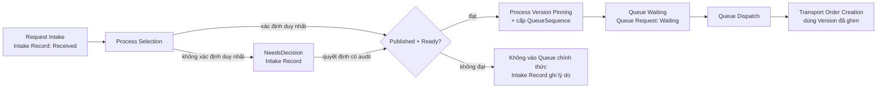

# AGV Phase 2 – Chi tiết quy trình (PH2-01 … PH2-06)

> **IO MAP HIỆN HÀNH (2026-11-26, CR-045).** Dự án chỉ dùng một IO Map: [AGV_PLC Interface_List_22_11_2026.xlsx](../../02_Interface_Specification/PLC_IO_Map/AGV_PLC%20Interface_List_22_11_2026.xlsx) (SHA-256 `405586c9…34da3`). Các workbook cũ (IO Map v2, 10/11, 20/11) **đã ngừng sử dụng và đã gỡ khỏi repository**; nội dung dựa trên chúng trong tài liệu này chỉ còn giá trị lịch sử. IO Map 22/11 **chưa** được kỹ sư PLC xác nhận là hợp đồng IO. [Trạng thái từng tín hiệu](../../02_Interface_Specification/PLC_IO_Map/README.md).

| | |
|---|---|
| **Trạng thái** | **DRAFT – chờ chủ dự án duyệt (Revision 1.2).** Không process nào ở đây được coi là *Published/Approved* ở mức vận hành khi chưa có bằng chứng; riêng **baseline nghiệp vụ PH2-04 đã được chấp thuận (D-09)**. |
| **Đối chiếu** | PPTX `ETEK Process AGV Phase 2 12.08.26.pptx` (slide 4–9, đọc trực tiếp XML) · matrix `WCS_BP_Port_PLC_Transaction_Matrix.xlsx` `BP_Port_Matrix` R8–R13 · handoff `AGV_Phase2_Complete_Handoff.md` §01 · `reference-processes.json` PH2-01…06 · quyết định D-01…D-08 |
| **Nhãn** | [QĐ] đã duyệt · [NGUỒN] tài liệu nguồn · [CODE] hành vi code · [ĐX] đề xuất (*NEED USER CONFIRMATION*) · [OPEN OQ-xx] (bảng ở `PHASE2_OPERATIONAL_SPEC.md` §12) |
| **Kết luận** | KEEP / MODIFY / REPLACE / RETIRE / PROTECTED / OPEN |
| **Revision 1** | 2026-11-24 – thêm §11 chọn process động, hành vi theo phiên bản Published, trạng thái gói mặc định (PH2-04 thuộc gói – D-09), ví dụ cơ chế, mô hình Execution Step theo process. Nhãn **[QĐ R1-A…E]** = yêu cầu bổ sung đã duyệt (xem `PHASE2_OPERATIONAL_SPEC.md` §15–§19). Không đổi quyết định D-01…D-08 (riêng PH2-04: xem Revision 1.1). |
| **Revision 1.1** | 2026-11-24 – **D-09**: PH2-04 gỡ REVIEW, chấp thuận làm baseline (viết lại §5; sửa §8, §9, §11.4); **D-10**: ghim Process Version tại Queue intake (§11.2b, §11.2, §11.3); sửa diễn giải slide 4–9 theo cấu trúc connector của PPTX (nút "AGV hết nhiệm vụ" là điểm kết thúc, NG nối ngược = vòng chờ); OQ-31 đóng; OQ-24 thu hẹp; OQ-44/45/46 mới. |
| **Revision 1.2** | 2026-11-24 – **D-11 (Two-Gate):** §11.4 viết lại theo Publication ⟂ Readiness; **D-12:** §11.2/§11.2b – Intake chỉ nhận vào Queue chính thức khi **Published + Ready**, Intake Record, `Waiting/Held`; **D-13:** strict FIFO theo Queue Ordering Scope (§11.3). PH2-04 giữ nguyên D-09 (Published khi qua Publication Gate dù chưa Ready; không mở khóa BP-04 Phase 1). OQ-44, OQ-01 đóng; OQ-49…58 mới. |

## 0. Cách đọc

- "Điều kiện" trong sơ đồ PPTX (ví dụ "B1,B2 có vị trí trống?") được đọc **nguyên văn**; cách xác định "có vị trí trống / có rack" trong WCS là: tồn kho WCS + Reservation + capacity (D-06), **không** lấy từ tín hiệu PLC (workbook 20/11 không có tín hiệu trạng thái trạm hay hiện diện Rack – xem `PHASE2_STATION_IO_MAPPING.md`).
- "Handshake PLC" chỉ áp dụng cho trạm **PLC-managed**; P1–P4, M5–M6 là **WCS-managed**: xác nhận thủ công có audit hoặc bằng chứng tự động khi có (D-05, D-07).
- Khi nguồn không đủ → **OPEN**; không tự suy ra luồng X1–X4, E/G, Y/Z, P3/P4, M6.
- PPTX slide 4–7 ghi "Model A (Phase 1)" – nghĩa theo slide 2 là mô hình A↔B đã có ở Phase 1; Phase 2 **thêm** P1–P4/M5/M6 ("Thêm mới"). (Câu hỏi phiên bản PPTX: OQ-23.)
- **Nguồn sơ đồ (Revision 1.1):** slide 4–9 là shape + connector của PowerPoint (không có hình ảnh nhúng). Đã đọc **cấu trúc XML** (vị trí, loại hình, `stCxn/endCxn` của từng connector) để xác định mũi tên; **chưa render hình ảnh** (không có trình render PPTX trong môi trường) – giới hạn ghi ở báo cáo Revision 1.1.

## 1. Quy ước chung của các process Phase 2

| Mục | Quy ước | Nhãn |
|---|---|---|
| Transport Job | Một Job cho mỗi yêu cầu; các process PH2-0x trong nguồn đều là **một Leg** (một Rack, một Pick, một Drop) | [QĐ D-01], [NGUỒN] |
| RCS Mission | Một Mission cho mỗi Leg | [QĐ D-01] |
| Chọn đích | Theo thứ tự ưu tiên của nguồn; chỉ trong danh sách ứng viên đã khai báo; không có đích → Queue (D-04) | [QĐ D-04] |
| Chọn Rack từ Buffer | Origin phù hợp ưu tiên; trong nhóm phù hợp: FIFO; không có Rack đúng Origin → **không** chọn Rack khác Origin, giữ yêu cầu chờ | [QĐ D-02] |
| Reservation | Rack nguồn khóa (duy nhất theo Rack) và slot đích giữ chỗ; thời điểm giữ chỗ đích (trước/ sau Pick) | [HOẠT ĐỘNG]; thời điểm: [OPEN OQ-18] |
| Xác nhận Pick/Drop | RCS-Completed không đủ; cần bằng chứng bàn giao (PLC chu trình + presence/identity hoặc PDA có audit) | [QĐ D-05] |
| Inventory | Rack → InTransit khi Pick được xác nhận; `Current Location` = đích khi Drop được xác nhận; **không** đổi khi mới dispatch | [QĐ D-06] |
| Hoàn tất | Leg hoàn tất khi Drop được xác nhận; Job hoàn tất khi mọi Leg cần thiết hoàn tất (D-05) | [QĐ] |
| Station Transaction | Mở tại trạm PLC-managed (nguồn/đích); đóng khi bàn giao xong và AMR rời; không hoàn tất Job | [HOẠT ĐỘNG] ADR-0008 |

---

## 2. PH2-01 – A1/A2 có Full Rack (slide 4; matrix R8)

### 2.1 Bằng chứng nguồn

| Nguồn | Nội dung |
|---|---|
| PPTX slide 4 | "PLC gửi tín hiệu A1 hoặc A2 gắp đầy" → "AGV tới vị trí lấy rack và ra vị trí buffer" → "B1, B2 có vị trí trống?" → OK: "AGV thả hàng vào vị trí trống ở B1, B2"; NG → "P1, P2 có vị trí trống?" → OK: thả ở P1, P2; NG → "M5 có vị trí trống?" → OK: thả ở M5. **Cấu trúc connector:** NG của "M5…?" nối ngược về "B1, B2 có vị trí trống?" (connector 85) = **vòng chờ/kiểm tra lại**; nút "AGV hết nhiệm vụ và về điểm chờ" là **điểm kết thúc** sau mỗi nhánh thả thành công (connector 35/37/39) |
| Matrix R8 | Cổng phát: A1 hoặc A2; Rack đầy; ưu tiên 1 = B1/B2 trống, 2 = P1/P2 trống, 3 = M5 trống; "P1/P2 là buffer hàng; M5 là QC manual"; PLC nguồn PLC1; PLC đích "PLC2 nếu B1/B2; P1/P2 và M5 chưa rõ"; hoàn tất: "Rack đến đích được chọn"; ghi chú "Ưu tiên B1/B2 → P1/P2 → M5" |
| Handoff §2 | Giống slide; "chưa đặc tả thuật toán reserve, xử lý đồng thời, xác nhận vật lý và tình huống tất cả đích đều đầy" |
| `reference-processes.json` PH2-01 | Pickup, nguồn = Request, đích Candidates `AfterPick`: B1,B2 (ưu tiên 1) → P1,P2 (2) → M5 (3); `WaitBehavior=Wait`; **không** `noBind` |

### 2.2 Đặc tả theo 14 mục

| # | Mục | Nội dung | Nhãn |
|---|---|---|---|
| 1 | Trigger | PLC tại A1 hoặc A2 báo có Full Rack cần lấy (20/11: `PLC_MissionRequest` = 1 "Pick" – ánh xạ "gắp đầy" ↔ Pick là suy luận, PQ-17) | [NGUỒN], mapping [OPEN OQ-03/05] |
| 2 | Điều kiện đầu vào | Trạm A1/A2 có yêu cầu hợp lệ; tồn kho WCS có Full Rack tại trạm đó; Job chưa trùng (chống duplicate – OQ-05); PLC online; không Maintenance | [HOẠT ĐỘNG]/[CODE] `PlcRequestService.cs:34-137` |
| 3 | Rack Full/Empty | **Full** | [NGUỒN] |
| 4 | Origin | Rack lấy tại A1/A2 có Origin nghiệp vụ riêng (trạm/luồng nguồn gốc); **Origin phải được lưu và giữ qua các Leg** (không thay bằng Current Location). Cách gán Origin lúc Rack xuất hiện tại A1/A2: [OPEN OQ-16] | [QĐ D-02] + [OPEN] |
| 5 | Nguồn Rack | Chính trạm yêu cầu (A1 hoặc A2) | [NGUỒN] |
| 6 | Thứ tự chọn nguồn | Không áp dụng (nguồn cố định theo yêu cầu) | — |
| 7 | Thứ tự chọn đích | Nhóm 1: B1/B2 → nhóm 2: P1/P2 → nhóm 3: M5. Trong cùng nhóm: thứ tự B1 trước B2, P1 trước P2 **chỉ là thứ tự tài liệu** [OPEN OQ-26]. Điều kiện mỗi ứng viên: `Enabled`, chấp nhận Full Rack, còn slot (`capacity − occupied − reserved > 0`), không đối soát, trạm (nếu có PLC) sẵn sàng/online | [NGUỒN] + [CODE] `RouteConditionEvaluator.cs:96-100` |
| 8 | Pick | Tại A1/A2 (PLC-managed): chu trình 6 bước 20/11 (PLC yêu cầu → phản hồi → AMR tới cửa → PLC cho phép thao tác – permission, không phải bằng chứng cửa/kẹp đã mở (OQ-48) → AMR lấy và ra → PLC xác nhận). Bàn giao vật lý được **WCS** xác nhận (D-05) | [NGUỒN] 20/11 *pending*; [QĐ D-05] |
| 9 | Drop | Tại B1/B2 (PLC-managed): handshake Drop – **cách khởi tạo khi B1/B2 không phát yêu cầu: [OPEN OQ-27]**; tại P1/P2 hoặc M5 (WCS-managed): **không** handshake PLC; xác nhận thủ công có audit (PDA/operator) hoặc bằng chứng tự động khi có | [QĐ D-07]; [OPEN OQ-12/21/27] |
| 10 | Handshake / xác nhận thủ công | Nguồn A1/A2: PLC. Đích B1/B2: PLC. Đích P1/P2, M5: WCS thủ công. Không tự gán handshake cho P/M | [QĐ D-07] |
| 11 | Inventory | Pick confirmed: Rack `Full → InTransit`, `Current Location = null`, Reservation nguồn Consumed. Drop confirmed: `Current Location = đích`, status Full, Reservation đích Consumed, occupancy đích +1 (P1/P2/M5: Buffer occupancy). **Origin không đổi**. Mọi bước có `InventoryTransaction` | [QĐ D-06] + [CODE] `RouteEngine.cs:585,632-640` |
| 12 | Queue / wait | Không có đích nào dùng được → yêu cầu **ở lại Queue**, chờ đến khi có đích; không hủy/báo lỗi nghiệp vụ/đổi đích ngoài danh sách (D-04). **Slide 4 khớp D-04:** NG cuối nối ngược về kiểm tra B1/B2 (vòng chờ); "AGV hết nhiệm vụ…" là kết thúc sau thả thành công (đã sửa diễn giải sai ở Revision 1). Rack nằm ở A1/A2 hay trên AMR trong khi chờ: [OPEN OQ-18/14] | [QĐ D-04] |
| 13 | Hoàn tất | Drop tại đích đã chọn được xác nhận (D-05) + tồn kho cập nhật thành công + lịch sử ghi → Leg Completed → Job Completed. Station Transaction đóng sau khi AMR rời trạm | [QĐ D-05] |
| 14 | Lỗi / reconciliation | PLC báo Full Rack nhưng tồn kho không có → `RECON_PLC_INVENTORY_MISMATCH`, Location bị khóa, không dispatch; RCS Completed nhưng chưa có Drop confirmed → chờ (không tiến); `PLC_MissionCompleted` thất bại / `Mission_Feedback` lỗi → hành vi [OPEN]; rack không ở vị trí WCS → đối soát, không chọn vị trí khác | [CODE] `PlcRequestService.cs:90-115`, `RouteEngine.cs:248-254,398-402` |

### 2.3 Đối chiếu code và kết luận

| Nội dung | Baseline | Tài liệu hiện tại | Code hiện tại | Kết luận |
|---|---|---|---|---|
| Thứ tự đích B→P→M5 | Có | Matrix R8, JSON PH2-01 | JSON khớp (`candidates` 1/1/2/2/3) | **KEEP** (dữ liệu) |
| Origin của Rack | D-02 | Handoff 03-2 | Không có trường Origin | **MODIFY** (thêm dữ liệu) |
| Đích P1/P2/M5 | Location WCS-managed | JSON ghi "not locations of the Phase 1 baseline" | Chưa là Location; validator `LOCATION_NOT_FOUND` (`ProcessValidator.cs:54`) | **MODIFY** (khai báo Location – dữ liệu) |
| `noBind` | Chưa xác nhận | Matrix R2 (BP-01) có "B1/B2 drop không bind" | PH2-01 không `noBind` | **OPEN OQ-22** |
| Resolution `AfterPick` | Chưa chốt | Slide 4: "tới vị trí lấy rack và ra vị trí buffer" | JSON dùng `AfterPick` | **OPEN OQ-18** |
| Khi không có đích | Queue (D-04) | Slide 4: về điểm chờ | `Wait` → `HoldWithRack` (`RouteEngine.cs:341-348`) | **MODIFY** (Queue bền, điều kiện đánh thức) |
| Cùng trigger với BP-01 | — | Matrix R2 (BP-01 A1/A2 Full) | Hai process Published cùng trigger → `PROCESS_AMBIGUOUS` (`RouteEngine.cs:99-102`) | **OPEN OQ-28** |

---

## 3. PH2-02 – A1/A2 cần Empty Rack (slide 5; matrix R9)

### 3.1 Bằng chứng nguồn

| Nguồn | Nội dung |
|---|---|
| PPTX slide 5 | "PLC gửi tín hiệu A1, A2 trống" ("A1 và A2 có vị trí cần cấp rack trống") → "B1, B2 có rack trống?" → OK: "AGV lấy rack trống tại B1, B2"; NG → "P1, P2 có rack trống?" → OK: "AGV lấy rack trống tại P1, P2". **Cấu trúc connector:** các nhánh lấy thành công dẫn tới "AGV hết nhiệm vụ và về điểm chờ" (điểm kết thúc, connector 45); NG của nhánh P có connector có đầu/cuối cùng gắn vào quyết định B (connector 39) = vòng quay về kiểm tra lại (**đọc từ XML, độ chắc chắn trung bình**) |
| Matrix R9 | Cổng phát A1/A2; Rack rỗng; lấy tại "B1/B2; nếu không xét P1/P2"; hoàn tất: Rack được giao vào A1/A2; ghi chú: "Không đồng nhất P1/P2 với F3/F4" |
| Handoff §3 | Giống; "không định nghĩa cơ chế chọn giữa nhiều Rack cùng thỏa điều kiện hoặc reserve chống cấp trùng" |
| JSON PH2-02 | Delivery; nguồn Candidates B1,B2 (1) → P1,P2 (2); đích = Request (A1/A2); `BeforePick`; `WaitBehavior=Wait` |

### 3.2 Đặc tả

| # | Mục | Nội dung | Nhãn |
|---|---|---|---|
| 1 | Trigger | PLC tại A1/A2 báo cần Empty Rack (20/11: `PLC_MissionRequest` = 2 "Drop/Cấp Rack" – ánh xạ là suy luận, PQ-17) | [NGUỒN] [OPEN OQ-03/05] |
| 2 | Điều kiện đầu vào | Yêu cầu hợp lệ, không trùng; vị trí cần cấp tại A1/A2 còn trống theo WCS (slot); PLC online | [CODE]/[HOẠT ĐỘNG] |
| 3 | Rack | **Empty** | [NGUỒN] |
| 4 | Origin | Khi nguồn là **Buffer P1/P2**: ưu tiên Rack có Origin phù hợp với trạm yêu cầu (A1/A2) rồi FIFO; không có → **không** chọn Rack khác Origin, chờ (D-02). Khi nguồn là **B1/B2** (trạm PLC-managed, không phải Buffer): D-02 chỉ nói "từ Buffer" → có áp Origin cho Rack tại B1/B2 hay không: **[OPEN OQ-16]** | [QĐ D-02] + [OPEN] |
| 5 | Nguồn Rack | B1/B2 (nhóm 1) rồi P1/P2 (nhóm 2) | [NGUỒN] |
| 6 | Thứ tự chọn nguồn | B1 → B2 → P1 → P2 theo thứ tự tài liệu [OPEN OQ-26]; mỗi nguồn cần có Rack Empty **chưa đặt chỗ** (Origin phù hợp nếu là Buffer) | [NGUỒN] + [QĐ D-02] |
| 7 | Thứ tự chọn đích | Đích cố định = trạm yêu cầu (A1/A2) | [NGUỒN] |
| 8 | Pick | Tại B1/B2 (PLC-managed): handshake Pick; khởi tạo khi B1/B2 không phát yêu cầu: [OPEN OQ-27]. Tại P1/P2 (WCS-managed): xác nhận thủ công/PDA hoặc bằng chứng tự động (D-05) | [QĐ D-07] |
| 9 | Drop | Tại A1/A2 (PLC-managed): chu trình PLC mà chính trạm đã yêu cầu | [NGUỒN] |
| 10 | Handshake / thủ công | A1/A2: PLC; B1/B2: PLC; P1/P2: WCS thủ công | [QĐ D-07] |
| 11 | Inventory | Pick: Rack `Empty → InTransit`, rời nguồn (P: occupancy −1); Drop: `Current Location = A1/A2`, Empty; Origin giữ nguyên | [QĐ D-06] |
| 12 | Queue / wait | **Thiếu nguồn** (không có Rack rỗng, hoặc chỉ có Rack khác Origin ở Buffer): D-02 → giữ yêu cầu **chờ**; slide 5 thể hiện vòng kiểm tra lại (không có nút báo lỗi) và `WaitBehavior` của JSON = Wait → **nhất quán**, không còn xung đột (Revision 1 hiểu sai nút "AGV hết nhiệm vụ"). Điều kiện đánh thức: file 5 §7 | [QĐ D-02] + [QĐ D-04 tương tự] |
| 13 | Hoàn tất | Drop tại A1/A2 được xác nhận (presence/identity theo OQ-12), tồn kho cập nhật, lịch sử ghi → Leg/Job Completed | [QĐ D-05] |
| 14 | Lỗi / reconciliation | Rack không còn ở nguồn khi Pick → đối soát; Rack sai Origin/Rack mismatch → không tự chọn Rack khác; Reservation nguồn giữ cho đến đối soát | [CODE]/[HOẠT ĐỘNG] |

### 3.3 Đối chiếu và kết luận

| Nội dung | Baseline | Tài liệu hiện tại | Code hiện tại | Kết luận |
|---|---|---|---|---|
| Thứ tự nguồn B→P | Có | Matrix R9, JSON | JSON khớp | **KEEP** |
| Chọn Rack từ Buffer | Origin + FIFO | Handoff 03-2 | `FindUnreservedAsync`: rack cũ nhất theo `LastConfirmedAt` (`Repositories.cs:59-62`), không Origin | **REPLACE** logic chọn Rack |
| Thiếu nguồn | Chưa chốt | Slide 5: kết thúc; D-02: chờ | `WaitBehavior=Wait` | **OPEN OQ-17** |
| Pick tại B1/B2 không có yêu cầu của B | — | — | Chỉ có ánh xạ request từ PLC | **OPEN OQ-27** |

---

## 4. PH2-03 – B1/B2 có Empty Rack (slide 6; matrix R10)

### 4.1 Bằng chứng nguồn

| Nguồn | Nội dung |
|---|---|
| PPTX slide 6 | "PLC thông báo B1, B2 có rack trống" → "AGV tới vị trí lấy rack và ra vị trí chờ trung gian" → "A1, A2 có vị trí trống?" → OK: "AGV thả hàng vào vị trí trống ở A1, A2"; NG → "P1, P2 có vị trí trống?" → OK: "AGV thả hàng vào vị trí trống ở **P1**" (slide chỉ ghi P1). **Cấu trúc connector:** NG của quyết định P nối ngược về quyết định A (connector 26) = vòng chờ; "AGV hết nhiệm vụ…" là điểm kết thúc sau thả thành công |
| Matrix R10 | Cổng B1/B2; Rack rỗng; ưu tiên 1 = A1/A2 trống, 2 = "P1/P2 theo process"; "Có vị trí chờ trung gian trong luồng"; ghi chú: "Vị trí chờ trung gian không đồng nghĩa buffer lưu rack" |
| Handoff §4 | A1/A2, rồi P1/P2 |
| JSON PH2-03 | Pickup; nguồn Request (B1/B2); đích A1,A2 (1) → P1,P2 (2); `AfterPick`; `Wait` |

### 4.2 Đặc tả

| # | Mục | Nội dung | Nhãn |
|---|---|---|---|
| 1 | Trigger | PLC tại B1/B2 báo có Empty Rack (`PLC_MissionRequest` = 1 "Pick": suy luận) | [NGUỒN] [OPEN OQ-03/05] |
| 2 | Điều kiện đầu vào | Tồn kho WCS có Empty Rack tại B1/B2; yêu cầu không trùng | [CODE] |
| 3 | Rack | **Empty** | [NGUỒN] |
| 4 | Origin | Rack tại B1/B2 là Rack đã được xử lý tại QC; Origin nghiệp vụ của nó (không phải B1/B2 nếu Rack xuất phát từ A) phải được **giữ**, không suy từ Current Location (B1/B2). Cách gán/giữ: [OPEN OQ-16] | [QĐ D-02] + [OPEN] |
| 5 | Nguồn | B1/B2 (trạm yêu cầu) | [NGUỒN] |
| 6 | Thứ tự nguồn | Không áp dụng | — |
| 7 | Thứ tự đích | A1/A2 (nhóm 1) → P1/P2 (nhóm 2). Slide 6 chỉ ghi "P1"; matrix/handoff ghi P1/P2 → [OPEN OQ-24]. Có thể ưu tiên theo Origin hay không khi chọn *đích*: D-02 chưa nêu (chỉ nêu khi chọn Rack) | [NGUỒN] [OPEN] |
| 8 | Pick | Tại B1/B2: handshake PLC (chu trình 6 bước) | [NGUỒN] pending |
| 9 | Drop | Tại A1/A2: handshake PLC (khởi tạo khi A1/A2 không yêu cầu: OQ-27); tại P1/P2: WCS thủ công | [QĐ D-07] |
| 10 | Handshake/thủ công | B1/B2, A1/A2: PLC; P1/P2: WCS thủ công | [QĐ D-07] |
| 11 | Inventory | Pick: Empty → InTransit; Drop: Current Location = đích (A1/A2 hoặc P1/P2), Empty; Origin giữ nguyên; Buffer occupancy +1 nếu P | [QĐ D-06] |
| 12 | Queue/wait | Không có đích → Queue (D-04). Slide: "ra vị trí chờ trung gian" sau Pick — vị trí chờ chưa khai báo; ai điều AMR tới đó: [OPEN OQ-14]; Rack trên AMR hay còn ở B1/B2 khi chờ: [OPEN OQ-18] | [QĐ D-04] + [OPEN] |
| 13 | Hoàn tất | Drop tại đích được xác nhận, tồn kho cập nhật → Leg/Job Completed | [QĐ D-05] |
| 14 | Lỗi/reconciliation | Như PH2-01 | [CODE] |

### 4.3 Đối chiếu và kết luận

| Nội dung | Baseline | Tài liệu hiện tại | Code hiện tại | Kết luận |
|---|---|---|---|---|
| Thứ tự đích A→P | Có | Matrix R10, JSON PH2-03 | Khớp | **KEEP** |
| Vị trí chờ trung gian | Có trong slide | Matrix: "không đồng nghĩa buffer" | `WaitingPositionCode` chỉ mô tả; AMR không được điều tới (`RouteEngine.cs:341-348`) | **OPEN OQ-14** |
| Slide 6 chỉ ghi P1 (đích) | — | Matrix/JSON: P1,P2 | JSON P1,P2 | **OPEN OQ-24** (thu hẹp: chỉ slide 6; nhãn slide 7 đã xử lý ở §5.3) |

---

## 5. PH2-04 – B1/B2 cần Full Rack (slide 7; matrix R11) – **Baseline nghiệp vụ ĐÃ CHẤP THUẬN (D-09)**

> **Quyết định chính thức D-09 (chủ dự án):** gỡ REVIEW và **chấp thuận toàn bộ quy trình PH2-04 làm baseline triển khai Phase 2**. Không đặt lại câu hỏi PH2-04 có được phép triển khai hay không; không dùng việc BP-04 (Phase 1) từng ở REVIEW làm lý do chặn PH2-04. Các mâu thuẫn trong slide/matrix/JSON/tài liệu Revision 1 được phân loại là **lỗi tài liệu/diễn giải cần hiệu chỉnh theo baseline đã chấp thuận** (§5.3), không phải lý do đảo ngược quyết định.

**Baseline được chấp thuận (nguyên văn quyết định):**
1. PLC tại B1/B2 phát sinh yêu cầu cần **Full Rack**.
2. WCS kiểm tra nguồn **A1/A2 trước**.
3. A1/A2 có Full Rack phù hợp → **ưu tiên lấy từ A1/A2**.
4. A1/A2 không có Full Rack phù hợp → kiểm tra nguồn thay thế **P1/P2**.
5. P1/P2 có Full Rack phù hợp → lấy từ P1/P2.
6. Không có nguồn Rack phù hợp → xử lý theo **nhánh chờ/vị trí chờ** của quy trình; **không** tự chọn Rack không phù hợp hoặc nguồn chưa được phê duyệt.

### 5.1 Bằng chứng nguồn (đã đối chiếu cấu trúc sơ đồ)

| Nguồn | Nội dung |
|---|---|
| PPTX slide 7 – **text** | "PLC thông báo B1, B2 cần rack đầy" → "AGV tới vị trí lấy rack và ra vị trí chờ trung gian" → "A1, A2 có vị trí rack đầy không?" → OK: "AGV lấy rack đầy từ A1, A2"; NG → "P1, P2 có vị trí trống?" → OK: "AGV lấy rack đầy từ P1, P2"; "AGV hết nhiệm vụ và về điểm chờ" |
| PPTX slide 7 – **cấu trúc XML (hình/connector)** | Quyết định A (id 26) → OK → hành động lấy từ A1/A2 (id 36); A **NG** (connector 44) → quyết định P (id 37); P → OK → lấy từ P1/P2 (id 38). **P NG: connector 47 (`bentConnector3`, 37 → 26) nối ngược về quyết định A** = **vòng lặp chờ/kiểm tra lại** (không có nút "báo lỗi"). Nút "AGV hết nhiệm vụ và về điểm chờ" (id 51) là **điểm kết thúc** sau nhánh lấy thành công (connector 52 từ id 36), **không** phải kết quả của nhánh NG. Bước "tới vị trí lấy rack và ra vị trí chờ trung gian" (id 33) nằm **trước** quyết định A |
| Hình layout trên slide 7 | Minh họa ví dụ trạng thái: A1, A2 "Có rack"; B1 "Trống rack", B2 "Có rack"; P1 "Có rack", P2 "Trống rack" (nhãn trong hình); **không** thể hiện việc thả vào B1/B2 |
| Matrix R11 | Cổng phát B1 hoặc B2; Rack đầy; lấy tại "A1/A2; nếu không xét P1/P2"; PLC nguồn "PLC1 nếu lấy A1/A2; P1/P2 chưa rõ"; hoàn tất: "Rack đầy được giao tại B1/B2"; ghi chú "P1/P2 là nguồn thay thế theo process" |
| Handoff §5 | B1/B2 yêu cầu Full Rack; kiểm tra Full Rack tại A1/A2; nếu không có/không phù hợp xét P1/P2; Rack được lấy và chuyển đến B1/B2 |
| `reference-processes.json` PH2-04 | Delivery; nguồn A1,A2 (ưu tiên 1) → P1,P2 (ưu tiên 2); đích = Request (B1/B2); `BeforePick`; `WaitBehavior=Wait`; **`reviewBlocked=true`** (+ lý do "Same scenario as BP-04 (REVIEW); not approved for implementation") – **cần gỡ bằng CR** (§5.4) |

### 5.2 Đặc tả theo 14 mục

| # | Mục | Nội dung | Nhãn |
|---|---|---|---|
| 1 | Trigger | PLC tại B1 hoặc B2 báo cần Full Rack (20/11: `PLC_MissionRequest` = 2 "Drop/Cấp Rack" – ánh xạ là suy luận, PQ-17) | [QĐ D-09] [NGUỒN] [OPEN OQ-03/05] |
| 2 | Điều kiện đầu vào | Yêu cầu hợp lệ, không trùng; process PH2-04 **Published và đủ điều kiện nhận yêu cầu** (§11.4); vị trí nhận tại B1/B2 còn trống theo WCS; PLC online | [HOẠT ĐỘNG]/[CODE] |
| 3 | Rack Full/Empty | **Full** – **không bao giờ chọn Empty Rack** cho yêu cầu này | [QĐ D-09] |
| 4 | Origin | Khi nguồn là **Buffer P1/P2**: ưu tiên Rack có Origin phù hợp với trạm yêu cầu (B1/B2) rồi FIFO; **không** chọn Rack khác Origin (D-02). Origin có áp cho Rack ở A1/A2 hay không và quan hệ "phù hợp" (B1/B2 ↔ Origin nào): **[OPEN OQ-16]** | [QĐ D-02] + [OPEN] |
| 5 | Nguồn Rack | **A1/A2 trước, rồi P1/P2** (nhóm ưu tiên 1 → 2) | [QĐ D-09] |
| 6 | Thứ tự chọn nguồn | Nhóm 1: A1/A2 (chỉ Full Rack phù hợp, chưa đặt chỗ, Location bật, không đối soát); nhóm 2: P1/P2 (Origin phù hợp + FIFO). Thứ tự A1 vs A2, P1 vs P2: [OPEN OQ-26]. **Không** chuyển sang nguồn ngoài A1/A2/P1/P2 | [QĐ D-09] + [OPEN] |
| 7 | Thứ tự chọn đích | Đích cố định = trạm yêu cầu (B1/B2) | [NGUỒN] |
| 8 | Pick | Tại A1/A2 (PLC-managed): chu trình PLC (cách khởi tạo khi A1/A2 không phát yêu cầu: [OPEN OQ-27]); tại P1/P2 (WCS-managed): xác nhận thủ công/PDA hoặc bằng chứng tự động (D-05), **không** handshake PLC | [QĐ D-07] |
| 9 | Drop | Tại B1/B2 (PLC-managed): chu trình PLC mà chính trạm đã yêu cầu | [NGUỒN] |
| 10 | Handshake / thủ công | A1/A2, B1/B2: PLC; P1/P2: WCS thủ công | [QĐ D-07] |
| 11 | Inventory | Reserve Rack nguồn; Pick xác nhận: Full → InTransit, `Current Location = null`; Drop xác nhận: `Current Location = B1/B2`, Full; Origin giữ nguyên; Buffer occupancy P −1 (nếu lấy từ P) | [QĐ D-06] |
| 12 | Queue / wait / vị trí chờ | **Không có nguồn Rack phù hợp** (A1/A2 và P1/P2 đều không): yêu cầu **ở lại Queue/chờ theo nhánh chờ** của quy trình, **lặp lại việc kiểm tra A1/A2 → P1/P2** (đúng vòng lặp trên slide 7); **không** tự chọn Rack không phù hợp (kể cả Empty Rack hoặc Rack sai Origin) hay nguồn chưa được phê duyệt; không hủy/báo lỗi nghiệp vụ. Vị trí chờ trung gian (slide 7 id 33): mã vị trí và ai điều AMR: **[OPEN OQ-14]**; Rack ở nguồn hay trên AMR khi chờ: **[OPEN OQ-18]** | [QĐ D-09, D-02, D-04] + [OPEN] |
| 13 | Hoàn tất | Drop tại B1/B2 được xác nhận (D-05) + tồn kho cập nhật + lịch sử → Leg/Job Completed; Station Transaction đóng sau khi AMR rời | [QĐ D-05] |
| 14 | Lỗi / reconciliation | PLC/tồn kho lệch tại A1/A2; Rack không còn ở nguồn khi Pick; nhầm Rack/Buffer (OQ-21) → `ReconciliationRequired`, không chọn nguồn khác; tranh chấp cùng một Rack với PH2-01 (A1/A2 vừa là nguồn của PH2-04 vừa là nơi PH2-01 lấy Rack đi) → giải bằng Reservation Rack duy nhất (D-06) và thứ tự Queue (OQ-01) | [CODE]/[HOẠT ĐỘNG] |

### 5.3 Phân loại mâu thuẫn của nguồn – hiệu chỉnh theo baseline D-09

| # | Mâu thuẫn trong nguồn/Revision 1 | Phân loại | Hiệu chỉnh |
|---|---|---|---|
| 1 | **Nhãn slide 7** nhánh P1/P2: "P1, P2 có vị trí trống?" trong khi hành động kế tiếp là "AGV lấy **rack đầy** từ P1, P2" | **Lỗi nhãn/diễn giải của nguồn** | Đọc là **"P1/P2 có Full Rack phù hợp?"**. Nhãn "vị trí trống" **không** được hiểu là điều kiện chọn Empty Rack hay slot trống để thả; không đổi mục tiêu Full Rack |
| 2 | Revision 1 (§5, OQ-24, bảng §9) ghi PH2-04 là PROTECTED/REVIEW và "không đặc tả hành vi" | **Lỗi tài liệu (đã lỗi thời theo D-09)** | Thay bằng §5 này; OQ-31 đóng; OQ-24 thu hẹp còn slide 6 |
| 3 | Revision 1 hiểu nút "AGV hết nhiệm vụ và về điểm chờ" là kết quả của nhánh NG | **Diễn giải sai** (đối chiếu connector XML) | Nút này là **điểm kết thúc** sau nhánh thành công; **NG ở P1/P2 nối ngược về kiểm tra A1/A2** (vòng chờ) – khớp bước 6 của quyết định |
| 4 | JSON `reviewBlocked=true`, `reviewReason` "not approved for implementation" | **Dữ liệu tham chiếu lỗi thời** | Phải gỡ bằng CR (§5.4); P0 không sửa JSON |
| 5 | Slide 7 **không vẽ** việc thả Rack vào B1/B2 (sơ đồ dừng ở "lấy rack") | **Khoảng trống của sơ đồ**, không phải nhánh nghiệp vụ bị loại | Hoàn tất theo matrix R11/handoff/D-09: Rack được giao tại B1/B2 |
| 6 | Trình bày "BP-04 REVIEW" (BR-02, CLAUDE §2) | **Tài liệu cần cập nhật** bởi CR | Xem Spec §2 và §13 (CR P1-G); **BP-04 Phase 1** nằm ngoài D-09 (OQ-46) |

### 5.4 Đối chiếu code, dữ liệu, test và kết luận

| Nội dung | Baseline | Hiện tại | Kết luận |
|---|---|---|---|
| Cờ REVIEW của PH2-04 | Gỡ (D-09) | JSON `reviewBlocked=true`; `ImportReferenceAsync` đặt `MarkReview` từ JSON (`ProcessAdminService.cs:126-135`); `ProcessValidator.cs:33` và `RouteEngine.cs:81-90` chặn khi cờ bật | **REPLACE (dữ liệu)**: gỡ `reviewBlocked`/`reviewReason` của PH2-04 trong dữ liệu tham chiếu – **cần CR** (P1-G); cơ chế `ReviewBlocked` chung **KEEP** |
| Test hiện có | PH2-04 không bị chặn vì REVIEW | `Cr010ProcessConfigTests.cs:183-184` khẳng định `PH2-04 ReviewBlocked`; `:186-198` (BP-04) | **MODIFY** dòng PH2-04 bằng CR; test BP-04 Phase 1 không thuộc D-09 |
| Thứ tự nguồn A→P, loại Full, đích = Request, `Wait` | Có | JSON khớp | **KEEP** |
| Chọn Rack tại P theo Origin + FIFO | D-02 | Rack cũ nhất, không Origin (`Repositories.cs:59-62`) | **REPLACE** (P2-A) |
| Vòng chờ (NG → kiểm tra lại) | Có (slide 7) | Order `Waiting` đánh giá lại mỗi tick (`RouteEngine.cs:302-338`) | **MODIFY** (Queue bền, đánh thức) |
| Location P1/P2, ánh xạ IO PLC, trigger conflict | Điều kiện kỹ thuật | Chưa có/chưa duyệt | **OPEN** – Location (bản ghi hợp lệ) và trigger conflict thuộc **Publication Gate**; ánh xạ IO PLC thuộc **Readiness Gate**; không phải căn cứ đảo ngược D-09 (§11.4) |
| Vòng đời | Draft → Pending Approval → Approved → Published | `Draft → Validated → Published → Disabled` | **MODIFY** (P1-E); PH2-04 tham gia vòng đời thường |

**Hai trục (Revision 1.2, Two-Gate):** *Publication* – PH2-04 được phép **Published khi vượt Publication Gate** (tham chiếu Location P1/P2 hợp lệ, không xung đột trigger) dù **chưa Ready**; *Operational Readiness* – cần ánh xạ IO PLC được duyệt, P1/P2 xác minh, commissioning, … và **chưa đạt** → chưa nhận Request (§11.4). Business approval (D-09) **không** bị đảo ngược bởi trạng thái hai trục này; D-09 không mở khóa BP-04 Phase 1.

---
## 6. PH2-05 – Trả Rack rỗng từ M5 (slide 8; matrix R12)

### 6.1 Bằng chứng nguồn

| Nguồn | Nội dung |
|---|---|
| PPTX slide 8 | "Gửi rack trống về khi nhặt xong tại M5": "Công nhân lấy hàng trên rack" → "Công nhân ấn PDA để gọi AGV mang rack về" → "AGV tới lấy rack tại M5" → "A1, A2 có vị trí trống?" OK: "AGV mang rack vào A1, A2"; NG → "P1,P2 có vị trí trống?" OK: "AGV mang rack vào P1, P2"; NG → "AGV mang rack và chờ tại vị trí trung gian"; cuối: "Hết nhiệm vụ và về điểm chờ". Nhãn: "M5 – Buffer manual" |
| Matrix R12 | Request: Manual/PDA tại M5; Rack rỗng; vị trí lấy M5; ưu tiên A1/A2 trống, P1/P2 trống; "Nếu chưa có đích, AMR mang rack chờ ở vị trí trung gian"; PLC nguồn "chưa xác định"; hoàn tất: "Rack được giao tại đích; **nếu chờ thì task chưa xong**" |
| Handoff §6 | "M5 là điểm thủ công, không có PLC IO ... cần định nghĩa cách WCS nhận xác nhận worker đã yêu cầu và Rack thực sự đã được lấy/đặt" |
| JSON PH2-05 | `ManualRequest`, trigger `M5`; Pickup, nguồn Request, đích A1,A2 (1) → P1,P2 (2), `AfterPick`, `Wait` |

### 6.2 Đặc tả

| # | Mục | Nội dung | Nhãn |
|---|---|---|---|
| 1 | Trigger | Operator bấm PDA tại M5 sau khi lấy hết hàng (yêu cầu **thủ công**, không PLC) | [NGUỒN] slide 8; [QĐ D-07] |
| 2 | Điều kiện đầu vào | WCS ghi nhận yêu cầu thủ công (người thao tác, thời gian); tồn kho WCS có Rack tại M5 (đã được xác nhận Drop trước đó); Rack ở trạng thái "đã lấy hết hàng" → **Empty** do ai xác nhận: [OPEN OQ-21/12] | [NGUỒN] + [OPEN] |
| 3 | Rack | **Empty** (sau khi công nhân lấy hàng) | [NGUỒN] |
| 4 | Origin | Rack đến M5 mang Origin của luồng gốc (M5 là "QC thủ công cho A1, A2" – slide 2); Origin được **giữ**. Khi chọn đích: D-02 chưa nêu quy tắc theo Origin | [QĐ D-02] + [OPEN OQ-16] |
| 5 | Nguồn | M5 | [NGUỒN] |
| 6 | Thứ tự nguồn | Không áp dụng | — |
| 7 | Thứ tự đích | A1/A2 trống → P1/P2 trống → (không có) chờ | [NGUỒN] |
| 8 | Pick | Tại M5 (WCS-managed): **không PLC**; bàn giao vật lý được xác nhận thủ công/PDA có audit hoặc bằng chứng tự động nếu có (OQ-12) | [QĐ D-05/D-07] |
| 9 | Drop | Tại A1/A2 (PLC-managed): handshake (OQ-27); tại P1/P2: WCS thủ công | [QĐ D-07] |
| 10 | Handshake/thủ công | M5, P1/P2: WCS; A1/A2: PLC | [QĐ D-07] |
| 11 | Inventory | Pick tại M5: Empty → InTransit, M5 occupancy −1; Drop: Current Location = đích; Origin giữ | [QĐ D-06] |
| 12 | Queue/wait | Không có đích: slide cho "AGV mang rack và chờ tại vị trí trung gian" (Rack trên AMR) — tương thích D-04 (không hủy/lỗi) nhưng cơ chế (Queue vs AMR giữ Rack) **[OPEN OQ-18/14]**. Matrix: Job **chưa hoàn tất** khi còn chờ | [QĐ D-04] + [OPEN] |
| 13 | Hoàn tất | Drop tại đích được xác nhận (A1/A2 theo PLC+presence/identity; P1/P2 thủ công có audit) | [QĐ D-05] |
| 14 | Lỗi/reconciliation | Operator xác nhận nhầm Rack/Buffer: quy trình sửa sai + audit: [OPEN OQ-21]; Rack không còn tại M5 khi Pick → đối soát | [OPEN]/[CODE] |

### 6.3 Đối chiếu và kết luận

| Nội dung | Baseline | Tài liệu hiện tại | Code hiện tại | Kết luận |
|---|---|---|---|---|
| Yêu cầu thủ công | Có (PDA) | Matrix R12, `RequestType.ManualRequest` | `POST orders` (Admin API) (`RoutingEndpoints.cs:57`); không có PDA | **MODIFY** (CR manual/PDA – P3-C) |
| M5 không có PLC | Có | Handoff 00-§2.2 | Location không Port ⇒ luôn sẵn sàng (`RouteConditionEvaluator.cs:106,115`) | **KEEP** hành vi; **MODIFY** thêm phân loại tường minh |
| Thứ tự đích | Có | JSON khớp | Khớp | **KEEP** |
| Chờ ở vị trí trung gian | Có | Matrix | Không điều AMR | **OPEN OQ-14** |

---

## 7. PH2-06 – Yêu cầu Full Rack tới M5 (slide 9; matrix R13)

### 7.1 Bằng chứng nguồn

| Nguồn | Nội dung |
|---|---|
| PPTX slide 9 | "Công nhân yêu cầu rack đầy tới M5" → "Ấn PDA để gọi AGV mang rack đầy tới" → "AGV tới lấy rack đầy tại P1, P2" → "P1, P2 có rack đầy?" OK: "AGV mang rack tới vị trí M5"; NG: "Thông báo gửi lỗi vì không có rack đầy"; cuối "AGV hết nhiệm vụ và về điểm chờ" |
| Matrix R13 | Manual/PDA tại M5; Rack đầy; nguồn P1/P2; đích M5; "Không có rack đầy tại P1/P2 thì báo lỗi"; PLC "chưa xác định; M5 PLC mapping chưa rõ" |
| Handoff §7 | "Cần bổ sung kiểm tra Rack theo Origin, reserve Rack và xác nhận Drop tại M5" |
| JSON PH2-06 | `ManualRequest`, trigger `M5`; Delivery; nguồn P1,P2; đích = Request; `BeforePick`; **`WaitBehavior=Fail`** |

### 7.2 Đặc tả

| # | Mục | Nội dung | Nhãn |
|---|---|---|---|
| 1 | Trigger | Operator yêu cầu Full Rack tại M5 qua PDA | [NGUỒN] |
| 2 | Điều kiện đầu vào | Yêu cầu thủ công ghi nhận (audit); M5 còn chỗ nhận (capacity M5 chưa biết: OQ-11) | [OPEN OQ-11/21] |
| 3 | Rack | **Full** | [NGUỒN] |
| 4 | Origin | Chọn Full Rack tại P1/P2 theo **Origin phù hợp với M5/luồng M5** rồi FIFO; M5 là "QC thủ công cho A1, A2" (slide 2) nên Origin phù hợp **có thể** là A1/A2 — **không khóa** khi OQ-16 chưa trả lời. **Không có Rack đúng Origin → không chọn Rack khác Origin; chờ** | [QĐ D-02] + [OPEN OQ-16] |
| 5 | Nguồn | P1/P2 (Buffer WCS-managed) | [NGUỒN] |
| 6 | Thứ tự nguồn | P1 → P2 theo thứ tự tài liệu [OPEN OQ-26]; trong mỗi Buffer: Origin phù hợp → FIFO | [QĐ D-02] |
| 7 | Thứ tự đích | M5 cố định | [NGUỒN] |
| 8 | Pick | Tại P1/P2: WCS-managed – xác nhận thủ công/PDA/bằng chứng tự động | [QĐ D-07] |
| 9 | Drop | Tại M5: WCS-managed – xác nhận thủ công | [QĐ D-07] |
| 10 | Handshake/thủ công | Không PLC | [QĐ D-07] |
| 11 | Inventory | Reserve Rack nguồn khi chọn; Pick: Full → InTransit (P occupancy −1); Drop: Current Location = M5 (M5 occupancy +1), Full; Origin giữ | [QĐ D-06] |
| 12 | Queue/wait | Slide 9 / matrix R13 / JSON: *không có Rack đầy → báo lỗi*; D-02: *chỉ có Rack sai Origin → chờ*; D-04 chỉ nêu *đích*. Phân biệt "hoàn toàn không có Full Rack" (nguồn nói lỗi) và "có Full Rack sai Origin" (D-02 chờ): **[OPEN OQ-17]**; không tự chọn | [QĐ D-02] + [OPEN OQ-17] |
| 13 | Hoàn tất | Drop tại M5 được xác nhận thủ công (có audit), tồn kho cập nhật | [QĐ D-05] |
| 14 | Lỗi/reconciliation | Rack không có thật khi Pick; nhầm Rack/Buffer (OQ-21); Reservation giữ đến đối soát | [OPEN]/[CODE] |

### 7.3 Đối chiếu và kết luận

| Nội dung | Baseline | Tài liệu hiện tại | Code hiện tại | Kết luận |
|---|---|---|---|---|
| Không có Rack đầy | Lỗi (slide) vs chờ (D-02) | Matrix R13 "báo lỗi" | `WaitBehavior=Fail` ⇒ Order Failed (`RouteEngine.cs:307-309`) | **OPEN OQ-17**; hiện hành vi `Fail` có thể trái D-02 → **MODIFY** sau khi chốt |
| Chọn Rack theo Origin | D-02 | Handoff §7 | Không Origin | **REPLACE** |
| Drop tại M5 | Thủ công | Handoff 00-§2.2 | Không có luồng xác nhận thủ công riêng (chỉ API Admin) | **MODIFY** |

---

## 8. Phủ nguồn theo nhóm trạm

| Nhóm | Nguồn mô tả luồng? | Kết luận |
|---|---|---|
| A1/A2 ↔ B1/B2 ↔ P1/P2 ↔ M5 | Có (slide 4–9) | PH2-01…06 ở trên |
| A3/A4, D1/D2 | "Giữ nguyên process cũ" (`process-flows.md §2.2`, BR-04) | **PROTECTED** |
| X1–X4 (F-Pis) | Chỉ xuất hiện trên slide 2/3 (nhãn, takt 6.3/12.8 p/rack) – **không có luồng** | **OPEN OQ-09** |
| P3/P4, M6 | Slide 2/3: "Buffer hàng cho X1,X2 (Thêm mới)", "QC thủ công cho X1,X2 (Thêm mới)" – **không có luồng** | **OPEN OQ-09** (không sao chép từ P1/P2/M5) |
| E1/E2, G1/G2 | Slide 3 (takt 7.5/12.8 p/rack); workbook (PLC .131) – **không có luồng** | **OPEN OQ-08** |
| Y1/Y2, Z1/Z2 | Slide 2 (QC của F-Pis) – workbook không có | **OPEN OQ-07** (không đồng nhất với D/E/G) |
| F1–F5 (BP-01…06 Phase 1) | Matrix R2–R7 (Phase 1) | **OPEN OQ-10/28** (quan hệ với Phase 2 chưa xác định); **BP-04 (Phase 1)** nằm ngoài D-09 – OQ-46; PH2-04 **không** bị ràng buộc bởi trạng thái BP-04 |

## 9. Tổng hợp kết luận theo process

| Process | Trạng thái nguồn | Chủ yếu giữ | Chủ yếu sửa/thay | Chủ yếu mở |
|---|---|---|---|---|
| PH2-01 | Đủ (slide 4, R8) | Thứ tự đích B→P→M5 | Origin, Queue bền, Location P/M | OQ-18, 22, 27, 28 |
| PH2-02 | Đủ (slide 5, R9) | Thứ tự nguồn B→P | **Replace** chọn Rack theo Origin+FIFO | OQ-16, 17, 27 |
| PH2-03 | Đủ (slide 6, R10) | Thứ tự đích A→P | Queue, vị trí chờ | OQ-14, 24 |
| PH2-04 | Đủ (slide 7, R11, **D-09**) | Thứ tự nguồn A→P, loại Full, đích = Request | **Replace** chọn Rack tại P theo Origin+FIFO; gỡ `reviewBlocked` (dữ liệu, CR P1-G); vòng chờ → Queue bền | OQ-14, 16, 18, 26, 27, 28 (**không** còn câu hỏi cho phép triển khai) |
| PH2-05 | Đủ (slide 8, R12) | Thứ tự đích A→P | Luồng thủ công/PDA tại M5 | OQ-12, 14, 18, 21 |
| PH2-06 | Đủ (slide 9, R13) | Nguồn P1/P2 → M5 | **Replace** chọn Rack; `Fail`↔D-02 | OQ-16, 17 |

## 10. Open Questions liên quan tài liệu này

OQ-05, OQ-07…OQ-12, OQ-14…OQ-18, OQ-21, OQ-22, OQ-24, OQ-26, OQ-27, OQ-28 – nội dung đầy đủ (vì sao, tác động, phương án, khuyến nghị, bên xác nhận) ở `PHASE2_OPERATIONAL_SPEC.md` §12.

---

## 11. Chọn process động và hành vi theo phiên bản Published [QĐ R1-A]

### 11.1 PH2-01…06 là gói mặc định, không phải tập tối đa

Các process ở §2–§7 là **dữ liệu mặc định** của hệ thống (R1-A). Người dùng có thể **tạo thêm** process (ví dụ A1 → X1) qua vòng đời `Draft → Pending Approval → Approved → Published` (Spec §15.3). Không có quy tắc nào trong code/dữ liệu được phép giới hạn Station nguồn/đích hợp lệ ở các trạm của gói mặc định; ràng buộc duy nhất là **Station hợp lệ** (Spec §15.1: tồn tại, bật, không PROTECTED, đúng phân loại PLC-/WCS-managed).

### 11.2 Quy tắc chọn process cho một yêu cầu mới

| Bước | Quy tắc | Căn cứ/Hiện có |
|---|---|---|
| 1 | Chỉ xét process có **version Published** **và Ready** (Operational Readiness), process `Enabled`, không REVIEW-blocked (cờ là cơ chế chung; PH2-04 không còn cờ – D-09) | [QĐ D-12]; [CODE] `FindPublishedAsync` (`RoutingRepository.cs:29-35`), `SelectProcessAsync` (`RouteEngine.cs:81-104`) – hiện **không** có khái niệm Ready → **MODIFY** |
| 2 | Khớp theo (loại yêu cầu, loại Rack, trạm khởi tạo ∈ trigger) (+ selector bổ sung nếu được duyệt – OQ-34) | [CODE] |
| 3 | Yêu cầu **thủ công/PDA** có thể chỉ định **mã process** tường minh (kiểm tra trạm được phép) | [CODE] `StartAsync` với `ProcessCode` |
| 4 | **Đúng một** process khớp → **kiểm tra Published + Ready** → **ghim Process ID + Version tại intake và cấp `QueueSequence`** (một thao tác nhất quán, §11.2b) → Queue Request `Waiting`; Order được tạo khi dispatch **bằng Version đã ghim** | [QĐ D-10, D-12]; hiện [CODE] ghim lúc tạo Order (`StartAsync`) → **MODIFY** |
| 5 | **Không process nào khớp**, hoặc process **chưa Published / NotReady / Suspended / Disabled** → **không** thành Queue Request; ghi **Intake Record** kèm lý do (ghi nhận/thông báo/nhận lại: OQ-50); **không** tự chọn Version khác | [QĐ D-12]; hiện [CODE] `PROCESS_NOT_FOUND` |
| 6 | **≥ 2 process khớp** → **không thực thi mơ hồ, không tự chọn**; Intake Record **`NeedsDecision`** (giữ bền, cảnh báo operator, không ghim, không Order); sau giải quyết **kiểm tra lại Published + Ready** rồi ghim (OQ-35: quyền giải quyết) | [QĐ D-10, D-12]; hiện `PROCESS_AMBIGUOUS` (`RouteEngine.cs:99-102`) → **MODIFY** |

Phòng ngừa chính là **chặn xung đột trigger ngay khi phê duyệt/kích hoạt** (Spec §15.7); bước 6 chỉ là chốt chặn cuối.

### 11.2b Queue Intake: kiểm tra Published + Ready và ghim Process Version [QĐ D-10, D-12]

**Luồng:** `Request Intake → Process Selection → Check Publication + Readiness → Process Version Pinning → Queue Waiting → Queue Dispatch → Transport Order Creation`.

| # | Quy tắc |
|---|---|
| 1 | **Intake Record** (Received/NeedsDecision/không được tiếp nhận) ≠ **Queue Request chính thức** (bắt đầu từ `Waiting`); Intake Record không đủ điều kiện Dispatch |
| 2 | Chỉ **Published + Ready** mới được ghim và nhận vào Queue chính thức; không tự chọn Version khác; không bỏ qua Readiness |
| 3 | Kiểm tra Published + Ready, ghim `ProcessVersionId` và cấp `QueueSequence` là **một thao tác nhất quán** – không có Queue Request chính thức thiếu `ProcessVersionId` hợp lệ |
| 4 | Mơ hồ → `NeedsDecision`; không chọn latest Version; sau giải quyết kiểm tra lại Published + Ready; ghi audit (quyết định, người, Version) |
| 5 | Request đã ghim không tự đổi Version khi Process Definition được cập nhật; Disabled sau khi ghim: OPEN OQ-45 |

Chi tiết trạng thái Queue Request: `PHASE2_TRANSPORT_JOB_LIFECYCLE.md` §2.5; Held, Scope: `PHASE2_OPERATIONAL_SPEC.md` §22.

### 11.3 Hành vi theo phiên bản Published

| Tình huống | Quy tắc |
|---|---|
| Sửa một process đang Published | Sửa = **version mới (Draft)**; version Published đang dùng **không thay đổi**; không có sửa tại chỗ |
| Order đang chạy khi version mới được Published | Order **tiếp tục dùng đúng snapshot cũ** (kèm content hash); không bao giờ đọc cấu hình sống (`TransportOrder.cs:19-20`, `Snapshot`) |
| Version mới Published | Chỉ ảnh hưởng yêu cầu **tạo Order sau thời điểm kích hoạt**; version cũ → Disabled |
| Yêu cầu đang nằm trong Queue chưa thành Order | **Đã ghim Version tại intake (D-10)**: Order tạo khi dispatch dùng đúng Version đó; Version mới Publish trong lúc chờ **không** áp dụng cho Request cũ; Request `NeedsDecision` chưa ghim, không gán latest |
| Readiness của Process Version chuyển **Suspended** khi Request đang `Waiting` | **Waiting → Held**: giữ `ProcessVersionId` và `QueueSequence`; không hủy; không đổi tồn kho; khi Ready lại → revalidate → `Waiting` ở **vị trí FIFO ban đầu**; **không** tự Dispatch (Spec §22.2) |
| Strict FIFO theo Scope | Request sau **không bypass** Request đầu **trong cùng Scope**; đầu Scope Blocked thì Request sau chờ; Scope độc lập chạy song song; Scope chưa xác định → `SCOPE_UNDETERMINED`, không Dispatch (OQ-54) |
| Disable process | Ngừng nhận Request **mới** (không vào Queue chính thức); Order đang chạy **hoàn tất bình thường**; Request đã ghim đang `Waiting`/`Held`: **OPEN OQ-45** (không đóng); không tự đổi Version đã ghim |
| Rollback | Tạo version mới từ nội dung version cũ rồi đi qua vòng đời (không sửa version cũ) |
| Lịch sử | Mọi chuyển trạng thái/phê duyệt/kích hoạt có bản ghi append-only (Spec §15.5) |

### 11.4 Hai Gate cho gói mặc định PH2-01…06 [QĐ D-11] (thay mô hình L1–L5 của Revision 1.1)

**Hai trục độc lập** (Spec §15.2b): *Publication Status* (Draft, Pending Approval, Approved, Published, Disabled) và *Operational Readiness* (NotReady, Ready, Suspended). **OQ-44/DC-01 đã đóng.**

| Process | Business baseline | **Publication Gate** (để Published) | **Readiness Gate** (để Ready → nhận Request) | Nhận Request hiện nay? |
|---|---|---|---|---|
| PH2-01 | Baseline (slide 4, R8) | Location P1/P2/M5 **có bản ghi** hợp lệ; không xung đột trigger với BP-01 (OQ-28); `noBind` (OQ-22) | Ánh xạ IO PLC A1/A2, B1/B2 được duyệt; Location P/M cấu hình + xác minh; PLC/RCS/handshake đã kiểm tra; xác nhận Pick/Drop thủ công cho P/M (OQ-21); commissioning | **Không** – Readiness chưa đạt (Not Verified) |
| PH2-02 | Baseline (slide 5, R9) | Như trên; chọn Rack theo Origin cấu hình hợp lệ (OQ-16) | Như trên | Không |
| PH2-03 | Baseline (slide 6, R10) | Như trên; vị trí chờ (OQ-14) | Như trên | Không |
| **PH2-04** | **Đã chấp thuận (D-09)** | **Được phép Published khi qua Publication Gate dù chưa Ready**: Location P1/P2 có bản ghi; không xung đột trigger với BP-0x/process khác (OQ-28; BP-04 Phase 1: OQ-46) | Ánh xạ IO PLC A1/A2, B1/B2 được duyệt; P1/P2 cấu hình + xác minh; vị trí chờ (OQ-14/18); handshake do WCS khởi tạo tại A1/A2 (OQ-27); commissioning | **Không** (chưa Ready) |
| PH2-05 | Baseline (slide 8, R12) | M5, P1/P2 có bản ghi; vị trí chờ | M5 thủ công + PDA (OQ-21); ánh xạ IO A1/A2; commissioning | Không |
| PH2-06 | Baseline (slide 9, R13) | M5, P1/P2 có bản ghi | P/M5 thủ công (OQ-21); commissioning; OQ-17 | Không |
| BP-01…06 (Phase 1) | Phase 1 | Trạng thái DB: Not Verified; trùng trigger với PH2-0x → mơ hồ nếu cùng Published (OQ-28) | — | — |

- **Published ≠ Ready.** Process Approved + NotReady **có thể** Published nếu Publication Gate đạt; Published + NotReady **không** nhận Request. Readiness thay đổi **không** đổi Publication Status.
- **Kết hợp:** Published + Ready → nhận Request (vẫn qua Process Selection và business checks); Published + NotReady/Suspended → không; Disabled (mọi Readiness) → không.
- Gói mặc định (gồm PH2-04) khởi tạo **Published** theo R1-A/D-09 khi qua Publication Gate; Readiness ban đầu **NotReady**. Khởi tạo cần CR, idempotent, actor `SEED` + người duyệt (OQ-32); `ImportReferenceAsync` hiện chỉ tạo **Draft** (`ProcessAdminService.cs:126-135`).
- **Không** dùng workbook PLC chưa duyệt làm căn cứ Ready. Điều kiện kỹ thuật **không** đảo ngược D-09 và **không** đưa PH2-04 về REVIEW.

### 11.5 Ví dụ minh họa cơ chế: process mới A1 → X1

> **Chỉ minh họa cơ chế.** Nguồn **không** mô tả luồng X1 (OQ-09), tên trạm PLC3 mâu thuẫn X1…X4/X6 (OQ-29); không có nội dung nào dưới đây là đặc tả luồng X.

| Bước vòng đời | Điều gì xảy ra theo cơ chế |
|---|---|
| Draft | Author tạo process "A1 → X1" (loại yêu cầu, Rack, trigger, nguồn/đích, kế hoạch Execution Step) |
| Validate (trước Pending Approval) | **Station**: X1 tồn tại, bật, không PROTECTED, phân loại PLC-managed; **Rack**: X1 chấp nhận loại Rack; **PLC capability**: ánh xạ IO PLC của A1 và X1 **đã được duyệt** (hiện giao diện 20/11 *chưa duyệt* ⇒ `PORT_MAPPING_NOT_APPROVED`); **AMR/RCS**: Location X1 có ánh xạ RCS; **an toàn**: có bước xác nhận bàn giao bắt buộc; **xung đột trigger**: nếu trigger giống PH2-01 (A1, Pickup, Full) ⇒ **bị chặn** (chồng lấn) |
| Cách để hợp lệ | (a) trigger riêng không chồng lấn (OQ-34); hoặc (b) process khởi tạo **thủ công** với mã process tường minh; hoặc (c) selector bổ sung được duyệt |
| Pending Approval → Approved | Người duyệt (≠ người soạn nếu OQ-33) xem diff/validation/xung đột; ghi quyết định |
| Published | Chạy lại **Publication Gate** lúc kích hoạt; nguyên tử thay version; Order mới dùng version này **chỉ khi Published + Ready** (Readiness Gate riêng, §11.4) |
| Kết quả | Order ghim version + hash; Execution Step theo kế hoạch của version |

### 11.6 Mô hình Execution Step trong luồng

Mỗi Process Version mang một **Execution Plan** (xem LIFECYCLE §10): Order của process đó sinh các Step theo kế hoạch, **không** một dãy cố định cho mọi Order. Dưới đây là **mẫu minh họa** cho các process mặc định (bước thực tế do Process Version định nghĩa; OQ-37):

| Process | Khác biệt so với mẫu chung (LIFECYCLE §10.3) | Giao tiếp tại các Step |
|---|---|---|
| PH2-01 (A → B/P/M5) | Thêm Step **chọn đích theo nhóm ưu tiên** (B → P → M5); Drop tại B1/B2: handshake PLC; Drop tại P/M5: **xác nhận thủ công** (không handshake) | PLC (A1/A2, B1/B2); RCS; PDA/xác nhận thủ công (P/M5) |
| PH2-02 (B/P → A) | Step **chọn Rack nguồn theo Origin + FIFO** (nguồn Buffer); Pick tại P: thủ công; Drop tại A: handshake PLC | PLC (A1/A2, B1/B2); RCS; thủ công (P) |
| PH2-03 (B → A/P) | Step chọn đích A → P; vị trí chờ (OQ-14) | PLC (B, A); RCS; thủ công (P) |
| PH2-04 (A/P → B) | Step chọn **nguồn Full Rack**: A1/A2 trước, rồi P1/P2 (Origin+FIFO ở Buffer); Pick A: handshake PLC; Pick P: thủ công; Drop B: handshake PLC; **vòng chờ** khi không có nguồn phù hợp (Step `Blocked`, không Failed) | PLC (A1/A2, B1/B2); RCS; thủ công (P) |
| PH2-05 (M5 → A/P) | Step đầu = **yêu cầu thủ công/PDA ghi nhận** (người, thời gian); Pick tại M5 thủ công; Drop A: PLC; Drop P: thủ công | RCS; PDA; PLC (A) |
| PH2-06 (P → M5) | Step chọn Rack Origin phù hợp + FIFO (OPEN OQ-17 khi không có); Pick P và Drop M5 thủ công | RCS; PDA/xác nhận thủ công |

Mọi Step Pick/Drop vật lý đòi hỏi **E6** (bằng chứng vật lý – LIFECYCLE §11.2, D-05).

## 12. Open Questions liên quan Revision 1

OQ-28, OQ-32, OQ-33, OQ-34, OQ-35, OQ-36, OQ-37, **OQ-45, OQ-46**, **OQ-49…58** (đầy đủ: `PHASE2_OPERATIONAL_SPEC.md` §12). OQ-31, OQ-44 (Two-Gate, D-11) và OQ-01 (strict FIFO, D-13) đã đóng.

## 13. Revision 1 – thay đổi trong file này

Thêm: dòng Revision (đầu file); §11 chọn process động, hành vi theo phiên bản Published, trạng thái gói mặc định, ví dụ cơ chế A1 → X1, mô hình Execution Step theo process. *(Các kết luận về PH2-04 và slide đã bị Revision 1.1 sửa – xem bên dưới.)*

## 14. Revision 1.1 – thay đổi trong file này

| Mục | Thay đổi | Lý do |
|---|---|---|
| Đầu file | Trạng thái, hàng Revision 1.1, ghi chú nguồn sơ đồ | D-09, kiểm tra sơ đồ |
| §2.1–§2.2 (PH2-01), §3 (PH2-02), §4 (PH2-03) | Sửa diễn giải slide: nút "AGV hết nhiệm vụ…" là điểm kết thúc; NG nối ngược = vòng chờ | Đối chiếu connector XML |
| §5 (PH2-04) | **Viết lại toàn bộ**: baseline đã chấp thuận (D-09), 14 mục, phân loại mâu thuẫn, đối chiếu code/test | Decision 1 |
| §8, §9 | PH2-04 không còn PROTECTED; BP-04 Phase 1 ngoài D-09 | Decision 1 |
| §11.2, §11.2b, §11.3 | Ghim Version tại Queue intake, luồng Mermaid, `NeedsDecision` | Decision 2 |
| §11.4 | Bốn mức L1–L5, DC-01 (gate ↔ gói mặc định), PH2-04 trong gói | Issue 1 |
| §11.6 | Thêm hàng PH2-04 | Đồng bộ |
## 15. Revision 1.2 – thay đổi trong file này

| Mục | Thay đổi | Decision |
|---|---|---|
| Đầu file | Trạng thái và hàng Revision 1.2 | — |
| §5 (bảng đối chiếu, đoạn phân biệt trạng thái) | Hàng Location/IO/trigger phân Gate; "bốn trạng thái" → hai trục | D-11 |
| §11.2 (bước 1, 4, 5, 6), §11.2b | Published + Ready tại Intake; Intake Record; Mermaid mới; quy tắc 1–5 | D-12 |
| §11.3 | Hàng Suspended → Held, strict FIFO theo Scope; Disable (OQ-45 giữ mở) | D-12, D-13 |
| §11.4 | Viết lại: Publication Gate ⟂ Readiness Gate theo từng process; bỏ L1–L5 và DC-01 | D-11 |
| §11.5, §12 | Publication Gate khi kích hoạt; danh sách OQ | D-11 |
