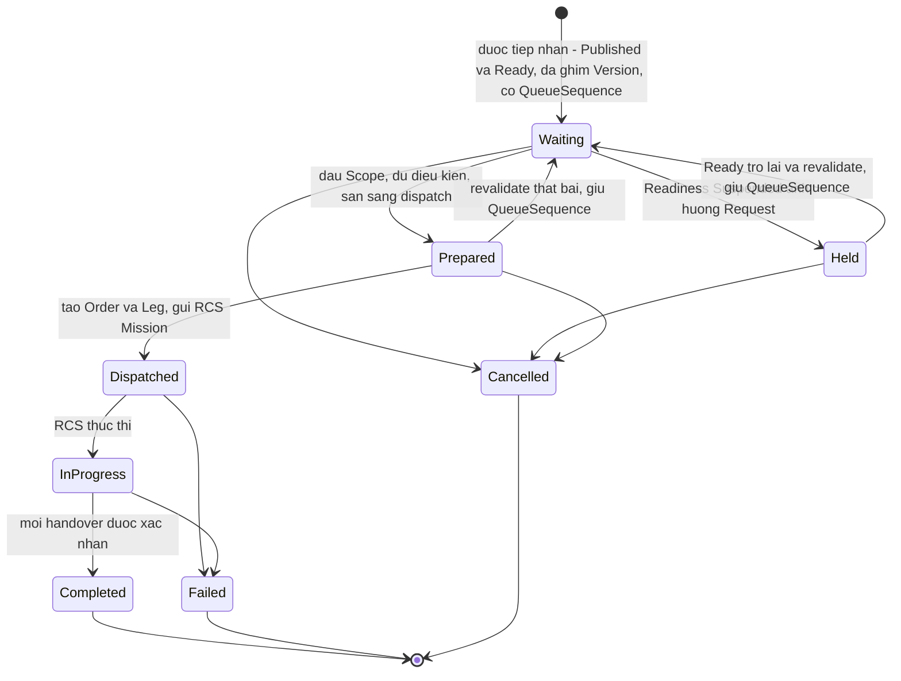

# AGV Phase 2 – Vòng đời Transport Job, Leg, Station Transaction, RCS Mission

> **IO MAP HIỆN HÀNH (2026-11-26, CR-045).** Dự án chỉ dùng một IO Map: [AGV_PLC Interface_List_22_11_2026.xlsx](../../02_Interface_Specification/PLC_IO_Map/AGV_PLC%20Interface_List_22_11_2026.xlsx) (SHA-256 `405586c9…34da3`). Các workbook cũ (IO Map v2, 10/11, 20/11) **đã ngừng sử dụng và đã gỡ khỏi repository**; nội dung dựa trên chúng trong tài liệu này chỉ còn giá trị lịch sử. IO Map 22/11 **chưa** được kỹ sư PLC xác nhận là hợp đồng IO. [Trạng thái từng tín hiệu](../../02_Interface_Specification/PLC_IO_Map/README.md).

| | |
|---|---|
| **Trạng thái** | **DRAFT – chờ chủ dự án duyệt (Revision 1.2).** Phân biệt rõ **[CODE] đã xác nhận trong code**, **[QĐ] đã duyệt**, **[ĐX] đề xuất (NEED USER CONFIRMATION)**. Không trạng thái "đề xuất" nào được coi là đã duyệt. |
| **Căn cứ** | D-01…D-08; `WCS.Domain/Routing/*`; `RouteEngine.cs`; `StationTransactionService.cs`; ADR-0008/0010/0011; `docs/specification/task-state-machine.md`; Phase 0 `MISSION_ORCHESTRATION_ASSESSMENT.md` (kiểm lại trực tiếp trên code) |
| **Revision 1** | 2026-11-24 – thêm **Execution Step** (§10), **Communication Transaction/Message và mức bằng chứng E0–E6** (§11), liên kết sự kiện ↔ Step (§12), mất kết nối/restart (§13). Các nhãn: **[QĐ R1-B]** Execution Step, **[QĐ R1-C]** truy vết giao tiếp. Không đổi §2–§9. |
| **Revision 1.1** | 2026-11-24 – **D-10** (ghim Process Version tại Queue intake): viết lại §2.5 thành **Queue Request** có `NeedsDecision` và trường ghim; sửa EV-1/2/3; **chuẩn hóa thang bằng chứng E0–E6** (§11.2); **diễn giải `PLC_ReaddyTranfer`** là permission/ready (§17); **bằng chứng bền vững, lệnh `Unknown outcome` và recovery** (§16). Đổi mã sự kiện vòng đời **E1–E13 → EV-1…EV-13** để không trùng với mức bằng chứng E0–E6. |
| **Revision 1.2** | 2026-11-24 – **D-12/D-13:** tách **Intake Record** (Received, NeedsDecision, không được tiếp nhận) khỏi **Queue Request chính thức** (Waiting, **Held**, Prepared, Dispatched, InProgress, Completed, Failed, Cancelled); kiểm tra **Published + Ready** + ghim Version + cấp `QueueSequence` nhất quán; **Waiting → Held** khi Readiness Suspended; **strict FIFO theo Queue Ordering Scope** (chi tiết Scope: Spec §22). Ánh xạ trạng thái Revision 1.1 → 1.2 ở §2.5. Thêm sự kiện EV-14/EV-15. |

## 1. Bốn thực thể – không đồng nhất [QĐ D-01]

| Thực thể | Là gì | Định danh trong code | Sở hữu | Hoàn tất khi |
|---|---|---|---|---|
| **Transport Job** | Yêu cầu vận chuyển nghiệp vụ theo một process; nhiều Leg tuần tự | `TransportOrder.Id`, `RequestKey` (idempotency), `CorrelationId` | WCS | Process đến `ProcessCompletion` **và** mọi Leg cần thiết có xác nhận bàn giao (D-05) |
| **Leg** | Một chặng: 1 Rack, 1 Pick, 1 Drop | `TransportLeg.Id`, `Sequence`, `StepKey`, `RackId`, `AgvRequestCode` | WCS | Drop được xác nhận (`ConfirmDropAsync`) |
| **Station Transaction** | Một lần AMR làm việc tại **một trạm**; tại trạm PLC-managed gồm handshake | `StationTransaction.Id`, `PortId`, `PlcId`, `RequestId?` | WCS (+PLC) | Bàn giao xong **và** AMR rời trạm; **không** hoàn tất Job |
| **RCS Mission** | Nhiệm vụ gửi RCS cho **một Leg** | `Leg.AgvRequestCode` (mã yêu cầu idempotent), `Leg.AgvTaskCode` (mã RCS), `Leg.RobotCode` (AMR do RCS chọn) | RCS | Không quyết định bàn giao |
| **Execution Step** *(mới – R1-B)* | Đơn vị **điều phối của WCS** trong một Order đang chạy; không nhất thiết 1–1 với API call/lệnh RCS | `StepId`, `OrderId`, `LegId?`, `AttemptNo` | WCS | Hoàn tất khi tiêu chí + mức bằng chứng tối thiểu đạt (§10) |
| **Communication Transaction / Message** *(mới – R1-C)* | Một trao đổi WCS ↔ PLC/RCS và từng message của nó, kèm bằng chứng thô | `CommTransactionId`, `MessageId` | WCS | Không có "hoàn tất" nghiệp vụ; chỉ có kết quả/mức bằng chứng E0–E6 (§11) |
| **Queue Request** *(mới – D-03/D-10/D-12)* | Yêu cầu đã được tiếp nhận vào **Queue chính thức** (Published + Ready), đã ghim Process Version, có `QueueSequence`; Order chỉ được tạo khi Dispatched | `QueueRequestId`, `ProcessVersionId`, `QueueSequence` | WCS | Khi Order hoàn tất xử lý (§2.5) |
| **Intake Record** *(mới – D-12)* | Bản ghi tiếp nhận ban đầu (Received/NeedsDecision/không được tiếp nhận kèm lý do); **không** đủ điều kiện Dispatch | `IntakeRecordId` | WCS | Khi thành Queue Request hoặc bị từ chối (OQ-50) |

Quan hệ [CODE/QĐ]: `Job 1—n Leg (tuần tự)`; `Leg 1—1 RCS Mission`; `Leg 1—0..2 Station Transaction` (nguồn, đích; điểm không có PLC không có giao dịch); `Station Transaction n—1 Job` (qua `OrderId`/`LegId`).

> Quy tắc đặt tên: tài liệu dùng "Transport Job"; trong code là `TransportOrder`. `TransportTask` (legacy) **không** thuộc vòng đời này.

## 2. Máy trạng thái

### 2.1 Transport Job (`OrderState`) – [CODE] đã xác nhận

`Created → Accepted → InProgress ⇄ Waiting → Completed | Failed | Cancelled`; `ReconciliationRequired` có thể vào từ Accepted/InProgress/Waiting; **ra** khỏi `ReconciliationRequired`: cạnh tới InProgress/Waiting/Failed/Cancelled có trong `Edges` (`TransportOrder.cs:26-34`) nhưng **không có chức năng nào thực thi** (OQ-15). Hoàn tất khi engine đến `ProcessCompletion` (`RouteEngine.cs:151-154`).

| Từ → Đến | Sự kiện/điều kiện [CODE] | Ghi chú |
|---|---|---|
| Created → Accepted | `AdvanceCoreAsync` (`RouteEngine.cs:142`) | |
| Accepted/InProgress ⇄ Waiting | `NoCandidateAsync` (`:302-318`), `HoldWithRack` (`:341-348`), Waiting step (`:165-180`), Drop → tiếp bước (`:643`) | `WaitKind` cho biết lý do (`RoutingEnums.cs:61-78`) |
| * → Failed | `WaitBehavior.Fail`, `STEP_NOT_FOUND`, `LEG_REJECTED_BY_AGV_SYSTEM`… (`FailOrder :212`) | |
| * → Cancelled | `CancelAsync` (`:654`), bị từ chối nếu rack trên AMR/Leg đang chạy | |
| * → ReconciliationRequired | rack không ở vị trí lưu (`:248-254`), RCS đổi AMR khi rack trên AMR (`:429-434`), Fail-behavior khi rack trên AMR (`:598-603`), PLC recovery | |

**[ĐX] Bổ sung hiển thị (không phải trạng thái mới trong enum):** giai đoạn "xếp Queue" của Job được biểu diễn bằng `Waiting` + `WaitKind` mới (ví dụ `QueuedForDestination`, `QueuedForSource`, `QueuedForPlc`) thay vì thêm trạng thái; hoặc entity **Queue Request** riêng (§2.5). Chọn phương án nào: để CR P2-B quyết định.

### 2.2 Leg (`LegState`) – [CODE]

`Pending → Ready → InProgress ⇄ Waiting → Completed | Failed | Cancelled`; `InProgress → Ready` chỉ khi **chưa** Pick (`TransportOrder.cs:97-104,144-145`). `Ready` với lý do `PORT_BUSY`/`AGV_BUSY` = đang xếp chờ (`RouteEngine.cs:478-483,501-512`). Leg có `PickConfirmedAt`, `DropConfirmedAt` (`:128-129`); `RackOnAgv = PickConfirmedAt ≠ null ∧ DropConfirmedAt = null` (`:139`).

### 2.3 Station Transaction (`StationTransactionState`) – [CODE]

`Created → Requested → Accepted → AgvAssigned → AgvApproaching → AtStation → Handling → HandoverCompleted → AgvExited → Completed`; ngoài chuỗi: `Failed`, `ReconciliationRequired` (`RoutingEnums.cs:86-90`, `StationTransaction.cs:71-89`). Ràng buộc: `Completed` chỉ sau `AgvExited`; `AgvExited` chỉ sau `HandoverCompleted`; không đi lùi. `HandshakeStep` 1–9 (mô hình 10/11) **không khớp** 6 bước 20/11 (xem `PLC_TRANSACTION_LIFECYCLE_V2_20_11_2026.md §3` – ánh xạ là suy luận chưa duyệt) → **MODIFY** khi chốt giao diện.

### 2.4 RCS Mission – [CODE]

Trạng thái RCS mà WCS đọc: `RcsTaskStatus` = NotFound, Created, Executing, Completed, Cancelling, Cancelled, Interrupted, Unknown (`Abstractions/Integration.cs:47`). Kết quả gửi: `LegDispatchOutcome` = Accepted, Blocked, Rejected, Unknown (`RoutingAbstractions.cs:76`). **Quy tắc [QĐ D-05]:** `Completed` của RCS **không** làm Leg hoàn tất (`RouteEngine.cs:398-402`).

### 2.5 Intake Record và Queue Request [QĐ D-03, D-10, D-12, D-13] – **[ĐX]** (entity mới, chưa tồn tại)

**Luồng nhất quán:** `Request Intake → Process Selection → Check Publication + Readiness → Process Version Pinning → Queue Waiting → Queue Dispatch → Transport Order Creation`. Kiểm tra Published + Ready, ghim `ProcessVersionId` và cấp `QueueSequence` là **một thao tác nhất quán** (một giao dịch; đọc khóa trạng thái Readiness); **không** tồn tại Queue Request chính thức thiếu `ProcessVersionId` hợp lệ.

#### 2.5.1 Intake Record (chưa phải Queue Request)

| Trạng thái | Ý nghĩa | Chuyển |
|---|---|---|
| `Received` | Yêu cầu hợp lệ đã đọc/ghi nhận bền (mức Spooled/Persisted – Spec §16.8); đang chọn Process | → chọn được duy nhất → kiểm tra Published + Ready; → không xác định duy nhất → `NeedsDecision` |
| `NeedsDecision` | Không xác định duy nhất Process (mơ hồ/không khớp); **chưa ghim**, **không** chọn latest Version; cảnh báo operator | → sau quyết định có audit (người, Version được chọn) → **kiểm tra lại Published + Ready** |
| Không được tiếp nhận | Process chưa Published / NotReady / Suspended / Disabled → **không** thành Queue Request; ghi lý do | Việc ghi nhận/thông báo/nhận lại: **OPEN OQ-50** |

#### 2.5.2 Queue Request chính thức

*(Nhãn sơ đồ không dấu để tránh lỗi cú pháp; ý nghĩa chi tiết ở bảng dưới. Cạnh `Prepared → Waiting` và `Prepared → Held` là [ĐX] chờ OQ-49/OQ-57.)*

| Trạng thái | Chủ sở hữu chuyển trạng thái | Có `ProcessVersionId` | Có `QueueSequence` | Có Order | Ý nghĩa |
|---|---|---|---|---|---|
| `Waiting` | Queue service | ✔ (đã ghim) | ✔ | Chưa | Đã vào Queue chính thức, chờ tới lượt trong Scope (strict FIFO) hoặc chờ điều kiện (không đích/nguồn – D-04; `SCOPE_UNDETERMINED`; khe PLC bận) |
| `Held` | Queue service theo sự kiện Readiness | ✔ (giữ nguyên) | ✔ (giữ nguyên) | Chưa | Tạm giữ vì Readiness **Suspended**; **không** hủy; không đổi tồn kho; **không** tự Dispatch khi hồi phục |
| `Prepared` *(OQ-49)* | Queue service/Dispatcher | ✔ | ✔ | Chưa (đề xuất) | Đã tới lượt, **đã revalidate** (Published + Ready, Rack, Destination, PLC, RCS) và giữ chỗ tài nguyên cần thiết; sẵn sàng bàn giao cho dispatcher |
| `Dispatched` | Dispatcher/Route Engine | ✔ | ✔ | **Có** | Transport Order + Leg được tạo bằng Version đã ghim; RCS Mission đã gửi (E1+); chưa xác nhận RCS thực thi |
| `InProgress` | Route Engine | ✔ | ✔ | Có | RCS xác nhận thực thi (E5) / Order InProgress; waiting cấp Order (vd. chờ đích sau Pick) vẫn thuộc `InProgress` |
| `Completed` | Route Engine | ✔ | ✔ | Completed | Order Completed khi mọi handover bắt buộc của mọi Leg được xác nhận (E6, D-05) |
| `Failed` | Route Engine | ✔ | ✔ | Failed | Order Failed (không do Readiness Suspended) |
| `Cancelled` | Người có quyền/hệ thống theo quy tắc | ✔ | ✔ | Cancelled/không có | Hủy có chủ đích có audit; **không** hủy chỉ vì Readiness Suspended |

**Điều kiện Waiting → Prepared → Dispatched (Queue → Dispatch):** (1) Request ở **đầu Scope** của nó (strict FIFO – không bypass Request đứng trước trong cùng Scope); (2) **Scope đã xác định** (không `SCOPE_UNDETERMINED`); (3) **Published + Ready** còn đúng và Version đã ghim còn dùng được (OQ-45); (4) có nguồn/Rack và đích theo quy tắc D-02/D-04 (nếu không: **ở lại Waiting**, không hủy, không đổi đích); (5) **khe giao dịch PLC** của các trạm liên quan còn trống (≤ 1 giao dịch hoạt động/PLC); (6) RCS link cho phép, không Maintenance giữ việc mới; (7) giữ chỗ tài nguyên thành công.

**Chuyển trạng thái – cho phép / cấm:**

| Chuyển | Trạng thái |
|---|---|
| Waiting → Held; Held → Waiting; Waiting → Prepared; Prepared → Dispatched; Dispatched → InProgress; InProgress → Completed; (Dispatched/InProgress) → Failed; (Waiting/Held/Prepared) → Cancelled | **Cho phép** |
| Prepared → Waiting; Prepared → Held | **Đề xuất, chờ OPEN** (OQ-49, OQ-57) |
| Held → Prepared; Held → Dispatched; Waiting → Dispatched (bỏ qua Prepared) | **Cấm** – phải qua Waiting + revalidate; không tự Dispatch khi hồi phục |
| Dispatched → Held; InProgress → Held | **Cấm** – không tự hủy/giả định AMR dừng an toàn; xử lý theo RCS/AMR và quy trình sự cố |
| Bất kỳ trạng thái nào → đổi `QueueSequence` hoặc `ProcessVersionId`; Waiting → cuối hàng chỉ vì từng Held | **Cấm** |
| Completed/Failed/Cancelled → trạng thái khác | **Cấm** (cuối) |
| Cancel từ Held do **hệ thống** vì Readiness | **Cấm**; chỉ hủy có chủ đích có audit |

**Sự kiện audit (append-only – Spec §16.7):** `IntakeReceived`, `ProcessSelected`, `NeedsDecisionRaised`, `NeedsDecisionResolved` (người, Version chọn), `AdmissionChecked` (ảnh chụp trạng thái Publication/Readiness, kết quả, lý do), `RequestNotAdmitted`, `VersionPinned`, `QueueSequenceAssigned`, `RequestAdmitted`, `RequestHeld` (sự kiện Readiness gây ra), `RequestResumed` (kết quả revalidate), `ScopeEvaluated` (cơ sở xác định Scope), `ScopeUndetermined`, `RequestPrepared`, `RequestDispatched` (OrderId), `RequestInProgress`, `RequestCompleted/Failed/Cancelled` (người/nguồn).

**Tương tác Order/Leg:** Order được tạo khi Dispatched và mang `QueueRequestId` + `ProcessVersionId` (+ hash); Leg tham chiếu Order ⇒ truy ngược Queue Request và Version. `Queue Request = Waiting` trước khi có Order; "không đích" (D-04) **trước Pick** ⇒ Request ở `Waiting` (chặn các Request sau trong Scope); **sau Pick** (AfterPick) ⇒ Order `Waiting` còn Queue Request `InProgress`.

**Khi Readiness thay đổi giữa các giai đoạn:** xem Spec §22.5 (Waiting → Held; Held → revalidate → Waiting; Dispatched/InProgress không tự hủy).

#### 2.5.3 Ánh xạ trạng thái Revision 1.1 → Revision 1.2 (khác biệt ngữ nghĩa)

| Revision 1.1 | Revision 1.2 | Khác biệt |
|---|---|---|
| `Received` (cùng thực thể Queue Request) | `Received` của **Intake Record** | Chưa phải Queue Request |
| `NeedsDecision` (trạng thái Queue Request) | `NeedsDecision` của **Intake Record** | Sau giải quyết phải **kiểm tra lại Published + Ready** trước khi ghim/nhận |
| `Queued` | `Waiting` | Chỉ nhận khi **Published + Ready**; thêm `QueueSequence` |
| *(không có)* | `Held` | Mới – Readiness Suspended |
| `Active` (+ tạo Order) | `Prepared` → `Dispatched` | Tách; ranh giới OQ-49 |
| `OrderCreated` | `Dispatched` / `InProgress` | Gộp vào Dispatched/InProgress |
| `Done` | `Completed` | Đổi tên |
| `Failed` / `Cancelled` | `Failed` / `Cancelled` | Không đổi |

Khóa FIFO (thứ tự nhận, tie-break) và hành vi sau restart: thiết kế của CR triển khai; **strict FIFO theo Queue Ordering Scope (D-13)**; xác định Scope: OQ-54; khe PLC: OQ-55; khóa FIFO: OQ-56.

## 3. Danh mục sự kiện

Mỗi sự kiện: tiền điều kiện · hiệu ứng · trạng thái · trạng thái hiện thực.

| # | Sự kiện | Tiền điều kiện | Hiệu ứng / chuyển trạng thái | Hiện thực hiện tại [CODE] | Kết luận |
|---|---|---|---|---|---|
| EV-1 | **Tiếp nhận yêu cầu, chọn Process, kiểm tra Published + Ready, ghim Version** | Yêu cầu từ PLC (đã đọc, hợp lệ, không trùng) hoặc PDA/Operator; không Maintenance | Ghi **Intake Record**; chọn Process; nếu duy nhất → **kiểm tra Published + Ready** → **ghim Process ID + Version + cấp `QueueSequence`** → Queue Request `Waiting`; nếu không xác định duy nhất → `NeedsDecision` (không ghim); nếu không Published/Ready/Disabled → **không** vào Queue chính thức (OQ-50) | Hiện: `PlcRequestService`/`StartAsync` tạo Order ngay và ghim lúc tạo Order (`RouteEngine.cs:56-69`); PLC chỉ qua HTTP (`RoutingEndpoints.cs:99-103`); chặn Maintenance (`:59`) | **REPLACE** (Intake Record + Queue Request + ghim tại intake); nguồn PLC tự động (P3-B); PDA (P3-C) |
| EV-2 | **Queue Dispatch và tạo Transport Order** | Queue Request `Prepared` (đầu Scope, revalidate đạt); Version đã ghim còn dùng được (OQ-45) | `Prepared → Dispatched`; tạo `TransportOrder` từ **snapshot của Version đã ghim**; Created → Accepted | `AdvanceCoreAsync :142` | **MODIFY** (Order tạo khi dispatch, không phải lúc intake) |
| EV-3 | **Chờ trong Queue (Queue Waiting, strict FIFO theo Scope)** | Chưa tới lượt trong Scope; hoặc chưa có đích/nguồn hợp lệ; hoặc khe PLC bận; hoặc `SCOPE_UNDETERMINED` | Queue Request `Waiting` (đã ghim Version, có `QueueSequence`); Job (nếu đã tạo) `Waiting` + `WaitKind` | Chỉ `PORT_BUSY` reject (`PlcRequestService.cs:85-86`) và Order `Waiting` đánh giá lại mỗi tick (`RouteEngine.cs:302-338`); không Queue bền, không FIFO theo Scope | **REPLACE** (P2-B, P2-E) |
| EV-4 | **Chọn Rack** | Có yêu cầu tới lượt; nguồn khả dụng | Chọn nguồn theo thứ tự ưu tiên; chọn Rack theo **Origin → FIFO** (D-02); không có Rack đúng Origin → **chờ** | `CreateLegAsync :230-262`: chọn vị trí, rồi Rack cũ nhất `LastConfirmedAt`; không Origin | **REPLACE** logic chọn Rack (P2-A) |
| EV-5 | **Reserve** | Đã chọn nguồn/đích | Reservation Rack nguồn (unique ACTIVE theo Rack); Reservation slot đích (`capacity − occupied − reserved`); Leg → Ready | `RouteEngine.cs:276-279`; đích AfterPick giữ chỗ sau Pick (`:331`) | KEEP; thời điểm giữ chỗ đích: **OPEN OQ-18** |
| EV-6 | **Dispatch** | Leg Ready; link RCS cho phép; (PLC) tới lượt/không bận | Leg → InProgress; mở Station Transaction nguồn/đích; gửi **RCS Mission** (1 Leg); nhận `AgvTaskCode`; RobotCode do RCS | `DispatchLegAsync :453-556`; bộ gửi thật chưa có trên main (`DependencyInjection.cs:90`) | KEEP khung; **OPEN** bộ gửi thật (OQ-13) |
| EV-7 | **Pick** | AMR tới trạm nguồn; PLC-managed: handshake; WCS-managed: xác nhận thủ công | **Bàn giao nguồn** được WCS xác nhận (D-05) → Rack `InTransit`, `Current Location = null`, Reservation nguồn Consumed, Leg `PickConfirmedAt` | `ConfirmPickAsync :566-610` chỉ nguồn Operator (`RoutingEndpoints.cs:72`) | **MODIFY** nguồn xác nhận (P3-A) |
| EV-8 | **Drop** | AMR tới trạm đích; handshake/thủ công | Bàn giao đích được xác nhận → `Current Location = đích`, status, Reservation Consumed, Leg Completed, bước kế | `ConfirmDropAsync :612-650` chỉ Operator (`RoutingEndpoints.cs:75`) | **MODIFY** (P3-A) |
| EV-9 | **Wait** | Không đích/nguồn; điều kiện chưa đạt; AMR chờ | Job/Leg `Waiting` + `WaitKind`; **không** hủy/lỗi (D-04) | `NoCandidateAsync`, `HoldWithRack` | **MODIFY** (Queue bền, đánh thức: file 5 §7) |
| EV-10 | **Retry** | `LegDispatchOutcome` Blocked/Unknown; PLC lỗi tạm | Giữ Leg; thử lại ở tick sau, idempotent theo `AgvRequestCode` | `DispatchLegAsync :549-552` | KEEP; chính sách retry/timeout PLC: **OPEN** |
| EV-11 | **Fail** | `Rejected` bởi RCS; `WaitBehavior.Fail`; lỗi cấu hình | Giải phóng Reservation (nếu **chưa gửi**); Order Failed | `:543-548`, `:307-309`, `FailOrder :212` | **MODIFY**: `WaitBehavior.Fail` trái D-02/D-04 khi áp cho thiếu Rack/đích (OQ-17) |
| EV-12 | **Cancel** | Chưa có Leg đang chạy/rack trên AMR | Giải phóng Reservation, Leg Cancelled, Order Cancelled; Station Transaction Failed `ORDER_CANCELLED` | `CancelAsync :654-677` (không gửi lệnh hủy RCS) | KEEP; hủy RCS Mission: **OPEN** |
| EV-13 | **Reconciliation** | Bất định vật lý | Job/Leg/Transaction/Location → `ReconciliationRequired`; không giải phóng Reservation; Admin xác nhận vị trí thực → ghi `InventoryTransaction` | Đánh dấu có; **lối thoát CR-010 không có** | **MODIFY** (P1-D, OQ-15) |
| EV-14 | **Readiness Suspended → Held** | Readiness của Process Version chuyển Suspended và ảnh hưởng Request Waiting | `Waiting → Held`; giữ `ProcessVersionId`, `QueueSequence`; không hủy; không đổi tồn kho; Dispatched/InProgress **không** tự hủy | Chưa có | **Mới** (P1-I, P1-H) |
| EV-15 | **Readiness Ready lại → revalidate → Waiting** | Readiness Suspended → Ready (xác minh lại) | `Held → Waiting` sau revalidate (Rack, Destination, PLC, Readiness, Scope); trả về **vị trí FIFO ban đầu**; **không** tự Dispatch | Chưa có | **Mới** (P1-I, P1-H) |

## 4. Job nhiều Leg

- [QĐ D-01] Mỗi Leg có đúng một Rack, một Pick, một Drop. Các Leg nối nhau tuần tự: Leg n+1 chỉ bắt đầu khi Leg n **Completed** (Drop xác nhận) – [CODE] `RouteEngine.cs:184-199,643-644` (`AdvanceCoreAsync` sau Drop).
- Nguồn của Leg kế có thể là đích của Leg trước (`SourceMode.PreviousDestination`): engine kiểm Rack **đúng vị trí đã lưu**, sai → `ReconciliationRequired` (không chọn vị trí khác) – `RouteEngine.cs:241-257` [CODE, KEEP].
- AMR của các Leg có thể khác nhau (RCS chọn); không ép cùng AMR (ADR-0010 §12–13); khi Rack đang trên AMR mà RCS báo AMR khác → cảnh báo, rồi nếu lặp lại → `ReconciliationRequired` (`RouteEngine.cs:424-436`).
- Các process Phase 2 trong nguồn (PH2-01…06) đều **một Leg**. Chuỗi nhiều Leg (lưu Buffer rồi lấy lại – BufferStorage → Waiting → BufferRetrieval) được engine hỗ trợ (`Cr010MultiLegTests.cs:57,81`) nhưng nguồn Phase 2 **chưa yêu cầu** (OQ-09: X/P3/P4/M6).
- **Hoàn tất Job [QĐ D-05]:** khi process đến `ProcessCompletion` **và** mọi Leg cần thiết có điều kiện bàn giao đạt (Pick + Drop được WCS xác nhận, tồn kho cập nhật, lịch sử ghi). Station Transaction hoàn tất độc lập và **không** làm Job hoàn tất ([CODE] ADR-0008 §2-1). `PLC_MissionCompleted` tại nguồn **không** hoàn tất hành trình (handoff §00-5, §02-5).

## 5. RCS báo Completed nhưng chưa có Drop confirmation [QĐ D-05]

| Bước | Hành vi bắt buộc | Hiện thực |
|---|---|---|
| 1 | Ghi sự kiện, **không** hoàn tất Leg, **không** cập nhật `Current Location`, **không** chạy Leg kế | `LEG_RCS_COMPLETED_WITHOUT_DROP` (`RouteEngine.cs:398-402`) ✔ |
| 2 | Leg ở lại `InProgress/Waiting`, Reservation giữ nguyên | ✔ |
| 3 | Yêu cầu bằng chứng bàn giao: PLC chu trình + presence/identity, hoặc PDA/scan có audit | **Chưa có** nguồn tự động; chỉ Operator (P3-A) |
| 4 | Nếu bằng chứng không đạt/không nhất quán → `ReconciliationRequired` | Có cho nhiều nhánh; **không có lối thoát** (OQ-15) |
| 5 | Không tự cho là "đã bàn giao" khi quá hạn | [ĐX] chỉ cảnh báo + chờ; timeout: OQ-19 |

## 6. Mất kết nối và khởi động lại

| Tình huống | Hành vi bắt buộc [HOẠT ĐỘNG/QĐ] | Hiện thực [CODE] | Kết luận |
|---|---|---|---|
| **RCS mất kết nối** | Không dispatch; Leg chờ, không mất; không hủy | `guard.Check()` → `link.Allowed=false` → giữ Leg `Ready` (`RouteEngine.cs:456,466-471`) | KEEP |
| **AMR lỗi/Interrupted** | Không tự giải phóng Reservation; đối soát vị trí Rack | Legacy: `MarkUncertain` (Cr008b4); CR-010: chưa có phản ứng riêng cho `Interrupted` (`SyncLegRobotsAsync` chỉ ghi robot/lỗi đồng bộ) | **MODIFY** (OPEN: chính sách) |
| **PLC mất kết nối** | Giữ trạng thái giao dịch, không hủy/reset, không ghi; khi nối lại đọc trạng thái thật rồi đối chiếu | `SuspendPlcAsync` (`StationTransactionService.cs:133-138`); `RecoverPlcAsync` (`:141-170`) với `UnavailablePlcObservationSource` (`DependencyInjection.cs:92`) → mọi quyết định `NoData` | KEEP khung; **MODIFY** nguồn quan sát (P3-B) |
| **Restart WCS** | Mọi thứ phục hồi từ DB; không lặp Leg đã xong; yêu cầu đã ghi nhưng chưa tạo Job được tạo lại | `RoutingHostedService` mỗi tick (`:20-30`), `ResumeOrphansAsync` (`PlcRequestService.cs:159`), test `Cr010MultiLegTests.cs:318` | KEEP; **Queue Request bền** phải có (D-03) |
| **Maintenance** | Không nhận Job mới/Leg đầu mới; Job đang chạy tiếp tục | `maintenance.EnsureOpenAsync/HoldNewWorkAsync` (`RouteEngine.cs:59,191,464`) | KEEP |
| **Readiness Suspended** | Waiting → Held (giữ Version, `QueueSequence`); Dispatched/InProgress không tự hủy; Step không bị Failed chỉ vì Readiness; theo trạng thái RCS/AMR và quy trình sự cố | Spec §22.2, §22.5 | **Mới** |

## 7. Trạng thái đã xác nhận ↔ trạng thái đề xuất

| Hạng mục | Đã xác nhận (có trong code/quyết định) | Đề xuất (chưa duyệt) |
|---|---|---|
| Job states | `OrderState` 8 giá trị | `WaitKind` mới / Queue Request |
| Leg states | `LegState` 7 giá trị | — |
| Station Transaction | 11 giá trị; Completed sau AgvExited | Rút gọn/ánh xạ theo 6 bước 20/11 (cần PLC) |
| Queue | Không có | **Intake Record + Queue Request** (Waiting/Held/Prepared/Dispatched/InProgress/…) + `QueueSequence` + strict FIFO theo Scope (§2.5) |
| Xác nhận bàn giao | Quy tắc (D-05) | Nguồn tự động, `ConfirmationSource` đã có `Plc/Rcs/Operator` (`Enums.cs:44`) nhưng chưa có người gọi cho `Plc/Rcs` |
| Mốc kết thúc giao dịch PLC | — | OQ-02 |

## 8. Đối chiếu baseline ↔ code (vòng đời)

| Nội dung | Baseline | Tài liệu hiện tại | Code hiện tại | Kết luận |
|---|---|---|---|---|
| Job/Leg/Transaction/Mission tách biệt | D-01 | ADR-0008 §2-1 | Có | **KEEP** |
| Job hoàn tất khi mọi Leg bàn giao | D-05 | ADR-0010 §15 | Leg hoàn tất chỉ khi `ConfirmDrop` | **KEEP** |
| Không có đích → Queue không hủy | D-04 | `task-state-machine.md §3.6` | `Waiting` (không bền, không thứ tự) | **MODIFY** |
| Một giao dịch/PLC | D-03 | ADR-0011 D-1 | Per-port + reject | **REPLACE** |
| Station Transaction kéo dài đến AgvExited | OPEN (OQ-02) | ADR-0008 | Có | **OPEN** |
| Xác nhận Pick/Drop tự động | D-05 | ADR-0011 D-4 | Operator-only | **MODIFY** |
| Legacy `TransportTask` 13 trạng thái | PROTECTED | `task-state-machine.md` | Giữ nguyên | **PROTECTED** |
| Reconciliation CR-010 | D-06/D-08 | inventory §4.8 | Thiếu lối thoát | **MODIFY** |

## 9. Open Questions liên quan

OQ-02, OQ-05, OQ-12, OQ-13, OQ-14, OQ-15, OQ-17, OQ-18, OQ-19 (bảng đầy đủ: `PHASE2_OPERATIONAL_SPEC.md` §12). Thêm câu hỏi riêng của vòng đời: *chính sách khi RCS báo `Interrupted`/`Cancelled` giữa chừng Leg* và *có gửi lệnh hủy RCS Mission khi Job bị hủy không* – chưa có căn cứ trong nguồn; ghi nhận là **OPEN** (sẽ đánh số khi mở CR P4-A).

---

## 10. Execution Step của Order [QĐ R1-B]

### 10.1 Khái niệm và ranh giới

Một **Execution Step** là **đơn vị điều phối của WCS** trong một Order đang chạy. Nó **không** nhất thiết tương ứng 1–1 với một API call hay một lệnh RCS: một Step có thể sinh **0, 1 hoặc nhiều** giao tiếp (ví dụ bước "Dispatch" gồm gọi tạo nhiệm vụ RCS và các lần truy vấn trạng thái), và một lệnh RCS/handshake PLC có thể được theo dõi qua nhiều Step (gửi, rồi giám sát).

| Khái niệm | Là gì | Khác Execution Step ở chỗ |
|---|---|---|
| **Route Step** (`RouteStep`) | Bước *định nghĩa tuyến* trong Process Version (Pickup/Delivery/BufferStorage/BufferRetrieval/Waiting/Condition/ProcessCompletion); sinh ra Leg | Là cấu hình tuyến, không có trạng thái/thời lượng lúc chạy |
| **Execution Step** | Đơn vị điều phối lúc chạy, có định danh/trạng thái/lịch sử | — |
| **API call / lệnh RCS / thanh ghi PLC** | Một lần giao tiếp (Communication Transaction – §11) | Là *bằng chứng giao tiếp* gắn vào Step |
| **Station Transaction** | Một lần AMR làm việc tại trạm | Có thể liên quan nhiều Step |
| **Handshake step (1–9 / 1–6)** | Bước tín hiệu PLC | Nằm *trong* một Step (hoặc nhiều Step) – chi tiết là message |

### 10.2 Định nghĩa trong Process Version (không phải một chuỗi cố định)

- Các Step của một Order do **Process Version** quy định (kế hoạch thực thi – *Execution Plan*), **không** phải một dãy hard-code cho mọi Order. Kế hoạch được đóng băng cùng Process Version; **Version này đã được ghim tại Queue intake (D-10)** và nằm trong **snapshot** mà Order ghim (cơ chế đã có: `TransportOrder.SnapshotJson`).
- **Mẫu Step (Step Template)** trong kế hoạch: `StepKey`, loại Step (từ **danh mục**, §10.3), `Mandatory`, phạm vi (cấp Order hoặc cấp Leg), điều kiện tiên quyết/phụ thuộc, ràng buộc tài nguyên (vai trò Station, PLC, RCS, AGV, Rack), chính sách retry/timeout (trong **trần hệ thống**, OQ-38), điều kiện bỏ qua (chỉ cho bước không bắt buộc), tiêu chí hoàn tất (gồm **mức bằng chứng tối thiểu** – §11.2).
- **Khởi tạo instance:** các Step cấp Order được tạo khi tạo Order; Step cấp Leg được tạo khi Leg được tạo (Leg phát sinh theo `RouteStep`). Order luôn hiển thị toàn bộ Step đã/sẽ có.
- **Order cũ** (tạo trước khi có Execution Step) không có Step: hiển thị "không có Step" hoặc backfill có nhãn – OQ-43. Không bịa bằng chứng.

### 10.3 Danh mục Step (minh họa [ĐX], OPEN OQ-37)

Ví dụ **A1 → B1** (chỉ minh họa; bước thực tế do Process Version định nghĩa):

| # | Step (minh họa) | Phạm vi | Bắt buộc | Tài nguyên liên quan | Giao tiếp thường gặp |
|---|---|---|---|---|---|
| 1 | Validate yêu cầu (hợp lệ, không trùng, process Published, không Maintenance) | Order | ✔ | Station A1, PLC-01 | Đọc tín hiệu PLC (bằng chứng yêu cầu) |
| 2 | Xếp Queue / chờ tới lượt (FIFO/PLC) | Order | ✔ (nếu có Queue) | PLC-01, QueueRequest | — |
| 3 | Chọn nguồn/Rack và đích | Leg | ✔ | Location, Rack | — (quyết định ghi lại) |
| 4 | Đặt chỗ tài nguyên (Rack nguồn, slot đích) | Leg | ✔ | Rack, Location, Reservation | — |
| 5 | Gán AMR (WCS chọn AGV **hoặc** quan sát RCS gán – theo chế độ, OQ-13) | Leg | ✔ | AGV/`RobotCode`, RCS | RCS: truy vấn gán |
| 6 | Dispatch RCS Mission | Leg | ✔ | MissionId (`AgvRequestCode`), RCS | RCS: tạo nhiệm vụ |
| 7 | Handshake Pick tại A1 (PLC-managed) | Leg | ✔ | Station A1, PLC-01 | PLC: yêu cầu/cho phép/hoàn tất |
| 8 | Xác nhận **Pick vật lý** (bằng chứng D-05) | Leg | ✔ | Rack, A1 | PLC/PDA/scan |
| 9 | AMR di chuyển (giám sát RCS) | Leg | ✔ | RCS Mission, `RobotCode` | RCS: truy vấn/callback |
| 10 | Handshake Drop tại B1 (PLC-managed) | Leg | ✔ | Station B1, PLC-02 | PLC |
| 11 | Xác nhận **Drop vật lý** (D-05) | Leg | ✔ | Rack, B1 | PLC/PDA/scan |
| 12 | Cập nhật tồn kho (Current Location, Reservation Consumed) | Leg | ✔ | Rack, Location | — |
| 13 | Giải phóng tài nguyên / đóng Station Transaction | Leg | ✔ | Station Transaction | — |
| 14 | Hoàn tất Leg/Order | Order | ✔ | — | — |

Danh sách **bắt buộc không thể gỡ** (khuyến nghị): validate, đặt chỗ, dispatch, xác nhận Pick vật lý, xác nhận Drop vật lý, cập nhật tồn kho – tương ứng INV-19/D-05. Bước tùy chọn (vd. thông báo, kiểm tra bổ sung) thêm từ danh mục. Với P1–P4/M5–M6 (WCS-managed) các bước "Handshake" **không tồn tại**; thay bằng bước **xác nhận thủ công/PDA có audit** (D-07).

### 10.4 Thuộc tính của một Execution Step (instance)

| Thuộc tính | Mô tả |
|---|---|
| `StepId` | Định danh WCS sinh (GUID), duy nhất |
| `OrderId`, `LegId?`, `QueueRequestId?` | Liên kết Job, (nếu có) Leg và Queue Request đã ghim Version |
| `ProcessVersionId` + `StepKey` | Mẫu Step trong Process Version đã ghim (kèm content hash) |
| `Seq`, `Type`, `Mandatory` | Thứ tự, loại, bắt buộc |
| `Status` | Waiting · Running · Completed · Failed · Blocked · Skipped (§10.5) |
| `CreatedAt`, `StartedAt`, `CompletedAt`, `Duration`, `TimeoutAt` | Mốc thời gian UTC chính xác và thời lượng |
| `AttemptNo`, `Attempts[]` | Số lần thử và **lịch sử từng lần** (§10.6) |
| `BlockedReason`, `FailureReason`, `SkipReason` | Mã lý do + chi tiết (không chỉ chuỗi tóm tắt) |
| Tài nguyên liên quan | `StationId`, `PlcId`, `StationTransactionId`, `MissionId` (`AgvRequestCode`), `AgvTaskCode`, `RobotCode`, `AgvId?`, `RackId`, `LocationId`, `ReservationId`, `QueueRequestId` |
| `CommunicationTransactions[]` | Danh sách giao dịch giao tiếp (§11) |
| `History[]` | Nhật ký **append-only** mọi chuyển trạng thái: từ → đến, thời điểm, tác nhân (hệ thống/người), lý do, `AttemptNo`, `MessageId` liên quan |
| Phiên bản hàng | Kiểm soát đồng thời (như `Version` của entity hiện có) |

### 10.5 Trạng thái và quy tắc chuyển

| Trạng thái | Nghĩa | Ghi chú |
|---|---|---|
| **Waiting** | Đã tạo, chưa bắt đầu (phụ thuộc chưa thỏa hoặc chưa tới lượt) | |
| **Running** | Một lần thử đang thực thi | Có `StartedAt` |
| **Blocked** | **Không thể tiến** do điều kiện bên ngoài/tài nguyên (không có đích, PLC đang có giao dịch hoạt động, RCS/PLC mất link, chờ quyết định operator, chờ bằng chứng) | **Không phải lỗi**; không tiêu thụ lần thử; bắt buộc mã lý do; tự mở khi sự kiện đánh thức (`RACK doc §7`); phù hợp D-04 (không hủy/không lỗi khi chờ đích) |
| **Failed** | Lần thử (cuối) thất bại và đã hết retry **hoặc** lỗi không retry được | Cuối với chuỗi lần thử hiện tại; retry thủ công do người có quyền tạo lần thử mới (ghi audit) |
| **Completed** | Tiêu chí hoàn tất thỏa, **kể cả mức bằng chứng yêu cầu** | Cuối, bất biến |
| **Skipped** | Bước tùy chọn/điều kiện-bỏ-qua đúng, hoặc Order đã kết thúc/hủy trước khi bắt đầu | Cuối; bắt buộc `SkipReason`; **bước bắt buộc không được Skipped** (trừ khi Order kết thúc – lý do `ORDER_TERMINATED`) |

| Từ → Đến | Điều kiện | Ghi lịch sử |
|---|---|---|
| Waiting → Running | Mọi phụ thuộc Completed/Skipped; tài nguyên sẵn sàng; tới lượt | `AttemptNo`, thời điểm |
| Waiting → Blocked | Điều kiện/tài nguyên chưa thỏa (kèm mã lý do) | Lý do |
| Waiting → Skipped | Chỉ bước không bắt buộc có điều kiện bỏ qua đúng; hoặc Order kết thúc | `SkipReason` |
| Blocked → Waiting | Nguyên nhân chặn được gỡ (sự kiện đánh thức) | Sự kiện nguyên nhân |
| Blocked → Skipped | Chỉ bước không bắt buộc, hoặc Order kết thúc | |
| Blocked → Failed | Chỉ khi chính sách Step quy định timeout-chặn → lỗi (**mặc định không có**, D-04; OQ-19) | |
| Running → Completed | Tiêu chí hoàn tất + bằng chứng tối thiểu đạt | Bằng chứng (`MessageId`/xác nhận) |
| Running → Failed | Lỗi không retry được hoặc hết số lần thử | `FailureReason`, kết quả từng lần |
| Running → Blocked | Mất link PLC/RCS giữa chừng; chờ quyết định | Lý do (KHÔNG coi là lỗi) |
| Running → Waiting | Giữa hai lần thử (retry) theo backoff | Lần thử thất bại + lý do; `AttemptNo` tăng |
| Failed → Waiting | **Retry thủ công** có quyền, có lý do | Người, lý do; lần thử mới |
| Completed/Skipped → * | **Cấm** | — |
| Bất kỳ → Completed khi thiếu bằng chứng | **Cấm** (RCS Completed ≠ bàn giao; D-05) | — |

### 10.6 Lịch sử retry và lý do lỗi

Mỗi Step lưu **`Attempts[]`**: `AttemptNo`, `StartedAt`, `EndedAt`, kết quả (`Succeeded | Failed | TimedOut | Cancelled | Blocked | Ambiguous`), mã lỗi + chi tiết/exception, danh sách `MessageId` của lần thử đó. Quy tắc retry: tối đa lần thử và backoff theo **trần hệ thống** (OQ-38); gọi RCS tạo nhiệm vụ được retry an toàn nhờ `reqCode` idempotent (`AgvRequestCode`); **ghi PLC bị mơ hồ không bao giờ retry tự động** (đã đúng: `PlcWriteAmbiguousException`, `PlcModels.cs:140-144`) → Step chuyển Blocked/Failed chờ kiểm tra và đối soát.

### 10.7 Suy trạng thái Order (và Leg) từ Step

**Nguyên tắc:** trạng thái Order là **hàm của các Step** (cộng với yêu cầu xác nhận nghiệp vụ/vật lý), được tính/kiểm tra **trong cùng giao dịch** với thay đổi Step; không được đặt tay mâu thuẫn với Step.

| Điều kiện (xét theo thứ tự ưu tiên) | Trạng thái Order | WaitKind/ghi chú |
|---|---|---|
| Đã yêu cầu hủy hợp lệ và các Step còn lại bị Skipped (`ORDER_TERMINATED`) | **Cancelled** | Chỉ khi không có Pick/Drop đang dở (`CancelAsync` hiện có) |
| Có Step liên quan bất định vật lý (Failed/Blocked sau khi AMR đã nhận Rack, Pick/Drop không rõ) | **ReconciliationRequired** | Không giải phóng Reservation (D-06) |
| Có Step **bắt buộc** `Failed` (hết retry) và không có đường phục hồi | **Failed** | Lý do từ Step |
| Mọi Step **bắt buộc** `Completed`; Step không bắt buộc `Completed` hoặc `Skipped`; **xác nhận nghiệp vụ/vật lý cuối cùng đạt** (Drop xác nhận ở mọi Leg, tồn kho cập nhật, lịch sử ghi) | **Completed** | D-05, INV-20 |
| Có Step `Running` | **InProgress** | |
| Không có Step `Running`, có Step `Blocked`/`Waiting` chờ điều kiện | **Waiting** | `WaitKind` suy từ `BlockedReason` (vd. QueuedForDestination, AtBuffer) |
| Order mới tạo, chưa Step nào bắt đầu | **Created/Accepted** | |

- Order **không** Completed nếu còn bất kỳ Step bắt buộc chưa Completed, **hoặc** thiếu xác nhận vật lý cuối cùng, **kể cả khi RCS báo Completed** (`RouteEngine.cs:398-402` đã đúng tinh thần).
- **Leg** = trạng thái suy từ các Step cấp Leg (Pick→Drop→Inventory); `Leg Completed` ⇔ Drop xác nhận + tồn kho cập nhật.
- `OrderState`/`LegState` hiện có **giữ nguyên** (enum); Step là lớp chi tiết bên dưới. **Không đổi** `TaskStateMachine`.

### 10.8 Người dùng xem Order → Step

Mở một Order phải xem được **mọi Step**: trạng thái, mốc thời gian, thời lượng, lần thử, lý do lỗi/chặn/bỏ qua, tài nguyên liên quan, lịch sử chuyển trạng thái, và **Communication History** của Step (§11.8). Hiện tại UI/API chỉ có Order/Leg/events (`RoutingEndpoints.cs` `orders/{id}` + `RoutingEvent`) → **MODIFY** (P1-F, P4-C).

### 10.9 Đối chiếu baseline ↔ code

| Nội dung | Baseline R1 | Code hiện tại | Kết luận |
|---|---|---|---|
| Execution Step (thực thể, trạng thái, lịch sử) | Bắt buộc | Không có; chỉ `RoutingEvent` (Kind/Detail/Source/At) | **REPLACE/MODIFY** (thực thể mới, không thay `RouteStep`) |
| Step theo Process Version | Bắt buộc | Process Version có `RouteStep`, không có Execution Plan | **MODIFY** (mở rộng định nghĩa/ snapshot) |
| Order = f(Step) | Bắt buộc | Engine đặt `OrderState` trực tiếp (`RouteEngine.cs:137-203`) | **MODIFY** |
| Retry history/failure reason theo bước | Bắt buộc | Một phần: sự kiện `LEG_DISPATCH_PENDING`, `RetryCount` legacy | **MODIFY** |
| `OrderState`/`LegState` | Giữ | 8/7 giá trị | **KEEP** |

---

## 11. Giao dịch giao tiếp (Communication Transaction) và bằng chứng thô [QĐ R1-C]

### 11.1 Mô hình

> **Tên:** `StationTransaction` (một lần AMR làm việc tại trạm) **khác** `CommunicationTransaction` (một trao đổi WCS ↔ PLC/RCS). Trong tài liệu: `StationTransactionId` và `CommTransactionId`.

**Communication Transaction** (gắn một Step và một `AttemptNo`): `CommTransactionId`, `StepId`, `AttemptNo`, hệ thống (PLC | RCS), giao thức (MC Protocol 3E binary [đề xuất, chờ PLC xác nhận] | HTTP/RCS-2000 API), đối tác (PLC/Station hoặc endpoint RCS), thao tác (READ | WRITE | CREATE_TASK | QUERY | CONTINUE | CANCEL | CALLBACK | OBSERVE), mục đích, `StartedAt`/`EndedAt`/`Duration`, `TimeoutMs`, kết quả (§11.3), kết quả xử lý nghiệp vụ, tương quan (`CorrelationId`, `OrderId`, `LegId`, `StationTransactionId`, `MissionId`, `AgvId/RobotCode`).

**Message** (mỗi tin nhắn riêng, độc lập định danh): `MessageId`, `CommTransactionId`, hướng (**Outbound** WCS → ngoài | **Inbound** ngoài → WCS), `Seq` trong giao dịch, **thời điểm chính xác** (`SentAt` hoặc `ReceivedAt`), **payload thô gốc** (byte + mã hóa; kích thước; hash), **dữ liệu parsed/normalized**, **diễn giải của WCS** (ý nghĩa + phiên bản ánh xạ đã dùng), endpoint/địa chỉ: PLC (`Device`, `StartAddress`, `Points`, tên tín hiệu, `PlcId+StationId+SignalName`) hoặc RCS (URL, method, tên API), định danh giao thức (HTTP status, mã `code`/`message` của RCS, mã kết thúc MC `EndCode`, `reqCode`/`taskCode`), lỗi (mã, exception, tham chiếu stack), danh sách che dữ liệu (§11.9).

### 11.2 Thang bằng chứng E0–E6 (chuẩn hóa Revision 1.1) – không được gộp

> **Ký hiệu:** `E0…E6` là **mức bằng chứng giao tiếp**. Mã sự kiện vòng đời (§3) dùng `EV-1…EV-13` để không trùng.

| Mức | Ý nghĩa | Chứng minh | **Không** chứng minh | Ví dụ PLC (MC) | Ví dụ RCS |
|---|---|---|---|---|---|
| **E0** | Command/transaction đã chuẩn bị | Bản ghi `Prepared` được tạo **trước** khi gửi | Đã gửi | Lệnh ghi đã dựng | Request đã dựng |
| **E1** | Command đã gửi | `Send` ở tầng truyền trả về thành công | Bên kia nhận được | Ghi frame ra TCP xong | HTTP request đã gửi |
| **E2** | Đã nhận phản hồi ở tầng giao thức | Có khung/phản hồi giao thức (mã kết thúc/HTTP status) | **Không** chứng minh RCS/PLC chấp nhận nghiệp vụ hay đã hành động | Phản hồi MC (`EndCode`) | **HTTP 200/TCP response** (chưa phải RCS chấp nhận nghiệp vụ) |
| **E3** | Phản hồi đã phân tích | Parse thành công thành dữ liệu có cấu trúc | Nghĩa nghiệp vụ | Giải mã giá trị thanh ghi | JSON parse đúng schema, đọc được `code`/`message` của RCS |
| **E4** | WCS đã áp dụng xử lý nghiệp vụ | WCS diễn giải và chuyển trạng thái nội bộ | Hệ thống ngoài đồng ý nghiệp vụ; vật lý | `PLC_ReaddyTranfer` 1/2 ⇒ WCS ghi nhận **permission đã được cấp** (không phải cửa mở) | WCS áp dụng kết quả phản hồi (vd. lưu `taskCode`, chuyển Step) |
| **E5** | Hệ thống ngoài xác nhận nghiệp vụ | Phản hồi/feedback **nghiệp vụ** của chính hệ thống ngoài | **Không** chứng minh Rack đã bàn giao (D-05) | `PLC_MissionCompleted` | RCS xác nhận nghiệp vụ: `code` thành công kèm `taskCode`, hoặc trạng thái nhiệm vụ (đã tạo/đã gán/đang chạy/`Completed`) qua query/callback |
| **E6** | WCS xác nhận hoàn tất vật lý | Bằng chứng vật lý + đúng Location (D-05) | — | — | — |

*Các mức là **loại bằng chứng**, không phải chuỗi bắt buộc tuần tự về thời gian; mỗi mức cần bản ghi riêng.*

**Quy tắc (bắt buộc):**
1. HTTP 200/TCP response **không** đồng nghĩa RCS chấp nhận nghiệp vụ.
2. **Phản hồi giao thức RCS** (E2/E3) và **kết quả nghiệp vụ RCS** (E5) là hai việc tách biệt.
3. **PLC permission** (`PLC_ReaddyTranfer`) không phải xác nhận bàn giao vật lý (E6) và không phải bằng chứng cửa/kẹp đã mở (OQ-48).
4. **RCS Completed** (E5) không chứng minh Rack đã bàn giao vật lý (E6).
5. Mức cao **không được tự suy ra** từ mức thấp (không có E4 chỉ vì có E2; không có E6 chỉ vì có E5).
6. Mọi bằng chứng phải **tương quan** với Job, Leg, Station Transaction, Command và tham chiếu ngoài (`reqCode`/`taskCode`, `PlcId+StationId+SignalName`).

Step chỉ `Completed` khi đạt **mức tối thiểu** ghi trong Step Template; Step Pick/Drop vật lý yêu cầu **E6**. **Không** khẳng định WCS có cảm biến/cơ chế xác nhận vật lý chưa được xác nhận (OQ-12). Không được ghi "PLC/RCS đã nhận" khi mới đạt E1.
### 11.3 Phân loại kết quả giao tiếp

| Kết quả | Mô tả | Mức đạt tối đa |
|---|---|---|
| `Prepared` | Chưa gửi | E0 |
| `SendFailed` | Không gửi được (kết nối/ghi lỗi) | E0 |
| `SentNoAck` | Đã gửi, **chưa** xác nhận | E1 |
| `Timeout` / `NoResponse` | Quá hạn không phản hồi; ghi `TimeoutMs` | E1 |
| `AmbiguousWrite` | Ghi PLC có thể đã thực thi nhưng không có phản hồi xác nhận (`IsAmbiguous`) – **không retry tự động** | E1 |
| `PeerRejected` | Đối tác phản hồi lỗi (EndCode ≠ 0, HTTP ≥ 400, `code` ≠ 0) | E2 |
| `ResponseParseError` | Có phản hồi nhưng không phân tích được – **raw được giữ** | E2 |
| `ResponseOk` | Phân tích được | E3 |
| `Processed` / `ProcessedRejected` | Kết quả xử lý nghiệp vụ của WCS | E4 |

### 11.4 Quan sát tín hiệu PLC (không có yêu cầu của WCS)

Khi một Step đang chờ tín hiệu PLC (ví dụ `PLC_ReaddyTranfer`, `PLC_MissionCompleted`), **lần đọc đã phát hiện thay đổi** được lưu **đầy đủ** như một Message (`OBSERVE`): raw frame, địa chỉ, giá trị trước/sau, thời điểm; gắn vào Step đang chờ. Polling nền thường xuyên (không gắn Step) thuộc **tầng 2** (lấy mẫu/đệm vòng, mất mát được đếm) – OQ-39. Tín hiệu đổi **không có Step đang chờ** được lưu với `StepId = null` và nhãn **Unmatched** để rà soát (không bỏ).

### 11.5 Retry

Mỗi lần thử là một `AttemptNo` riêng với giao dịch/Message riêng và kết quả riêng; không ghi đè lần trước. Hiển thị trong Step: danh sách lần thử ↔ giao dịch ↔ message theo thời gian.

### 11.6 Inbound không do WCS khởi tạo

Callback RCS và thay đổi tín hiệu PLC là **Inbound** độc lập; nối vào Step theo `taskCode/reqCode` hoặc theo Step đang chờ. Không khớp → lưu `Unmatched`; không đoán.

### 11.7 Tình huống lỗi giao tiếp (bằng chứng phải còn)

| Tình huống | Bằng chứng cần giữ |
|---|---|
| Timeout | Message gửi + `TimeoutMs` + thời điểm hết hạn; **không** có message nhận |
| Phản hồi không phân tích được | Raw đầy đủ + lỗi parse + phiên bản parser/ánh xạ |
| Phản hồi lỗi (EndCode/HTTP/`code`) | Raw + mã lỗi + diễn giải |
| Ngắt kết nối giữa chừng | Message đã gửi + lỗi kết nối + trạng thái link |
| Phản hồi trùng/sai thứ tự | Cả hai message + `Seq` + thời điểm |
| Ghi PLC mơ hồ | `AmbiguousWrite` + yêu cầu đọc-lại/đối soát (không retry tự động) |

### 11.8 Xem trong giao diện

Mở Step → **Communication History** theo thứ tự thời gian (Transaction → Message) → mở từng Message xem đủ chi tiết có sẵn (raw hex/JSON, parsed, diễn giải, thời điểm/thời lượng/timeout, lần thử, lỗi, tương quan, danh sách đã che). Hiển thị rõ **mức E0–E6** của từng message/giao dịch.

### 11.9 Dữ liệu nhạy cảm

Raw lưu **nguyên văn** cho nội dung nghiệp vụ; **trường credential (header Authorization, token, mật khẩu)** bị che **khi bắt giữ** (không thể khôi phục) và ghi vào danh sách che; xuất gói chẩn đoán che thêm lớp nữa (Spec §18.4). Người được xem raw: OQ-40.

### 11.10 Đối chiếu baseline ↔ code

| Nội dung | Code hiện tại | Kết luận |
|---|---|---|
| Raw PLC | `PlcExchange`: `RequestHex`, `ResponseHex`, `Device`, `StartAddress`, `Points`, `DurationMs`, `EndCode`, `Outcome`, `Error`, `IsAmbiguous` (`PlcModels.cs:137-138`); **không** có OrderId/StepId/MessageId/parsed/diễn giải/hướng/timeout/attempt; READ OK bị lấy mẫu (`PlcExchangeRecorder.cs:47-52`) | **MODIFY** (mở rộng + gắn Step) |
| Raw RCS (dispatch) | `LoggingRcsClient`: chỉ định danh/kết quả/thời lượng; "no request payload" (`LoggingRcsClient.cs:10`) | **REPLACE/MODIFY** |
| RCS thủ công/callback | `RcsApiTest` (raw JSON, HTTP status, mã RCS, thời lượng) và `RcsCallbackLogEntry` – **không** gắn Order/Step | **MODIFY** (hợp nhất vào kho Message) |
| `IsAmbiguous` / không retry ghi mơ hồ | Có | **KEEP** |
| Ghi bền, không rơi mất (tầng 1) | `DropOldest`, mất lô khi DB lỗi | **REPLACE** (Spec §16.4) |

---

## 12. Sự kiện ↔ Execution Step ↔ giao tiếp

| Sự kiện (§3) | Step bị tác động (minh họa) | Giao tiếp ghi lại (nếu có) |
|---|---|---|
| EV-1 Tiếp nhận + kiểm tra Published + Ready + ghim Version | Validate yêu cầu; chọn Process; kiểm tra Published + Ready; ghim Version (D-10, D-12) | Đọc/quan sát PLC (E3/E4), hoặc request thủ công (audit) |
| EV-3 Chờ trong Queue | Chờ lượt (Blocked); Queue Request `Waiting` đã ghim Version | — (quyết định Queue ghi) |
| EV-4 Chọn Rack | Chọn nguồn/Rack | — (bản ghi quyết định: ứng viên, lý do loại – RACK doc §13) |
| EV-5 Reserve | Đặt chỗ | — |
| EV-6 Dispatch | Dispatch RCS (Running → Completed khi `taskCode` nhận **và** RCS xác nhận nghiệp vụ – E5; HTTP 200/E2 không đủ) | RCS CREATE_TASK |
| EV-7 Pick | Handshake Pick + Xác nhận Pick vật lý | PLC READ/WRITE; PDA/scan |
| EV-8 Drop | Handshake Drop + Xác nhận Drop vật lý + Cập nhật tồn kho | PLC; PDA/scan |
| EV-9 Wait | Blocked + `BlockedReason` | — |
| EV-10 Retry | `AttemptNo`++ | Giao dịch mới cho lần thử |
| EV-11 Fail | Failed + `FailureReason` | Message lỗi |
| EV-12 Cancel | Skipped (`ORDER_TERMINATED`) | RCS CANCEL (nếu áp dụng – OPEN) |
| EV-13 Reconciliation | Blocked/Failed + Order ReconciliationRequired | — |
| EV-14 Readiness Suspended | (Order chưa tạo – chưa có Step) | Bản ghi `ReadinessSuspended` + `RequestHeld` (sự kiện, không phải giao tiếp ngoại vi) |
| EV-15 Readiness phục hồi | (Order chưa tạo) | `ReadinessRestored` + `RequestResumed` (kết quả revalidate) |

## 13. Mất kết nối và khởi động lại – hiệu ứng lên Step

| Tình huống | Hiệu ứng lên Step (R1-B/C) |
|---|---|
| PLC mất link | Step `Running` → **Blocked** (`PLC_LINK_LOST`), **không** Failed; giao dịch trạm `Suspended`; ghi nhận trạng thái link |
| RCS mất link | Step dispatch/giám sát → Blocked (`RCS_LINK_DOWN`); không mất Leg |
| Restart WCS | Step `Running` đánh dấu **chờ đối chiếu**: đọc lại trạng thái bên ngoài (PLC/RCS) bằng ID idempotent; lần thử khôi phục ghi `AttemptNo` riêng nhãn *recovery*; không lặp Step đã Completed |
| Mất ghi log (DB lỗi) | Bằng chứng tầng 1 vào spool bền; cảnh báo; không chặn Step |

## 14. Open Questions liên quan Revision 1

OQ-13, OQ-19, OQ-36, OQ-37, OQ-38, OQ-39, OQ-40, OQ-41, OQ-43 (đầy đủ: `PHASE2_OPERATIONAL_SPEC.md` §12).

## 15. Revision 1 – thay đổi trong file này

Thêm: dòng Revision (đầu file); hàng Execution Step/Communication Transaction (§1); §10 Execution Step (định nghĩa, trạng thái, suy trạng thái Order); §11 Communication Transaction/Message và mức bằng chứng E0–E6; §12 sự kiện ↔ Step; §13 hiệu ứng mất kết nối/restart. **Không đổi** §2–§9 (vòng đời Job/Leg/Station Transaction/RCS Mission, sự kiện E1–E13).
## 16. Command, Evidence và recovery – điểm dừng và kết quả không xác định [Revision 1.1 – Issue 4]

> Chi tiết lỗi hạ tầng (DB không sẵn sàng, spool không ghi được, đĩa đầy) và định nghĩa **ghi bền**: `PHASE2_OPERATIONAL_SPEC.md` §16.8. Mục này nêu **hệ quả lên Step/Command**.

### 16.1 Vòng đời một Command (gửi ra PLC/RCS)

`Prepared (E0)` → `Sent (E1)` → `ResponseReceived (E2)` → `Parsed (E3)` → `Persisted (Evidence)` → `Applied (E4)` → (E5 từ hệ thống ngoài) → (E6 do WCS). Mỗi Command có `CommandId` (WCS sinh), liên kết `CommTransactionId`, `MessageId`/`EvidenceId`, `StepId`, `AttemptNo`, tham chiếu ngoài.

**Enqueue trong bộ nhớ ≠ ghi bền.** Evidence chỉ được coi là ghi bền khi đạt mức Spooled (đã flush) hoặc Persisted có ack (Spec §16.8). Quyết định chuyển Step dựa trên Evidence phải dựa trên bằng chứng **đã ghi bền** (hoặc ghi rõ `evidence-pending`).

### 16.2 Điểm dừng và trạng thái Step

| Điểm dừng | Evidence biết được | Step sau recovery | Hành động |
|---|---|---|---|
| Trước khi Prepared được ghi bền | Không có | Chạy lại bình thường | Không có lệnh nào tồn tại |
| Sau Prepared, trước Sent | E0 | Không biết đã gửi hay chưa | PLC write: `Unknown outcome`; RCS: query theo `reqCode` rồi mới quyết định |
| Sau Sent, trước Response | E1 | `Unknown outcome` → Step **Blocked** (`UNKNOWN_OUTCOME`) | **Không retry PLC write**; đọc-lại/đối soát bởi người có quyền hoặc quy trình được duyệt; RCS: query theo `reqCode` |
| Sau Response, trước Persist | Có thể mất response | `Unknown outcome` nếu response chưa Spooled | Như trên |
| Sau Persist, trước cập nhật Step | E2/E3 | Tái xử lý **idempotent** theo `MessageId` → E4 | Không xử lý hai lần |
| Persist xong, Step đã cập nhật | E4 | Bình thường | — |

### 16.3 Kết quả không xác định (`Unknown outcome`)

- Là trạng thái **của giao tiếp**, không phải lỗi nghiệp vụ; Step ở **Blocked** với mã `UNKNOWN_OUTCOME` (không tiêu thụ lần thử).
- **Không tự động retry một lệnh ghi PLC** khi kết quả lần gửi trước chưa xác định (INV-28): chỉ có **kiểm tra đọc-lại** (read-only) và quyết định có kiểm soát; sau đó ghi **sự kiện mới** (`OutcomeResolved`: đã thực thi / chưa thực thi / không xác định được) – không sửa bản ghi cũ.
- RCS: tạo nhiệm vụ idempotent theo `reqCode` nên cho phép query-trước-khi-gửi-lại; nếu **không query được** → vẫn `Unknown outcome`, giữ Leg, không tạo Mission trùng.
- Kết quả giải quyết được liên kết `CommandId` và `StepId` để điều tra.

### 16.4 Không tuyên bố zero-loss

Không có tuyên bố mất mát bằng không: có cửa sổ giữa Enqueued và Spooled; ngân sách độ trễ cho ghi Prepared đồng bộ và hành vi khi spool/đĩa không ghi được là **OPEN OQ-47**.

## 17. Diễn giải `PLC_ReaddyTranfer` trong vòng đời [Revision 1.1 – Issue 2]

| Giá trị (nguồn workbook working tree – chưa duyệt) | Diễn giải của WCS | Không được suy ra |
|---|---|---|
| `1` | PLC **cho phép thao tác Pick** (permission/ready) | Cửa/kẹp **đã mở**; Rack đã sẵn sàng vật lý |
| `2` | PLC **cho phép thao tác Drop** (permission/ready) | Cửa/kẹp đã mở; vị trí đã trống thật sự |
| `10` | Lỗi phía PLC | — (hành vi: OPEN; Step Blocked/Failed theo chính sách OQ-38) |

- Ghi chú nguồn "xác nhận đã mở cửa Rack, mở Kẹp" **không** được dùng làm bằng chứng vật lý. Nếu cần xác nhận cửa/kẹp mở thì cần **tín hiệu riêng** do PLC engineer xác nhận (**OQ-48**); **không** thêm tín hiệu/địa chỉ.
- Trong Execution Step: bước "Chờ permission Pick/Drop" hoàn tất ở **E4** (WCS đã ghi nhận permission); bước "Xác nhận Pick/Drop vật lý" là **bước riêng** cần **E6**. Permission **không** thay thế E6.
- Giá trị `1/2` theo bản workbook working tree; bản HEAD là BOOL 0/1 – diễn giải luôn ghi kèm `InterfaceVersionRef` (OQ-03).

## 18. Revision 1.1 – thay đổi trong file này

| Mục | Thay đổi | Issue/Decision |
|---|---|---|
| Đầu file, §1 | Hàng Revision 1.1; thực thể Queue Request | Decision 2 |
| §2.5 | Queue Item → **Queue Request** (NeedsDecision, ghim Version, truy vết Queue→Order→Leg) | Decision 2; Issue 6 |
| §3 | Mã sự kiện E1–E13 → **EV-1…EV-13**; EV-1/2/3 viết lại | Issue 5, 6 |
| §10.2, §10.4 | Version đã ghim tại intake; `QueueRequestId` | Issue 6 |
| §11.2 | Thang E0–E6 chuẩn hóa + 6 quy tắc | Issue 5 |
| §12 | Cập nhật mã EV và mức bằng chứng | Issue 5 |
| §16 | Command lifecycle, điểm dừng, `Unknown outcome`, recovery | Issue 4 |
| §17 | Diễn giải `PLC_ReaddyTranfer` | Issue 2 |
## 19. Revision 1.2 – thay đổi trong file này

| Mục | Thay đổi | Decision |
|---|---|---|
| Đầu file, §1 | Hàng Revision 1.2; thực thể Intake Record, Queue Request | D-12 |
| §2.5 | Viết lại: Intake Record vs Queue Request; Mermaid; chuyển trạng thái cho phép/cấm; audit; điều kiện Queue → Dispatch; ánh xạ Revision 1.1 → 1.2 | D-12, D-13 |
| §3 | EV-1/2/3 viết lại; EV-14, EV-15 mới | D-12, D-13 |
| §6, §7, §12 | Hàng Readiness; Queue; EV-14/15 | D-12 |
